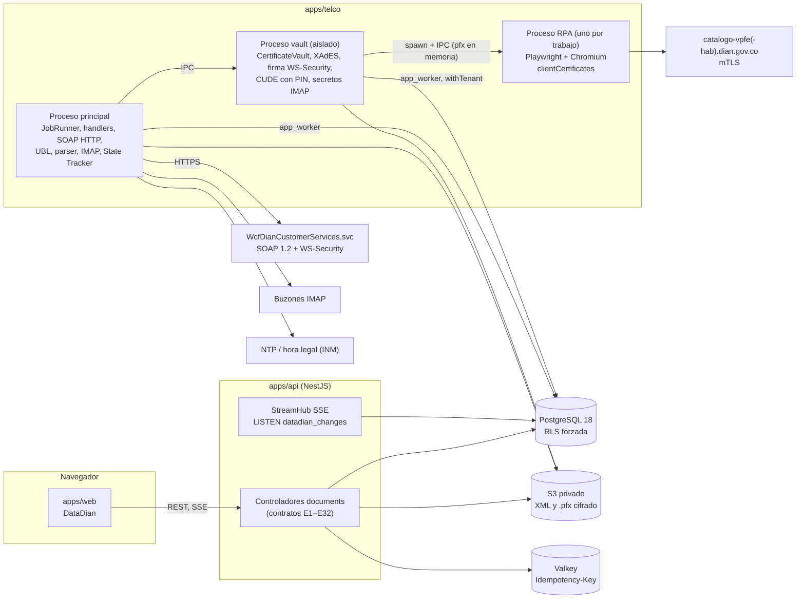
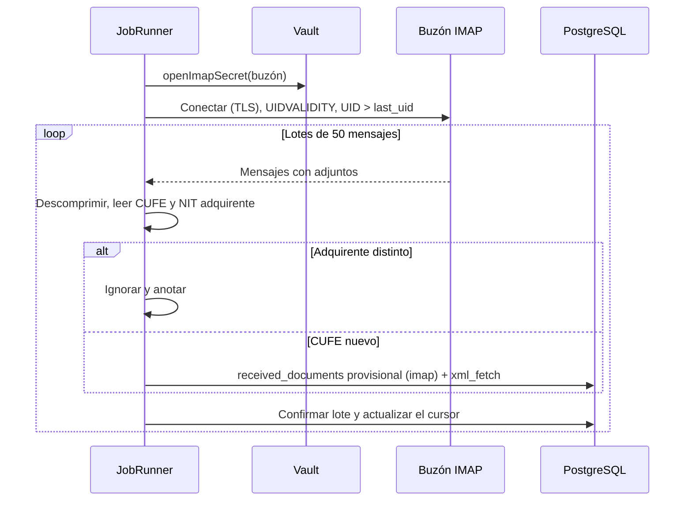
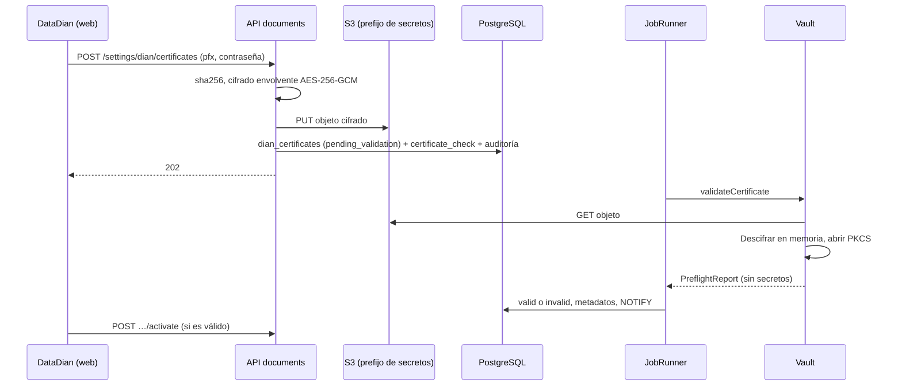

# Arquitectura del backend de DataDian: API y Telco

| Campo | Valor |
|---|---|
| Fecha | 12 de noviembre de 2026 |
| Módulo | 04, **DataDian**. Identificador interno: `documents` |
| Etapa | **Etapa 4: Backend (Telco y API)**, del orden fijado por el usuario el 12-nov-2026 (§1.1) |
| Estado | **Diseño propuesto.** No se implementa hasta que el usuario lo ordene. No incluye código de producción |
| Base | Blueprint oficial [`arquitectura Eventos RADIAN DIAN.md`](<DataDian/arquitectura Eventos RADIAN DIAN.md>) §2, §4, §5; soporte integrado en detalle: [`especificacion_certificado_pfx_telco.md`](DataDian/especificacion_certificado_pfx_telco.md) (custodia, validaciones previas, XAdES-EPES, WS-Security, mTLS, errores y habilitación), [`Facturación Electrónica DIAN Colombia.md`](<DataDian/Facturación Electrónica DIAN Colombia.md>) (UBL 2.1, `AttachedDocument`, `ApplicationResponse`, CUFE/CUDE, State Tracker) y [`Automatización Eventos RADIAN DIAN.md`](<DataDian/Automatización Eventos RADIAN DIAN.md>) (canales de ingesta, eventos, transmisión); [ARQUITECTURA_DB_DATADIAN.md](ARQUITECTURA_DB_DATADIAN.md) (Etapa 2); [ARQUITECTURA_FRONTEND_DATADIAN.md](ARQUITECTURA_FRONTEND_DATADIAN.md) (Etapa 3, contratos); [ARQUITECTURA_DATADIAN_TELCO.md](ARQUITECTURA_DATADIAN_TELCO.md); [ADR-002](../../decisions/ADR-002-estilo-arquitectonico.md), [ADR-009](../../decisions/ADR-009-datos-e-infraestructura.md), [ADR-014](../../decisions/ADR-014-arquitectura-datadian-telco.md); referencia de comportamiento: [`apidian/ANALISIS_APIDIAN.md`](apidian/ANALISIS_APIDIAN.md) §5 y §12 |
| Criterio de salida | Los E2E de la Etapa 3 pasan sin cambios contra la API real y Telco con la DIAN simulada; la simulación de tráfico de la §11 cumple sus criterios; la lista de chequeo de habilitación (§9.3) está completa, salvo los puntos que el usuario exima de forma explícita por D-14 o por la revisión legal del portal |

Las etiquetas siguen la convención de [ARQUITECTURA_DATADIAN_TELCO.md](ARQUITECTURA_DATADIAN_TELCO.md): **[PROPUESTA]** es una decisión de diseño que el usuario debe confirmar (resumen en la §15) y **[POR VERIFICAR n]** remite al punto n de la §14.

---

## 1. Alcance

### 1.1 Orden de etapas

| Etapa | Contenido |
|---|---|
| 1 | Fundaciones (cerrada) |
| 2 | Base de datos ([ARQUITECTURA_DB_DATADIAN.md](ARQUITECTURA_DB_DATADIAN.md)) |
| 3 | Frontend ([ARQUITECTURA_FRONTEND_DATADIAN.md](ARQUITECTURA_FRONTEND_DATADIAN.md)) |
| **4** | **Backend: Telco y API (este documento)** |
| 5 | Integración con Odoo 19 |
| 6 | CRM y notificaciones |

El plan del blueprint (§7: núcleo criptográfico, SOAP, RPA, base de datos, UBL y frontend) queda repartido así: la base de datos es la Etapa 2, el frontend la 3 y el resto son las subetapas 4.1 a 4.6 de este documento. ADR-014 (enmienda del 12-nov-2026), [ARQUITECTURA_DATADIAN_TELCO.md](ARQUITECTURA_DATADIAN_TELCO.md) §9 y `docs/etapas/` ya siguen este orden; la ficha corta es [`ETAPA_4_BACKEND.md`](../../etapas/ETAPA_4_BACKEND.md) y la ruta completa, [RUTA_DE_TRABAJO_DATADIAN.md](RUTA_DE_TRABAJO_DATADIAN.md) (§15, decisión 15, resuelta).

### 1.2 Las dos piezas

| Pieza | Qué es | Dónde | Habla con |
|---|---|---|---|
| **API** | Módulo NestJS `documents`. Implementa **los contratos de la Etapa 3** (catálogo E1 a E32 de `packages/contracts`) sin cambiarlos. Nunca llama a la DIAN ni usa la llave privada | `apps/api/src/modules/documents/` | Navegador (REST y SSE), PostgreSQL (`app_user`), S3, Valkey |
| **Telco** | Motor en segundo plano. Hace toda la interoperabilidad con la DIAN (RPA, IMAP, SOAP), la criptografía y el UBL 2.1 | `apps/telco/` **[PROPUESTA]** (ADR-014) | PostgreSQL (`app_worker`), S3, DIAN, buzones IMAP, NTP. No expone puertos al navegador |

La cola entre las dos es la tabla `telco_jobs` de la Etapa 2 (§7.6 de ese documento): la API inserta el evento y su trabajo en la misma transacción (outbox) y Telco reclama con `FOR UPDATE SKIP LOCKED`.

### 1.3 Fuera de alcance

El informe «Facturación Electrónica DIAN Colombia» entiende "Motor Telco" como el núcleo de tarificación de una empresa de telecomunicaciones y describe la **emisión** de facturas. Nada de eso aplica: DataDian **solo recibe facturas** (D-15) y Telco es el motor de interoperabilidad del blueprint (arquitectura §10.9). Quedan fuera:

- `SendBillSync`, `SendBillAsync`, `GetStatusZip` y el *TrackID* de emisión;
- CDR, tarificación, Kafka o RabbitMQ como bus (la cola es PostgreSQL, ADR-014);
- HSM para firma masiva de facturas, contingencias tipo 03 y 04, numeración (`sts:InvoiceControl`) y clave técnica de resoluciones;
- notas crédito y débito, documento soporte y nómina;
- la emisión del 034, que es del emisor (ADR-011): la suite solo la observa;
- el mandato (evento 043) y la figura de proveedor tecnológico, que dependen de D-14;
- Odoo (Etapa 5) y notificaciones por correo (Etapa 6).

---

## 2. Vista general

### 2.1 Componentes y procesos



**Regla de aislamiento [PROPUESTA]:** todo lo que toca un secreto (llave maestra, `.pfx`, su contraseña, PIN del software, secretos IMAP) corre en el proceso **vault**. El proceso principal arma documentos y sobres, pero recibe de vuelta solo resultados firmados, CUDE ya calculados o el secreto IMAP estrictamente necesario para abrir la conexión. El proceso RPA es hijo del vault y muere al terminar cada trabajo.

### 2.2 Los cuatro usos del `.pfx`, por proceso

Matriz del informe del `.pfx` §3, ubicada en los procesos de la §2.1:

| # | Uso | Protocolo | Parte del `.pfx` | Proceso que la tiene en memoria | Módulo |
|---|---|---|---|---|---|
| 1 | Entrar al portal "Documentos recibidos" | TLS con certificado de cliente (mTLS) | Certificado y llave privada (el `.pfx` entero, como lo pide Playwright) | RPA (hijo del vault), solo durante el trabajo | `RpaMtlsWorker` |
| 2 | Descargar el XML por CUFE (`GetXmlByDocumentKey`) | SOAP 1.2, WS-Security 1.1 | Certificado público (`BinarySecurityToken`) y llave privada (firma de `wsa:To`) | Vault | `SoapWsSecurityClient` (la firma), proceso principal (el HTTP) |
| 3 | Firmar el `ApplicationResponse` | XMLDSig *enveloped*, XAdES-EPES | Llave privada y cadena X.509 | Vault | `XadesEpesSigner` |
| 4 | Transmitir el evento (`SendEventUpdateStatus`) **[POR VERIFICAR 1]** | SOAP 1.2, WS-Security 1.1 | Igual que el uso 2 | Vault | `SoapWsSecurityClient` |

### 2.3 Paquetes compartidos [PROPUESTA]

| Paquete | Contenido | Lo usan | Por qué |
|---|---|---|---|
| `packages/contracts` (existe) | Contratos de la Etapa 3, enumerados, `deriveRadianActions`, `SYSTEM_ACTOR_TELCO`, códigos `DD0xx` | web, API, Telco | Una sola verdad de nombres y estados |
| `packages/dian-ubl` (**nuevo**) | Funciones puras sin E/S ni secretos: `parseAttachedDocument`, `buildApplicationResponse`, `computeCude` (recibe el PIN como argumento), utilidades de Base64 y ZIP con límites, `CoCalendar` | API (contenido del visor), Telco, vault | El parser lo necesitan la API (visor, E4) y Telco (ingesta); duplicarlo daría dos lecturas del mismo XML |
| `packages/database` (**nuevo**) | Esquemas Drizzle de las tablas y `withTenant`, extraídos de `apps/api/src/database/` | API, Telco | Telco no puede importar de `apps/api`. La alternativa es duplicar el esquema, que se desalinea (decisión 3) |
| `packages/envelope-crypto` (**nuevo**) | El formato `EncryptedSecret` y las funciones de `apps/api/src/common/credentials-cipher.ts`, sin Nest | API (cifra), vault (descifra) | El vault debe leer exactamente el formato que escribe la API |

---

## 3. La API (módulo `documents`)

### 3.1 Estructura

```
apps/api/src/modules/documents/
├── documents.module.ts
├── received-documents.controller.ts / .service.ts   # E1, E3–E6 (se amplían); decisión heredada y Odoo
├── radian-events.controller.ts / .service.ts        # E7–E10
├── radian-rules.controller.ts                       # E11
├── dian-settings.controller.ts / .service.ts        # E12–E14
├── dian-certificates.controller.ts / .service.ts    # E15–E19
├── imap-mailboxes.controller.ts / .service.ts       # E20–E22
├── sync.controller.ts / .service.ts                 # E23–E27
├── telco-jobs.controller.ts / .service.ts           # E28–E30
├── datadian-status.controller.ts                    # E31 (Zona 4)
├── datadian-stream.controller.ts, stream-hub.ts     # E32 (SSE)
├── datadian-problems.ts                             # SQLSTATE DD0xx → problem+json
├── dian-files.service.ts                            # S3 direccionado por contenido + dian_files
├── documents-settings.*, odoo.client.ts, odoo-vendor-bill.ts   # conservados (Odoo, Etapa 5)
└── xlsx-reader.ts                                   # se mueve a apps/telco/src/rpa/ en la 4.3
```

### 3.2 Cómo implementa los contratos

- **Validación:** cada controlador usa `ZodPipe` con el esquema de la ruta importado de `packages/contracts`, igual que hoy `receivedDocumentDecisionSchema`. Las respuestas se validan con `schema.parse` en modo de pruebas (no en producción, por costo).
- **Permisos:** `assertPermission(tx, actor.userId, '<permiso>')` dentro de `withTenant`, como `received-documents.service.ts`. El permiso de cada ruta sale del catálogo, y una prueba verifica que coincide.
- **Errores:** `datadian-problems.ts` traduce los `SQLSTATE` de la Etapa 2 sin leer el texto: `DD001`, `DD002`, `DD003` y la violación del índice `radian_events_one_live_per_code` → 409; `DD007` a `DD010` → 422; con `code` y `type` `urn:telcobras:datadian:<slug>` (contrato de la Etapa 3, §3.5).
- **Idempotencia:** `IdempotencyInterceptor` (Valkey, 24 h) más `radian_events.idempotency_key` único: si la llave ya existe en la base, se devuelve el evento existente aunque Valkey la haya olvidado.
- **Selecciones explícitas:** `dian_settings`, `dian_certificates` e `imap_mailboxes` tienen `SELECT` por columna (Etapa 2, §9.3): la API nunca usa `select *` ni `RETURNING *` sobre ellas.

### 3.3 Pedido de un evento (E10): outbox

```ts
// radian-events.service.ts (esbozo)
async request(actor: RequestActor, invoiceId: string, body: RadianEventRequest, idemKey: string) {
  return withTenant(this.db, actor.organizationId, async (tx) => {
    await assertPermission(tx, actor.userId, 'documents:events');
    const ctx = await this.loadActionContext(tx, invoiceId);        // factura, eventos, reglas, config
    const actions = deriveRadianActions(ctx);                       // misma función que la interfaz
    assertRequestable(actions, body.eventCode);                     // 409/422 tempranos y legibles
    const event = await insertEvent(tx, { ...body, origin: 'suite', actor: 'buyer',
      environment: ctx.configuredEnvironment, idempotencyKey: idemKey, requestedBy: actor.userId });
    // El disparador radian_events_sequence_guard es la barrera final (DD001…DD009).
    await enqueueJob(tx, { kind: 'radian_event_send', payload: { eventId: event.id },
      dedupeKey: event.id, priority: 20, maxAttempts: 8 });
    await audit(tx, 'datadian.event.request', event.id);
    await notify(tx, { org: actor.organizationId, type: 'event.changed', id: event.id });
    return event;                                                    // 202
  });
}
```

La función de la interfaz da errores rápidos y con buen texto; la base de datos sigue siendo la última palabra.

### 3.4 Carga del certificado (E16)

1. `@fastify/multipart` con límites: un archivo, 65 536 bytes, campos `password` (1 a 128 caracteres). Nada se escribe en disco: el archivo se lee a un `Buffer`.
2. SHA-256 del `.pfx`; si ya existe para la organización, 409 `duplicate-certificate`.
3. Cifrado envolvente (Etapa 2, §5.2): llave de datos aleatoria de 32 bytes; `AES-256-GCM(pfx, llave de datos)`; la llave de datos se envuelve con la KEK (formato `EncryptedSecret.key`) y la contraseña se guarda como `EncryptedSecret`.
4. `PUT` en S3 al prefijo privado de secretos con llave `orgs/<org>/certificates/<uuidv7>.bin`, **antes** de abrir la transacción.
5. Transacción: fila en `dian_certificates` (`pending_validation`), trabajo `certificate_check` (prioridad 10), auditoría `datadian.certificate.upload`, `NOTIFY`.
6. `buffer.fill(0)` sobre el `.pfx`, la contraseña y la llave de datos.
7. Responde 202. Si la transacción falla, el objeto queda huérfano: un barrido diario borra objetos del prefijo de secretos sin fila después de 24 h.

**La API no descifra el `.pfx`** (Etapa 2, §5.2; ADR-014). Hoy la API tiene la KEK porque cifra la clave de Odoo, así que la garantía es de código y revisión. **Endurecimiento propuesto** (decisión 6): sobre sellado asimétrico, en el que la API envuelve la llave de datos con la llave pública del vault (RSA-OAEP o X25519) y solo el vault puede abrirla. Cambia el formato de `pfx_data_key`, por eso se decide antes de la 4.1.

### 3.5 Visor (E4, E5, E9)

- **E4 contenido normalizado:** la API lee de S3 el `AttachedDocument` (verifica su SHA-256 contra `dian_files`), lo pasa por `parseAttachedDocument` de `packages/dian-ubl` y devuelve `InvoiceContent`. Caché en Valkey por SHA-256 durante 10 minutos **[PROPUESTA]**.
- **E5 y E9 XML original:** la API transmite el archivo tal cual, con `Content-Type: application/xml; charset=utf-8`, `Content-Disposition: attachment`, `X-Content-Type-Options: nosniff`, `Content-Security-Policy: sandbox` y `Cache-Control: private, no-store`. Se prefiere esto a una URL prefirmada de S3: pasa por RLS y por la auditoría, y no obliga a abrir la CSP del navegador hacia S3 **[PROPUESTA]**.

### 3.6 Canal SSE (E32)

- Telco y la API ejecutan `NOTIFY datadian_changes, '<json>'` **dentro** de la transacción que cambia algo visible: PostgreSQL solo entrega la notificación al confirmar, así que nunca se avisa de un cambio revertido. La carga solo lleva `org`, `type` e identificadores (menos de 8 000 bytes).
- `StreamHub` mantiene **una** conexión dedicada con `LISTEN datadian_changes` por instancia de la API y reparte cada mensaje solo a las conexiones SSE de esa organización. Con varias instancias, cada una escucha: no hace falta Valkey pub/sub.
- Latido (comentario SSE) cada 25 s; `retry: 5000`. Con `Last-Event-ID` el cliente simplemente invalida todas las consultas de DataDian: no se guarda historial de mensajes **[PROPUESTA]**.
- Si llega E2-4 (SSE general de la Etapa 6), el hub publica en ese canal y E32 se retira (decisión 11 del frontend).

### 3.7 Transacciones y S3

Regla para la API y Telco: **nunca escribir en S3 dentro de `withTenant`** (riesgo registrado en `PENDIENTES.md`). El orden es:

1. calcular el SHA-256;
2. `PUT` con llave direccionada por contenido: `orgs/<org>/dian/<kind>/<sha256>` (idempotente: el mismo archivo cae en la misma llave);
3. abrir la transacción e insertar en `dian_files` con `ON CONFLICT (organization_id, kind, sha256) DO NOTHING`.

Si el paso 3 falla, el objeto queda listo para el siguiente intento. Un objeto sin fila se detecta por inventario y se borra después de 7 días (salvo los tipos con *Object Lock*).

---

## 4. Telco

### 4.1 Estructura de `apps/telco`

```
apps/telco/
├── src/
│   ├── main.ts                 # arranque: config, telemetría, pool app_worker, procesos, JobRunner
│   ├── config/env.ts           # zod: DATABASE_WORKER_URL, S3, endpoints DIAN, límites, NTP…
│   ├── runtime/
│   │   ├── job-runner.ts       # reclamar, latido, cerrar, reintentar, recuperar
│   │   ├── scheduler.ts        # recurrentes, revisión anual del calendario
│   │   └── handlers/           # un handler por kind de telco_jobs
│   ├── vault/                  # PROCESO AISLADO
│   │   ├── vault-main.ts       # punto de entrada del proceso hijo
│   │   ├── certificate-vault.ts
│   │   ├── preflight.ts        # ONAC, NIT, vigencia, cadena
│   │   ├── xades-epes-signer.ts
│   │   ├── ws-security-signer.ts
│   │   ├── cude-service.ts     # computeCude con el PIN, sin que el PIN salga
│   │   └── vault-client.ts     # lado del proceso principal (IPC tipado)
│   ├── soap/                   # sobres, operaciones, clasificación de fallas, cortacircuitos
│   ├── rpa/                    # rpa-child.ts (proceso), portal page object, listing (xlsx-reader)
│   ├── imap/                   # imap-ingestor.ts
│   ├── radian/                 # event-sender.ts, state-tracker.ts
│   ├── ingest/                 # xml-fetch, persistencia de facturas e impuestos
│   ├── clock/                  # chequeo SNTP de desfase
│   ├── storage/                # S3 direccionado por contenido + dian_files
│   └── observability/          # pino con redacción, métricas OpenTelemetry
├── assets/politicadefirmav2.pdf    # copia fija, con su SHA-256 registrado
├── assets/xsd/                     # XSD oficiales del ApplicationResponse [POR VERIFICAR 6]
└── test/                       # vectores, falsos SOAP y portal, simulación
```

**Modelo de procesos [PROPUESTA]:**

| Nivel | Cómo | Cuándo |
|---|---|---|
| 1 (mínimo, 4.1) | El proceso principal lanza el vault con `child_process.fork` y un canal IPC. La KEK llega al vault por un archivo de secreto (`/run/secrets/credentials_master_key`) que solo él lee; el principal no la carga | Desarrollo, CI y primera puesta en marcha |
| 2 (recomendado en producción) | Vault en un **contenedor aparte** (`telco-vault`) con su propio usuario, sistema de archivos de solo lectura, sin salida a Internet salvo S3 y la DIAN del RPA, y un *socket* Unix compartido con `telco` | Producción (decisión 2) |

El contrato IPC es el mismo en los dos niveles:

```ts
// vault/vault-client.ts — todo lo que cruza el límite del proceso
export interface VaultApi {
  validateCertificate(req: { organizationId: string; certificateId: string }): Promise<PreflightReport>;
  computeCude(req: { organizationId: string; input: EventCudeInput }): Promise<{ cude: string; formulaId: string }>;
  signApplicationResponse(req: { organizationId: string; unsignedXml: string; signingTime: string })
    : Promise<{ signedXml: string; certificateId: string }>;
  signSoapEnvelope(req: { organizationId: string; envelope: string; toId: string; timestampId: string })
    : Promise<{ envelope: string; certificateId: string }>;
  runPortalListing(req: { organizationId: string; environment: '1' | '2'; periodStart: string; periodEnd: string })
    : Promise<{ fileBase64: string; fileName: string; diagnostics: PortalDiagnostics }>;
  openImapSecret(req: { organizationId: string; mailboxId: string }): Promise<{ secret: string }>;
  evict(req: { organizationId?: string }): Promise<void>;
  health(): Promise<{ certificatesCached: number; clockOffsetMs: number | null }>;
}
```

Cada mensaje lleva `requestId`, `deadline` y el `correlationId` del trabajo; ningún mensaje de respuesta trae la llave, el `.pfx`, la contraseña ni el PIN.

### 4.2 Configuración y entornos

```ts
// config/env.ts (esbozo)
const endpoints = {
  '2': { wcf: 'https://vpfe-hab.dian.gov.co/WcfDianCustomerServices.svc',
         portal: 'https://catalogo-vpfe-hab.dian.gov.co' },
  '1': { wcf: 'https://vpfe.dian.gov.co/WcfDianCustomerServices.svc',
         portal: 'https://catalogo-vpfe.dian.gov.co' },
} as const;   // sobreescribibles por variable para los falsos de la CI
```

| Variable | Uso |
|---|---|
| `DATABASE_WORKER_URL` | Rol `app_worker` (Etapa 2, §9.1) |
| `TELCO_INSTANCE_ID` | `lease_owner`; por defecto `hostname:pid` |
| `TELCO_CONCURRENCY_<KIND>` | Concurrencia por instancia y tipo de trabajo (§4.3) |
| `DIAN_RATE_LIMIT_PER_SECOND` | Tope de llamadas SOAP por instancia (por defecto 5) **[PROPUESTA]** |
| `DIAN_WCF_URL_1`, `DIAN_WCF_URL_2`, `DIAN_PORTAL_URL_1`, `DIAN_PORTAL_URL_2` | Solo para apuntar a los falsos en pruebas |
| `NTP_SERVERS`, `CLOCK_MAX_SKEW_MS` | Chequeo de reloj (§4.4.4); por defecto 2 000 ms |
| `SIGNATURE_POLICY_SHA256` | Huella del PDF de la política guardado en `assets/` |
| `S3_*`, `S3_SECRETS_PREFIX` | Archivos y prefijo privado de secretos |
| `OTEL_*`, `LOG_LEVEL` | Observabilidad, como la API |

La KEK **no** es una variable del proceso principal: la lee solo el vault desde su archivo de secreto.

### 4.3 JobRunner

**Responsabilidad:** ejecutar los trabajos de `telco_jobs` con exactamente las sentencias de la Etapa 2, §7.6.1 (reclamar, latido, terminar, fallar, recuperar).

```ts
export type JobOutcome =
  | { type: 'succeeded'; result?: Record<string, unknown> }
  | { type: 'retry'; error: SafeError; notBefore?: Date }   // vuelve a queued con telco_backoff
  | { type: 'dead'; error: SafeError };                     // sin más intentos

export interface JobContext {
  readonly signal: AbortSignal;          // se aborta al apagar o al perder el arrendamiento
  readonly log: Logger;                  // con correlation_id = job.id
  withTenant<T>(fn: (tx: Tx) => Promise<T>): Promise<T>;   // SET LOCAL app.org_id = job.organizationId
  enqueue(job: NewJob): Promise<void>;   // en la misma organización
}

export interface JobHandler<K extends TelcoJobKind> {
  readonly kind: K;
  readonly leaseSeconds: number;
  readonly concurrency: number;          // por instancia
  run(job: ClaimedJob<K>, ctx: JobContext): Promise<JobOutcome>;
}
```

Algoritmo del ciclo:

1. `LISTEN telco_jobs` (el disparador de la Etapa 2 avisa al insertar) y, además, sondeo cada 5 s: el aviso acelera, el sondeo garantiza.
2. Antes de reclamar, recuperar arrendamientos vencidos (`FOR UPDATE SKIP LOCKED LIMIT 100`).
3. Reclamar hasta llenar los cupos libres de cada tipo (`LIMIT` = cupos), en una transacción corta que se confirma enseguida. El trabajo corre **fuera** de la transacción.
4. Latido cada `leaseSeconds / 3` con el token `(lease_owner, attempts)`. Si afecta 0 filas, otra instancia recuperó el trabajo: se aborta `signal` y el resultado se descarta.
5. Al terminar, `succeeded`, `retry` (con `telco_backoff`) o `dead`, siempre con el token.
6. `SIGTERM`: deja de reclamar, espera hasta 30 s y devuelve a `queued` los trabajos que no alcanzaron a terminar, restando el intento consumido (la Etapa 2 permite `running → queued` a `app_worker`).

| `kind` | Arrendamiento | `max_attempts` | Concurrencia por instancia | `dedupe_key` | Prioridad |
|---|---|---|---|---|---|
| `certificate_check` | 60 s | 5 | 2 | id del certificado | 10 |
| `radian_event_send` | 120 s | 8 | 4 | id del evento | 20 |
| `xml_fetch` | 60 s | 8 | 4 | CUFE | 40 |
| `xml_ingest` (carga manual) | 60 s | 3 | 2 | SHA-256 del archivo | 40 |
| `rpa_sync` | 600 s | 3 | **1** (un Chromium por instancia) | `recurring` o el periodo pedido | 50 |
| `imap_sync` | 300 s | 5 | 2 | id del buzón | 50 |
| `radian_status_query` | 60 s | 8 | 4 | CUFE + motivo | 60 |
| `odoo_push` | — | — | — | — | Etapa 5 |

**Errores seguros:** `SafeError` es el único tipo que llega a `last_error`, `error_message` y los registros. Su constructor recorta a 2 000 caracteres, quita bloques Base64 de más de 100 caracteres, quita todo lo que parezca PEM y nunca incluye cuerpos XML.

### 4.4 CertificateVault

**Responsabilidad:** descifrar y abrir el `.pfx` **solo en memoria**, correr las validaciones previas y prestar la llave a los firmadores del mismo proceso (informe del `.pfx` §2 y §7.1).

```ts
export interface CertificateMetadata {
  serialNumber: string; subjectDn: string; issuerDn: string; subjectNit: string | null;
  notBefore: Date; notAfter: Date; signatureAlgorithm: 'sha256WithRSAEncryption'
    | 'sha384WithRSAEncryption' | 'sha512WithRSAEncryption' | string;
  keyUsageCritical: boolean; digitalSignature: boolean; nonRepudiation: boolean;
  chainComplete: boolean; rsaBits: number;
}
export interface PreflightReport {
  ok: boolean;
  metadata: CertificateMetadata | null;
  checks: Array<{ check: CertificateCheck; ok: boolean; detail?: string }>;   // los mismos de la Etapa 3
}
export interface LoadedCertificate {                // nunca sale del proceso vault
  readonly certificateId: string;
  readonly organizationId: string;
  readonly leaf: X509Certificate;                   // node:crypto
  readonly chain: readonly X509Certificate[];
  readonly privateKey: KeyObject;                   // para xml-crypto
  readonly webCryptoKey: CryptoKey;                 // extractable: false, para xadesjs
  readonly hash: 'sha256' | 'sha384' | 'sha512';    // según el algoritmo del certificado
}
export interface CertificateVault {
  validate(organizationId: string, certificateId: string): Promise<PreflightReport>;
  withActive<T>(organizationId: string, use: (cert: LoadedCertificate) => Promise<T>): Promise<T>;
  evict(organizationId?: string): void;
}
```

#### 4.4.1 Custodia: AES-256-GCM con KEK, solo en memoria

1. Leer la fila de `dian_certificates` con `app_worker` dentro de `withTenant` (columnas `storage_key`, `pfx_data_key`, `password`).
2. Descargar el objeto de S3 a un `Buffer`; verificar que el SHA-256 **del `.pfx` descifrado** coincide con `pfx_sha256`.
3. Desenvolver la llave de datos con la KEK y descifrar: `iv(12) + tag(16) + ciphertext`, AES-256-GCM. Una etiqueta inválida es error permanente (`certificate_tampered`).
4. Abrir el PKCS#12 con su contraseña (librería en §4.15), extraer la llave privada, el certificado hoja y la cadena.
5. Importar la llave como `KeyObject` y como `CryptoKey` **no exportable**; poner en cero (`fill(0)`) los `Buffer` del `.pfx`, la contraseña, la llave de datos y el DER de la llave.
6. Guardar `LoadedCertificate` en una caché en memoria con LRU y vencimiento de 10 minutos **[PROPUESTA]**; se vacía al recibir `NOTIFY` de un cambio de certificado o de configuración.

**Prohibido** (informe del `.pfx` §2.1, punto 3): escribir `.key`, `.pem` o el `.pfx` en `/tmp` o en cualquier disco, pasarlos por variables de entorno o argumentos de proceso, o registrarlos. El contenedor del vault no tiene volumen escribible salvo un `tmpfs` vacío.

#### 4.4.2 Validaciones previas (ONAC Circular 03-2016)

Se corren al cargar el certificado (`certificate_check`) **y** antes de cada uso:

| Validación | Regla | Si falla |
|---|---|---|
| Formato | PKCS#12 que abre con la contraseña y trae una sola llave privada RSA de 2 048 bits o más **[PROPUESTA el mínimo]** | `invalid`, `format` |
| Vigencia | `NotBefore ≤ ahora < NotAfter` con el reloj verificado (§4.4.4). Además, la fecha del documento firmado debe caer en la vigencia | `invalid`, `validity`; en uso, el evento queda `failed` sin enviarse |
| `KeyUsage` crítico | La extensión 2.5.29.15 existe y está marcada `critical` | `key_usage_critical` |
| Propósitos | Bits `digitalSignature` y `nonRepudiation` (*contentCommitment*) activos | `key_usage_purposes` |
| Algoritmo SHA-2 | OID de firma del certificado: `1.2.840.113549.1.1.11` (sha256WithRSA), `.12` (sha384WithRSA) o `.13` (sha512WithRSA). SHA-1 se rechaza | `signature_algorithm` |
| Cadena | La hoja y todos los intermedios hasta una raíz autofirmada están en el `.pfx`; cada firma se verifica con la llave del emisor. Opcional: la raíz pertenece a una lista de entidades acreditadas ante la ONAC mantenida en el repositorio **[PROPUESTA]** | `chain` |
| NIT | El NIT del `Subject` (atributo `SERIALNUMBER` 2.5.4.5 u otro según la entidad certificadora **[POR VERIFICAR 17]**), normalizado a dígitos y sin DV, es igual a `dian_settings.nit` **y** al NIT del `cac:SenderParty` del evento que se firma | `nit_match`; en uso, error permanente: impide firmar por una UT con el certificado de otra |
| Aviso de vencimiento | 90 días o menos → `expiry_state = 'due_soon'` (vista de la Etapa 2); la DIAN permite renovar hasta 3 meses antes | No bloquea; alerta |

El resultado llena las columnas de metadatos de `dian_certificates` (privilegios de `app_worker`, Etapa 2 §9.3) y `validation_errors`, y audita `datadian.certificate.validate`.

#### 4.4.3 Rotación

Dos certificados válidos pueden convivir (Etapa 2, §5.2). Al activar el nuevo, la API cambia `active_certificate_id`; el vault recibe `NOTIFY`, vacía la caché y los siguientes trabajos firman con el nuevo. Cada evento guarda `certificate_id`, así que el historial dice con qué certificado se firmó.

#### 4.4.4 Reloj: NTP y hora legal colombiana

`xades:SigningTime` y `wsu:Timestamp` dependen de la hora exacta (informe del `.pfx` §2.2; causa número uno del error 500 de seguridad, §4.14). La hora legal de Colombia la mantiene y difunde el **Instituto Nacional de Metrología (INM)**, según el Decreto 4175 de 2011 **[POR VERIFICAR 10]**; el informe la atribuye a la SIC, que es el dato anterior.

- El servidor sincroniza con `chrony` o `systemd-timesyncd` (infraestructura).
- Telco mide el desfase con una consulta SNTP (RFC 4330) a `NTP_SERVERS` al arrancar y cada 10 minutos, y lo publica como métrica.
- Si `|desfase| > CLOCK_MAX_SKEW_MS`, el vault se niega a firmar (`ClockSkewError`, reintentable) y se dispara una alerta. Mejor no enviar que recibir un rechazo de seguridad.
- Internamente todo es UTC. `SigningTime` y `cbc:IssueTime` se escriben en `-05:00` (Colombia no tiene horario de verano); `wsu:Created` y `wsu:Expires` en UTC con `Z`.

### 4.5 XadesEpesSigner

**Responsabilidad:** firmar un `ApplicationResponse` UBL 2.1 con XMLDSig *enveloped* en perfil XAdES-EPES (ETSI TS 101 903), según el informe del `.pfx` §4 y la política de firma v2 de la DIAN.

```ts
export interface XadesPolicy {
  identifier: 'https://facturaelectronica.dian.gov.co/politicadefirma/v2/politicadefirmav2.pdf';
  description: 'Política de firma para facturas electrónicas de la República de Colombia.';
  digestAlgorithm: 'sha256' | 'sha512';      // [POR VERIFICAR 16]
  digestValueBase64: string;                 // calculado sobre assets/politicadefirmav2.pdf
}
export interface XadesSignOptions {
  signingTime: Date;
  signerRole: 'supplier' | 'third party';     // [POR VERIFICAR 11]
  policy: XadesPolicy;
  canonicalization: 'http://www.w3.org/TR/2001/REC-xml-c14n-20010315'
                  | 'http://www.w3.org/2001/10/xml-exc-c14n#';   // [POR VERIFICAR 16]
}
export interface XadesEpesSigner {
  sign(unsignedXml: string, cert: LoadedCertificate, opts: XadesSignOptions): Promise<string>;
}
```

Algoritmo:

1. **Precondiciones del documento.** Parsear sin DTD. `ext:UBLExtensions` debe tener exactamente dos `ext:UBLExtension`: la primera con `sts:DianExtensions` (si el evento la lleva, **[POR VERIFICAR 11]**) y la segunda con `ext:ExtensionContent` vacío. No puede existir ningún `ds:Signature` (regla de unicidad; el informe la asocia a `FAC03`).
2. **Algoritmos según el certificado** (corrección del informe, **[POR VERIFICAR 9]**: el informe escribe `xmldsig-more#rsasha256`, sin guion; el identificador estándar de RFC 6931 lleva guion):

   | Hash del certificado | `ds:SignatureMethod` | `ds:DigestMethod` |
   |---|---|---|
   | SHA-256 | `http://www.w3.org/2001/04/xmldsig-more#rsa-sha256` | `http://www.w3.org/2001/04/xmlenc#sha256` |
   | SHA-384 | `http://www.w3.org/2001/04/xmldsig-more#rsa-sha384` | `http://www.w3.org/2001/04/xmldsig-more#sha384` |
   | SHA-512 | `http://www.w3.org/2001/04/xmldsig-more#rsa-sha512` | `http://www.w3.org/2001/04/xmlenc#sha512` |

3. **Las tres referencias** de `ds:SignedInfo`, en este orden (esqueleto del informe §4.4):
   1. `URI=""` con la transformación `http://www.w3.org/2000/09/xmldsig#enveloped-signature`: el documento completo sin la propia firma;
   2. `URI="#<id>-keyinfo"`: el `ds:KeyInfo`, que protege el certificado y la cadena;
   3. `URI="#<id>-signedprops"` con `Type="http://uri.etsi.org/01903#SignedProperties"`.
4. **`ds:KeyInfo`** con `ds:X509Data/ds:X509Certificate`: la hoja y la cadena en Base64 **[POR VERIFICAR 16]** (el informe pide la cadena completa).
5. **`xades:QualifyingProperties`** (namespace `http://uri.etsi.org/01903/v1.3.2#`) dentro de `ds:Object`, con `Target` igual al `Id` de la firma:
   - `xades:SigningTime` en `xsd:dateTime` con `-05:00`;
   - `xades:SigningCertificate` con el digest y el `IssuerSerial` del certificado hoja;
   - `xades:SignaturePolicyIdentifier/xades:SignaturePolicyId`: `xades:SigPolicyId/xades:Identifier` con la URL de la política v2, `xades:Description` con el texto oficial y `xades:SigPolicyHash` con `ds:DigestMethod` y `ds:DigestValue`;
   - `xades:SignerRole/xades:ClaimedRoles/xades:ClaimedRole` con **uno solo** de los literales `supplier` o `third party`.
6. **Hash de la política.** No se copia ningún valor de ejemplo (el informe advierte sobre `dgsHIZx49492MKkwson1wwEZWaBCc78kh/RIvd/W6gw=`). El PDF oficial se guarda en `assets/` con su SHA-256 en `SIGNATURE_POLICY_SHA256`; el digest se calcula de esos bytes con el algoritmo declarado; una prueba falla si el PDF cambia. El valor definitivo se confirma cuando un 030 pase la validación de firma en habilitación.
7. **Serializar sin formatear.** Nada de *pretty-print* después de firmar: un espacio o un salto de línea cambia el digest (`ZE02`).
8. **Autoverificación.** Antes de devolver, el firmador verifica la firma del resultado con la misma librería y comprueba que hay exactamente un `ds:Signature` en `//ext:UBLExtension[2]/ext:ExtensionContent`. Si algo falla, error permanente: nunca sale un documento que el propio sistema no puede verificar.

### 4.6 SoapWsSecurityClient

**Responsabilidad:** llamar a `WcfDianCustomerServices.svc` con SOAP 1.2 y WS-Security 1.1 (informe del `.pfx` §5; blueprint §5.3). El proceso principal arma el sobre y hace el HTTP; el vault inserta la seguridad y firma.

```ts
export type DianOperation = 'GetXmlByDocumentKey' | 'GetStatusEvent' | 'SendEventUpdateStatus';
export interface DianCallContext {
  organizationId: string; environment: '1' | '2'; correlationId: string; signal: AbortSignal;
}
export interface GetXmlByDocumentKeyResult { code: string; message?: string; xml: Uint8Array | null }
export interface GetStatusEventResult { isValid: boolean; documentKey?: string; events: ObservedEvent[]; raw: Uint8Array }
export interface SendEventResult {
  isValid: boolean; statusCode?: string; statusDescription?: string; statusMessage?: string;
  errors: Array<{ code: string; message: string }>; dianResponseXml: Uint8Array | null; raw: Uint8Array;
}
export interface DianSoapClient {
  getXmlByDocumentKey(ctx: DianCallContext, cufe: string): Promise<GetXmlByDocumentKeyResult>;
  getStatusEvent(ctx: DianCallContext, cufe: string): Promise<GetStatusEventResult>;
  sendEventUpdateStatus(ctx: DianCallContext, zip: { fileName: string; base64: string }): Promise<SendEventResult>;
}
```

Los nombres de las operaciones y de sus campos vienen de la referencia de APIDIAN (`ANALISIS_APIDIAN.md` §12.3) y se confirman contra el WSDL **[POR VERIFICAR 1 y 18]**. La operación de envío **no** es `SendEvent`, como dicen los informes: es `SendEventUpdateStatus` (`AcceptRejectDocumentController.php:169` lee `SendEventUpdateStatusResponse → SendEventUpdateStatusResult`).

#### 4.6.1 Anatomía del sobre

| Parte | Regla |
|---|---|
| Sobre | `soap:Envelope` con `xmlns:soap="http://www.w3.org/2003/05/soap-envelope"`, `xmlns:wcf="http://wcf.dian.colombia"` y `xmlns:wsa="http://www.w3.org/2005/08/addressing"` |
| `wsa:Action` | `http://wcf.dian.colombia/IWcfDianCustomerServices/<Operación>` |
| `wsa:To` | URL del `.svc` del ambiente de la organización, con `wsu:Id="ID-<uuid>"` y su `xmlns:wsu`. **Es el nodo firmado** |
| `wsse:Security` | `soap:mustUnderstand="true"`, con `wsu:Timestamp`, `wsse:BinarySecurityToken` y `ds:Signature` |
| `wsu:Timestamp` | `wsu:Id="TS-<uuid>"`; `wsu:Created` y `wsu:Expires` en UTC (`…Z`); ventana por defecto de 60 s **[POR VERIFICAR 15]** (el informe muestra 5 minutos y el blueprint habla de milisegundos) |
| `wsse:BinarySecurityToken` | Certificado público X.509 en **una sola línea Base64**: sin `-----BEGIN/END CERTIFICATE-----` ni `\r`/`\n`. `EncodingType` `…soap-message-security-1.0#Base64Binary`, `ValueType` `…x509-token-profile-1.0#X509v3`, `wsu:Id="X509-<uuid>"` |
| `ds:CanonicalizationMethod` | `http://www.w3.org/2001/10/xml-exc-c14n#` con `<ec:InclusiveNamespaces PrefixList="wsa soap wcf"/>` |
| `ds:SignatureMethod` | `http://www.w3.org/2001/04/xmldsig-more#rsa-sha256` |
| `ds:Reference` | `URI="#<wsu:Id de wsa:To>"`, transformación exc-c14n (el informe usa `PrefixList="soap wcf"` en la transformación y `"wsa soap wcf"` en el `SignedInfo` **[POR VERIFICAR 15]**), `DigestMethod` `xmlenc#sha256` |
| `ds:SignatureValue` | RSA-SHA256 del `ds:SignedInfo` canonicalizado, en Base64 |
| `ds:KeyInfo` | `wsse:SecurityTokenReference` con `wsse:Reference URI="#X509-<uuid>"` y `ValueType` X509v3 |
| HTTP | `POST` con `Content-Type: application/soap+xml; charset=utf-8; action="<wsa:Action>"`; TLS con verificación normal del servidor (nunca `rejectUnauthorized: false`) |

Cuerpos (**[POR VERIFICAR 18]**, según la referencia): `wcf:GetXmlByDocumentKey/wcf:trackId` (CUFE), `wcf:GetStatusEvent/wcf:trackId` (CUFE) y `wcf:SendEventUpdateStatus/wcf:contentFile` (ZIP en Base64).

Algoritmo de una llamada:

1. Tomar un permiso del limitador de tasa (por instancia) y comprobar el cortacircuitos del ambiente.
2. Armar el sobre con identificadores nuevos y `wsa:To` del ambiente de la organización.
3. `vault.signSoapEnvelope(...)`: el vault inserta `BinarySecurityToken` y `ds:Signature` con xml-crypto, sin reformatear.
4. `fetch` (undici) con `AbortSignal.any([ctx.signal, AbortSignal.timeout(t)])`: 30 s para consultas y 60 s para el envío **[PROPUESTA]**.
5. Guardar la respuesta cruda en S3 (`status_response` o `event_response`) por su SHA-256.
6. Parsear: `soap:Fault` → clasificar (§4.14); si no, extraer el `…Result`.
7. Métricas: operación, ambiente, HTTP, resultado y duración.

#### 4.6.2 Base64 → ZIP → XML

```ts
export interface UnpackLimits { maxBase64Bytes: number; maxEntries: number; maxUncompressedBytes: number; maxRatio: number }
export function unpackDianPayload(b64: string, limits: UnpackLimits): { fileName: string; xml: Uint8Array };
```

1. Decodificar Base64 en modo estricto (rechazar caracteres fuera del alfabeto) con tope de 10 MB.
2. Si los primeros bytes son `PK\x03\x04`, es ZIP: abrir con fflate, máximo 5 entradas, 20 MB descomprimidos en total y razón de compresión de 100:1 (protección contra bombas ZIP); nombres solo como nombre base (sin rutas); elegir la entrada `.xml`. Si no, tratar los bytes como XML (la referencia de APIDIAN lee `XmlBytesBase64`; si viene comprimido o no se confirma en habilitación **[POR VERIFICAR 18]**).
3. Quitar el BOM UTF-8; rechazar cualquier `<!DOCTYPE` antes de parsear (sin DTD ni entidades externas).
4. Para enviar: ZIP **determinista** (fecha fija de la entrada, nivel de compresión fijo) con un solo XML, para que un reintento produzca exactamente los mismos bytes. El nombre del archivo sigue la nomenclatura del anexo **[POR VERIFICAR 13]**.

#### 4.6.3 Cortacircuitos

Por ambiente y por instancia: con 10 fallas de transporte seguidas (tiempo agotado, 502, 503, 504) se abre 2 minutos; los trabajos que lo encuentran abierto vuelven a `queued` con `notBefore` sin gastar intento. No aplica a rechazos de negocio (04).

### 4.7 RpaMtlsWorker

**Responsabilidad:** descargar el listado de "Documentos recibidos" del portal entrando con certificado (blueprint RF1 y RF2; informe del `.pfx` §6). Es el único camino para **descubrir** CUFE: `GetXmlByDocumentKey` exige conocerlos de antemano (informe «Automatización» §3.1).

```ts
export interface PortalListingRequest {
  organizationId: string; environment: '1' | '2'; periodStart: string; periodEnd: string;  // máx. 92 días
}
export interface PortalDiagnostics {
  humanVerificationDetected: boolean; rows: number; durationMs: number; portalVersionHint?: string;
}
export interface RpaMtlsWorker {
  fetchReceivedListing(req: PortalListingRequest, signal: AbortSignal)
    : Promise<{ file: Uint8Array; fileName: string; diagnostics: PortalDiagnostics }>;
}
```

Algoritmo:

1. El vault lanza `rpa-child.ts` como proceso hijo y le entrega por IPC el `.pfx` (`Buffer`) y su contraseña. Nunca por disco, variable de entorno ni argumento.
2. `chromium.launch({ headless: true })` y `browser.newContext({ clientCertificates: [{ origin, pfx, passphrase }], acceptDownloads: true })`, con `origin` **exacto** del ambiente (`https://catalogo-vpfe.dian.gov.co` o `-hab`). Playwright 1.46 o superior en TypeScript: es la versión que trae `clientCertificates` y evita el diálogo nativo del sistema operativo, que vive fuera del DOM y no se puede automatizar (informe del `.pfx` §6.2). El repositorio ya usa `@playwright/test` 1.64.
3. Ir a `/User/Login`, elegir la pestaña "Certificado", esperar la sesión.
4. **Si aparece un captcha o una comprobación humana, se detiene.** Resultado `humanVerificationDetected = true`, el trabajo pasa a `dead` sin reintentos y se alerta. **No se resuelven captchas con servicios de terceros ni con modelos de visión**, aunque el informe «Automatización» lo mencione **[POR VERIFICAR 7]**.
5. Navegar a "Histórico" → "Documentos recibidos", fijar el rango y pulsar la exportación masiva (informe «Automatización» §3.2: exportar es más estable que leer la tabla).
6. Leer la descarga con `download.createReadStream()` a memoria; la carpeta de descargas es un `tmpfs` con permisos `0700` y el archivo se borra (`download.delete()`) enseguida.
7. Cerrar el contexto y el navegador, poner en cero los `Buffer`, terminar el proceso hijo.
8. De vuelta en el proceso principal: `xlsx-reader.ts` (conservado, se mueve aquí) extrae las filas y la columna del CUFE.

Los selectores viven en un único *page object* versionado. **Listado vacío sospechoso:** si un rango devuelve 0 filas y ejecuciones previas comparables devolvieron más de 0, la sincronización termina `partial` con aviso (en septiembre de 2026 un cambio de formato de fechas del portal vació los listados sin error, `ANALISIS_APIDIAN.md` §4.1). **Capturas de pantalla y trazas** de Playwright solo en habilitación: en producción mostrarían datos tributarios (decisión 13).

**Bloqueo en producción:** el RPA en producción queda detrás de una bandera que solo se activa cuando la revisión legal del acceso automatizado esté cerrada; el comunicado de la DIAN del 23-jul-2026 anunció el bloqueo de robots desde el 28-jul-2026 **[POR VERIFICAR 7]**. Sin RPA, la ingesta sigue por IMAP y por carga manual.

### 4.8 Ingesta IMAP

**Responsabilidad:** leer el buzón donde los proveedores envían el ZIP con el `AttachedDocument` y el PDF (informe «Automatización» §2 y §8.1, canal "push"), para **descubrir** CUFE. El XML que se registra siempre sale de `GetXmlByDocumentKey` (arquitectura §4.1) **[PROPUESTA, decisión 7]**.

```ts
export interface ImapPollResult {
  scannedMessages: number; cufesFound: number; newInvoices: number; ignored: number;
  cursor: { uidValidity: bigint; lastUid: bigint };
}
export interface ImapIngestor { poll(mailboxId: string, ctx: JobContext): Promise<ImapPollResult> }
```

Algoritmo (`imap_sync`):

1. Pedir el secreto al vault; conectar con `imapflow` (TLS, 993 por defecto; `password` u `oauth2` según `auth_method`).
2. Si `UIDVALIDITY` cambió respecto a la guardada, reiniciar el cursor y releer solo la ventana `sync_lookback_days`.
3. Traer los mensajes con UID mayor que `last_uid`, en lotes de 50, **sin marcarlos como leídos ni moverlos** **[PROPUESTA]**.
4. Por cada adjunto `.zip` o `.xml` (con los límites de §4.6.2): parsear; si es `AttachedDocument`, tomar el CUFE y el NIT del adquirente de la factura embebida; si es un `Invoice` suelto, igual.
5. Si el adquirente no es el NIT de la organización, se ignora y se anota en `details` (protección, no falla).
6. Por cada CUFE nuevo: fila provisional en `received_documents` (`ingestion_source = 'imap'`, `validation_status = 'pending_xml'`) y trabajo `xml_fetch` con `dedupe_key = CUFE`. El PDF adjunto se guarda como `invoice_pdf` en `dian_files`.
7. Al confirmar cada lote, actualizar `uid_validity` y `last_uid`. Si el trabajo cae a mitad, el siguiente retoma desde el último lote confirmado; los duplicados los frena `(organization_id, cufe)`.

**SSRF:** el servidor IMAP lo escribe el usuario. La API rechaza direcciones privadas o locales y puertos fuera de 993 y 143 al guardar, y Telco lo vuelve a comprobar al resolver el nombre **[PROPUESTA]** (mismo riesgo que la URL de Odoo en `PENDIENTES.md`).

### 4.9 AttachedDocumentParser

**Responsabilidad:** desarmar el contenedor legal y normalizar la factura (informe «Facturación» §AttachedDocument; informe «Automatización» §2). Vive en `packages/dian-ubl` y es puro.

```ts
export interface Party { nit: string; dv?: string; name: string; taxLevelCodes: string[] }
export interface TaxSubtotal { schemeId: string; schemeName?: string; percent: string | null;
  taxableAmount: string; taxAmount: string }
export interface ParsedInvoice {
  cufe: string; uuidSchemeName?: string;            // p. ej. CUFE-SHA384
  number: string; prefix?: string; typeCode: string; profileExecutionId: '1' | '2';
  issueDate: string; issueTime?: string; dueDate?: string; currency: string;
  supplier: Party; customer: Party;
  paymentMeans: Array<{ formId?: '1' | '2'; meansCode?: string; dueDate?: string }>;  // [POR VERIFICAR 8]
  totals: { lineExtension: string; taxExclusive: string; taxInclusive: string; payable: string;
            allowance?: string; charge?: string };
  taxTotal: string;                                  // suma de cac:TaxTotal/cbc:TaxAmount
  taxes: TaxSubtotal[]; withholdings: TaxSubtotal[];
  lines: Array<{ id: string; description: string; quantity: string; unitCode?: string;
                 lineExtension: string; standardItemId?: string }>;
}
export interface ParsedAttachedDocument {
  container: { senderNit: string; receiverNit: string; parentDocumentId?: string } | null;  // null si llegó un Invoice suelto
  invoice: ParsedInvoice;
  invoiceXml: string;                                // la factura embebida, tal cual
  dianValidation: { responseCode: string; validationDate?: string; validationTime?: string;
                    xml: string } | null;            // ApplicationResponse de la DIAN embebido
}
export function parseAttachedDocument(input: Uint8Array | string, limits?: ParseLimits): ParsedAttachedDocument;
export function validateForOrganization(doc: ParsedAttachedDocument,
  org: { nit: string; environment: '1' | '2' }, expectedCufe?: string): ValidationIssue[];
```

Algoritmo:

1. Parsear con `@xmldom/xmldom` sin DTD. Raíz `AttachedDocument` o `Invoice`.
2. La factura viaja como texto dentro de `cac:Attachment/cac:ExternalReference/cbc:Description` (por lo general en CDATA, `ANALISIS_APIDIAN.md` §4.1): se extrae y se parsea como segundo documento.
3. El `ApplicationResponse` de la DIAN viaja en `cac:ParentDocumentLineReference/cac:DocumentReference/cac:Attachment/cac:ExternalReference/cbc:Description`: de allí salen `cbc:ResponseCode` (02 es validado) y la fecha de validación (`dian_validated_at`).
4. De la factura: `cbc:UUID` (CUFE, en minúsculas), `cbc:ID`, fechas, `cbc:InvoiceTypeCode`, `cbc:DocumentCurrencyCode`, `cbc:ProfileExecutionID`, partes (`cac:AccountingSupplierParty`, `cac:AccountingCustomerParty` con `cac:PartyTaxScheme`), `cac:PaymentMeans` (`cbc:ID` forma de pago, `cbc:PaymentMeansCode`, `cbc:PaymentDueDate`), `cac:LegalMonetaryTotal`, `cac:TaxTotal/cac:TaxSubtotal` (base, valor, tarifa y `cac:TaxScheme/cbc:ID`: 01 IVA, 04 INC…), `cac:WithholdingTaxTotal` y líneas.
5. **El impuesto total es la suma de `cac:TaxTotal/cbc:TaxAmount`**, no `TaxInclusiveAmount − LineExtensionAmount` (error de la referencia que no se hereda, `ANALISIS_APIDIAN.md` §12.4).
6. Importes como texto decimal, sin pasar por coma flotante.

Validaciones (`validation_errors` de la Etapa 2):

| Código | Regla |
|---|---|
| `cufe_mismatch` | El CUFE del XML no es el pedido a `GetXmlByDocumentKey` |
| `buyer_mismatch` | El NIT del adquirente no es `dian_settings.nit` |
| `environment_mismatch` | `ProfileExecutionID` distinto del ambiente de la organización |
| `not_dian_validated` | Falta el `ApplicationResponse` de la DIAN o no trae 02 |
| `signature_invalid` | La firma XAdES del proveedor no verifica (se intenta; si la librería no puede, se deja como advertencia) **[PROPUESTA]** |
| `unsafe_xml` | DOCTYPE, tamaño o estructura fuera de límites |

El CUFE **no** se recalcula: exige la clave técnica de la resolución del proveedor, que la suite no tiene.

### 4.10 ApplicationResponseBuilder (UBL)

**Responsabilidad:** armar el evento sin firmar (blueprint RF4 y §5.1; informe «Automatización» §5). Vive en `packages/dian-ubl`.

```ts
export interface PartyTaxInfo { nit: string; dv: string; name: string; taxLevelCodes: string[];
  idSchemeName: '31' | string; organizationType?: string }
export interface ApplicationResponseInput {
  layout: 'pending-t5.1';                    // versión de plantilla; se fija al cerrar el punto 3
  environment: '1' | '2';                    // cbc:ProfileExecutionID
  eventCode: '030' | '031' | '032' | '033';
  eventDocumentId: string;                   // cbc:ID [POR VERIFICAR 13]
  issuedAt: Date;                            // cbc:IssueDate + cbc:IssueTime (-05:00)
  cude: string;                              // cbc:UUID, schemeName CUDE-SHA384 según la referencia
  sender: PartyTaxInfo;                      // la organización (adquirente)
  receiver: PartyTaxInfo;                    // el proveedor
  invoice: { number: string; cufe: string; documentTypeCode: string; issueDate: string };
  claim?: { code: '01' | '02' | '03' | '04'; name: string; note?: string };   // solo 031
  issuerPerson?: { idType: string; idNumber: string; firstName: string; familyName: string;
                   jobTitle?: string; department?: string };                  // [POR VERIFICAR 12]
  dianExtensions?: { softwareProviderNit: string; softwareId: string; softwareSecurityCode: string }; // [POR VERIFICAR 11 y 14]
}
export function buildApplicationResponse(input: ApplicationResponseInput): string;   // con UBLExtension[2] vacío
```

Estructura (esbozo; las líneas marcadas dependen de puntos por verificar):

```xml
<ApplicationResponse xmlns="urn:oasis:names:specification:ubl:schema:xsd:ApplicationResponse-2"
    xmlns:cac="…CommonAggregateComponents-2" xmlns:cbc="…CommonBasicComponents-2"
    xmlns:ext="…CommonExtensionComponents-2" xmlns:ds="http://www.w3.org/2000/09/xmldsig#"
    xmlns:xades="http://uri.etsi.org/01903/v1.3.2#" xmlns:xades141="http://uri.etsi.org/01903/v1.4.1#"
    xmlns:sts="urn:dian:gov:co:facturaelectronica:Structures-2-1">
  <ext:UBLExtensions>
    <ext:UBLExtension><ext:ExtensionContent><sts:DianExtensions>…</sts:DianExtensions></ext:ExtensionContent></ext:UBLExtension> <!-- [PV 11] -->
    <ext:UBLExtension><ext:ExtensionContent/></ext:UBLExtension>          <!-- aquí va la única ds:Signature -->
  </ext:UBLExtensions>
  <cbc:UBLVersionID>UBL 2.1</cbc:UBLVersionID>
  <cbc:CustomizationID>…</cbc:CustomizationID>        <!-- [PV 3]: ¿código del evento (blueprint) o 1 (referencia)? -->
  <cbc:ProfileID>DIAN 2.1: ApplicationResponse de la Factura Electrónica de Venta</cbc:ProfileID>
  <cbc:ProfileExecutionID>2</cbc:ProfileExecutionID>
  <cbc:ID>…</cbc:ID>                                   <!-- [PV 13] -->
  <cbc:UUID schemeID="2" schemeName="CUDE-SHA384">…</cbc:UUID>
  <cbc:IssueDate>2026-11-12</cbc:IssueDate>
  <cbc:IssueTime>09:37:00-05:00</cbc:IssueTime>
  <cac:SenderParty>…NIT de la organización, schemeAgencyID="195"…</cac:SenderParty>
  <cac:ReceiverParty>…NIT del proveedor…</cac:ReceiverParty>
  <cac:DocumentResponse>
    <cac:Response>
      <cbc:ResponseCode>032</cbc:ResponseCode>       <!-- [PV 3]; en el 031, listID con el concepto -->
      <cbc:Description>…</cbc:Description>
    </cac:Response>
    <cac:DocumentReference>
      <cbc:ID>…número de la factura…</cbc:ID>
      <cbc:UUID schemeName="CUFE-SHA384">…CUFE…</cbc:UUID>
      <cbc:DocumentTypeCode>01</cbc:DocumentTypeCode>
    </cac:DocumentReference>
    <!-- [PV 12] datos de la persona en 030 y 032 -->
  </cac:DocumentResponse>
</ApplicationResponse>
```

Reglas: el código del evento y el concepto del reclamo se ubican según el anexo (**los informes se contradicen**: el blueprint §5.1 dice `CustomizationID`; «Facturación» dice `ResponseCode`; la plantilla de referencia `88.blade.php` pone `CustomizationID` = 1, el código en `ResponseCode` y el concepto en `listID`). La plantilla se valida contra el XSD oficial con `xmllint-wasm` **antes** de firmar; un XML que no valida no se firma.

### 4.11 CudeCalculator

**Responsabilidad:** calcular el CUDE del evento con SHA-384 (blueprint RF5). **La fórmula no está confirmada [POR VERIFICAR 2]:** la lista del blueprint §5.2 (número, fecha y valor de la factura, impuestos, total, NIT del facturador, del adquirente y del emisor del evento, tipo de evento y PIN) se parece a la del CUFE o a la de las notas, y el informe «Automatización» §6 da otra (NIT del emisor de la factura, NIT emisor y receptor del evento, código, fecha y hora con huso y PIN). **Ninguna de las dos se implementa tal cual**: la fórmula se toma del anexo T5.1 con sus ejemplos.

```ts
/** Todos los campos que usa cualquiera de las listas candidatas; la fórmula elige cuáles y en qué orden. */
export interface EventCudeInput {
  eventDocumentId: string; issueDate: string; issueTime: string;      // HH:mm:ss-05:00
  senderNit: string; receiverNit: string; eventCode: '030' | '031' | '032' | '033';
  invoiceNumber: string; invoiceCufe: string; invoiceIssuerNit: string; documentTypeCode: string;
}
export interface CudeFormula {
  readonly id: string;            // p. ej. 'T5.1-eventos'
  readonly verified: boolean;
  readonly source: string;        // cita exacta del anexo
  concat(input: EventCudeInput, softwarePin: string): string;   // sin separadores ni espacios
}
export function computeCude(formula: CudeFormula, input: EventCudeInput, softwarePin: string,
                            environment: '1' | '2'): string {
  if (!formula.verified && environment === '1') throw new UnverifiedCudeFormulaError(formula.id);
  return createHash('sha384').update(formula.concat(input, softwarePin), 'utf8').digest('hex');
}
```

- Corre en el **vault**, porque la cadena incluye el PIN del software. La cadena plana nunca se registra ni sale del proceso.
- Salida: 96 caracteres hexadecimales en minúsculas (`CHECK` de la Etapa 2).
- Una fórmula sin verificar solo se usa en habilitación, donde un CUDE equivocado vuelve como rechazo y sirve para confirmar.
- Pruebas: vectores del anexo cuando se lean; mientras tanto, propiedades (96 hexadecimales, determinista, cambia con cada campo, no contiene el PIN en ningún registro).
- `sts:SoftwareSecurityCode`, si el evento lo lleva, se calcula también en el vault **[POR VERIFICAR 14]**.

### 4.12 State Tracker

**Responsabilidad:** saber qué tiene registrado la DIAN **antes** de reintentar, para no reenviar a ciegas (informe «Facturación», último párrafo de "Control total sobre la cadena RADIAN"; informe «Automatización» §8.2). Usa `GetStatusEvent`, que solo necesita el certificado.

```ts
export interface ObservedEvent {
  eventCode: string; cude: string | null; senderNit: string; registeredAt: Date | null; xml: Uint8Array;
}
export type InFlightResolution = 'registered' | 'absent' | 'unknown';
export interface StateTracker {
  observe(ctx: DianCallContext, cufe: string): Promise<ObservedEvent[]>;
  reconcile(ctx: JobContext, invoiceId: string): Promise<{ inserted: number; superseded: number }>;
  resolveInFlight(ctx: JobContext, eventId: string): Promise<InFlightResolution>;
}
```

Reglas:

1. **Antes de reintentar un envío** cuyo intento anterior terminó en `timeout` o `transport_error` (el evento pudo quedar registrado), se llama `resolveInFlight`:
   - `registered` (hay un evento observado con **nuestro CUDE**): el evento pasa a `accepted` con los datos observados; no se reenvía;
   - `absent`: se reenvía **el mismo XML** (mismo CUDE, mismos bytes, Etapa 2 §6.5);
   - `unknown` (la consulta también falló): no se reenvía; el trabajo vuelve a la cola con espera.
2. **Respuesta "documento procesado anteriormente"** (la referencia la asocia a la regla 90 **[POR VERIFICAR 18]**): se concilia con `observe` en lugar de marcar rechazo.
3. **Reconciliación:** cada evento observado que la suite no tiene se inserta con `origin = 'dian'` e `idempotency_key = 'dian:' + CUDE`. Si la suite tenía `pending` uno del mismo código (el usuario lo hizo también en el portal), primero se pasa a `failed` con `superseded_by_external` y luego se inserta el observado, en la misma transacción (Etapa 2, §7.2).
4. **034 del emisor:** si se observa, se inserta con `actor = 'issuer'`; el disparador deja la factura `accepted_tacit`; un 031 o 033 de la suite que siga `pending` se marca `failed` antes de enviarlo (Etapa 2, §7.3).
5. **Paso a `failed` de un evento ya enviado:** solo después de una consulta con resultado `absent` (regla de la Etapa 2, §6.3).

Programación de `radian_status_query` **[PROPUESTA]**: al registrar una factura (eventos hechos fuera de la suite); al vencer `claim_deadline_at` más 1 hora (detectar el 034); una vez al día para las facturas en `goods_received`; y desde el envío, cuando aplica la regla 1.

Correspondencia: un observado corresponde a un evento de la suite si coincide el CUDE. Sin CUDE en la respuesta, se usa código + NIT emisor + registro posterior a `generated_at`, y el caso queda marcado para revisión.

### 4.13 Calendario de días hábiles de Colombia

**Responsabilidad:** el mismo cálculo que las funciones de la Etapa 2 (`app.co_holidays_compute`, `app.is_business_day`, `app.radian_deadline`), en TypeScript. **La tabla `co_holidays` es la fuente de verdad**; la versión TypeScript sirve para verificar la siembra, para la revisión anual (cada 1 de octubre, que el año siguiente esté en `co_holiday_years`) y como segunda implementación con los mismos vectores. La interfaz no calcula días hábiles: los recibe del servidor.

```ts
export type LocalDate = `${number}-${number}-${number}`;        // AAAA-MM-DD en America/Bogota
export interface Holiday { day: LocalDate; name: string; rule: 'fixed' | 'emiliani' | 'easter' }
export interface DeadlineRule {
  unit: 'business_days' | 'business_hours'; amount: number;
  startMode: 'next_business_day' | 'same_instant'; cutoffLocal: string;   // '23:59:59.999'
  nonWorkingIsoDow: readonly number[];                                    // {6, 7} por defecto
}
export interface CoCalendar {
  holidays(year: number): readonly Holiday[];
  isBusinessDay(day: LocalDate, nonWorkingIsoDow?: readonly number[]): boolean;
  deadline(anchor: Date, rule: DeadlineRule): Date;
  businessDaysRemaining(now: Date, deadline: Date, rule: DeadlineRule): number;
}
```

Algoritmo (Ley 51 de 1983, la "Ley Emiliani"; 18 festivos al año):

1. **Fijos (no se trasladan):** 1 de enero, 1 de mayo, 20 de julio, 7 de agosto, 8 de diciembre y 25 de diciembre.
2. **Ley Emiliani (se trasladan al lunes siguiente si no caen en lunes):** Reyes (6 de enero), San José (19 de marzo), San Pedro y San Pablo (29 de junio), Asunción (15 de agosto), Día de la Raza (12 de octubre), Todos los Santos (1 de noviembre) e Independencia de Cartagena (11 de noviembre). Traslado: si el día ISO de la semana es `d` (1 lunes … 7 domingo) y `d ≠ 1`, se suman `8 − d` días.
3. **Ligados a la Pascua:** Jueves Santo (Pascua − 3) y Viernes Santo (Pascua − 2), sin traslado; Ascensión (Pascua + 43), Corpus Christi (Pascua + 64) y Sagrado Corazón (Pascua + 71), que ya caen en lunes.
4. **Domingo de Pascua** con el algoritmo gregoriano anónimo de Meeus/Jones/Butcher, derivado del método de Gauss:

```ts
export function easterSunday(year: number): { month: number; day: number } {
  const a = year % 19;
  const b = Math.floor(year / 100), c = year % 100;
  const d = Math.floor(b / 4), e = b % 4;
  const f = Math.floor((b + 8) / 25);
  const g = Math.floor((b - f + 1) / 3);
  const h = (19 * a + b - d - g + 15) % 30;
  const i = Math.floor(c / 4), k = c % 4;
  const l = (32 + 2 * e + 2 * i - h - k) % 7;
  const m = Math.floor((a + 11 * h + 22 * l) / 451);
  const n = h + l - 7 * m + 114;
  return { month: Math.floor(n / 31), day: (n % 31) + 1 };
}
```

5. **Plazo** (semántica de `radian_deadline_rules`, Etapa 2 §7.4):
   - `business_days` con `next_business_day`: desde la fecha local del ancla, avanzar día a día contando solo los hábiles (ni `nonWorkingIsoDow` ni festivo) hasta `amount`; el vencimiento es ese día a la hora de corte, en `-05:00`;
   - `business_hours`: avanzar desde el instante del ancla consumiendo horas solo dentro de días hábiles;
   - si el recorrido pisa un año que no está en `co_holiday_years`, error (`DD006`): mejor fallar que calcular mal.

Vectores (los mismos de la Etapa 2, subetapa 2.2): Pascua 2024-03-31, 2025-04-20, 2026-04-05, 2027-03-28, 2028-04-16, 2029-04-01, 2030-04-21; festivos 2026: 1 ene, 12 ene, 23 mar, 2 abr, 3 abr, 1 may, 18 may, 8 jun, 15 jun, 29 jun, 20 jul, 7 ago, 17 ago, 12 oct, 2 nov, 16 nov, 8 dic y 25 dic; 032 registrado el viernes 13-nov-2026 a las 10:00 → con 3 días hábiles vence el jueves 19-nov-2026 a las 23:59:59.999; con 72 horas hábiles, el jueves 19-nov-2026 a las 10:00. **Cuál regla rige no está confirmado [POR VERIFICAR 4]**, por eso el cálculo es parametrizable.

### 4.14 Matriz de errores

| Síntoma | Capa | Causa probable (informes) | Clasificación | Acción de Telco |
|---|---|---|---|---|
| Regla `ZE02`: valor de la firma inválido, o rechazo `SIGN` | XAdES | Se alteró un espacio o salto de línea después de firmar; falló la canonicalización; el `SigPolicyHash` no corresponde al `DigestMethod` declarado (informe del `.pfx` §7.3) | Rechazo 04, **defecto del sistema** | Evento `rejected` con la traza; alerta crítica; se suspende el envío de la organización hasta corregir. La autoverificación del firmador (§4.5, paso 8) debe impedir llegar aquí |
| HTTP 500 `soap:Fault` "An error occurred when verifying security for the message" | WS-Security | `wsu:Timestamp` desfasado de la hora legal; saltos de línea en `BinarySecurityToken`; `PrefixList` incorrecto; firma de `wsa:To` mal hecha | Reintentable 2 veces (el desfase puede ser pasajero), después `dead` | Revisar el reloj (§4.4.4) antes de reintentar; alerta; métrica `dian_soap_security_faults_total` |
| Más de un `ds:Signature` (el informe lo asocia a la regla `FAC03`) | XAdES | Se insertó más de un `ext:UBLExtension` con firma | Permanente | El firmador lo impide (§4.5, pasos 1 y 8); si ocurre, es un error de programación |
| Certificado vencido, fuera de vigencia, SHA-1 o sin `Non Repudiation` | Validación previa | `.pfx` no apto (Circular 03-2016) | Permanente para el certificado | No se llama a la DIAN: evento `failed` (`certificate_invalid`); aviso de renovación |
| NIT del certificado distinto | Validación previa | Certificado de otra UT | Permanente | Evento `failed`; `DD010` impide activarlo |
| Diálogo nativo del navegador o falla de mTLS | RPA | Playwright anterior a 1.46 o `origin` que no coincide | Configuración | `dead`; alerta |
| Captcha o comprobación humana | RPA | Control del portal **[POR VERIFICAR 7]** | Permanente, sin evasión | `dead` sin reintentos; aviso en Sincronizaciones |
| Listado vacío sospechoso | RPA | Cambio de formato del portal | Advertencia | Sincronización `partial`; alerta |
| "Documento procesado anteriormente" (regla 90 según la referencia) | DIAN | El evento ya estaba registrado (respuesta perdida en un intento anterior) | Conciliable | State Tracker → `accepted` con los datos observados |
| Evento fuera de secuencia (rechazo de la DIAN) | DIAN | Estado local desactualizado (evento hecho en el portal) | Rechazo 04 | `rejected` y reconciliación inmediata |
| `AAH10` (en la referencia, por conceptos de reclamo mal codificados) | DIAN | Catálogo de conceptos | Rechazo 04 | `rejected`; revisar el punto 19 |
| Tiempo agotado, conexión cortada, 502, 503, 504 | Transporte | DIAN caída o en mantenimiento | Reintentable | Espera exponencial; el siguiente intento empieza por el State Tracker; cortacircuitos |
| `GetXmlByDocumentKey` sin documento (código distinto de éxito) | DIAN | CUFE de otro ambiente, o la DIAN aún no lo publica | Reintentable 8 veces, después permanente | Factura `invalid` con `environment_mismatch` o `not_found` |
| `DD001`–`DD010` | Base de datos | Regla local | Permanente | Evento `failed` con el mensaje del código |
| XML con DOCTYPE, bomba ZIP, tamaño excesivo | Parser | Archivo malicioso o dañado | Permanente | `unsafe_xml`; el archivo no se procesa |
| Desfase de reloj mayor que el umbral | Local | NTP caído | Reintentable | El vault no firma; alerta |

Los códigos `ZE02`, `FAC03`, `90` y `AAH10` vienen de los informes y de la referencia; su texto oficial se confirma contra el anexo **[POR VERIFICAR 18]**. La interfaz muestra los mensajes de la DIAN tal como llegan.

### 4.15 Librerías candidatas

| Necesidad | Candidata | Licencia | Por qué | Descartadas |
|---|---|---|---|---|
| XAdES-EPES | **xadesjs** (con xmldsigjs, sobre WebCrypto de Node) | MIT | Implementa `SignedProperties`, `SigningTime`, `SigningCertificate`, `SignaturePolicyIdentifier` y `SignerRole`; tipos TypeScript; trabaja con `CryptoKey` no exportable | xml-crypto solo (habría que armar `QualifyingProperties` y la referencia tipada a mano, justo lo que el informe prohíbe); `xades4j` (Java); `xmlsec` (nativo, Python); la librería de APIDIAN (LGPL-3.0, no se copia ni se traduce) |
| Firma WS-Security | **xml-crypto** | MIT | Exc-c14n con `InclusiveNamespaces PrefixList`, referencias por `wsu:Id`, `KeyInfo` personalizado para `SecurityTokenReference`; muy usada (SAML) | `soap` (node-soap): su `WSSecurityCert` firma `Body` y `Timestamp`, no `wsa:To` con este perfil |
| PKCS#12 | **pkijs** + asn1js, o **node-forge** | BSD-3 / BSD-3 o GPL-2 | `node:crypto` no abre PKCS#12. pkijs es más moderno; node-forge es más simple. Probar ambas con `.pfx` reales de las entidades colombianas (cifrado PBES2/AES de OpenSSL 3 y 3DES antiguo) antes de elegir (decisión 4) | — |
| Inspección X.509 | `node:crypto` `X509Certificate` + **@peculiar/x509** | MIT | `X509Certificate` no expone la criticidad de `KeyUsage`; @peculiar/x509 sí | — |
| DOM y XPath | **@xmldom/xmldom** + **xpath** | MIT | Las piden xml-crypto y xadesjs | — |
| Validación XSD | **xmllint-wasm** | MIT | libxml2 compilado a WebAssembly, sin módulos nativos | `libxmljs2` (nativo, mantenimiento irregular) |
| ZIP | **fflate** | MIT | En memoria, rápido, sin dependencias; permite controlar tamaños | `adm-zip` (escribe a disco con facilidad), `yauzl` (orientado a archivos) |
| HTTP SOAP | `fetch` de Node (undici) | MIT | Ya está en Node; `AbortSignal.timeout` | — |
| RPA | **playwright** ≥ 1.46 | Apache-2.0 | `clientCertificates` (informe del `.pfx` §6.2) | Selenium; bindings de Python (brechas de soporte) |
| IMAP | **imapflow** + **mailparser** | MIT | IMAP moderno con `UIDVALIDITY`; OAuth2 | — |
| Registros, métricas y trazas | **pino**, **OpenTelemetry** | MIT, Apache-2.0 | Lo mismo que la API (`logging.ts`, `telemetry.ts`) | — |

Cada dependencia nueva pasa por la revisión de cadena de suministro del repositorio (versión fija, licencia, mantenimiento) antes de entrar.

---

## 5. Flujos de punta a punta

### 5.1 Ingesta por el portal (RPA) y `GetXmlByDocumentKey`

```mermaid
sequenceDiagram
  participant S as Scheduler (Telco)
  participant J as JobRunner
  participant V as Vault
  participant R as Proceso RPA
  participant P as Portal VPFE
  participant W as WcfDianCustomerServices
  participant DB as PostgreSQL
  participant S3 as S3
  S->>DB: rpa_sync recurrente (dedupe 'recurring')
  J->>DB: Reclamar (SKIP LOCKED) y crear dian_sync_runs (running)
  J->>V: runPortalListing(org, periodo)
  V->>V: Abrir .pfx en memoria y validaciones previas
  V->>R: spawn + IPC (pfx, contraseña)
  R->>P: TLS con certificado de cliente (clientCertificates)
  alt Comprobación humana
    R-->>V: humanVerificationDetected
    V-->>J: falla permanente
    J->>DB: sync failed, trabajo dead, alerta
  else Acceso
    R->>P: Histórico, Documentos recibidos, rango, exportar
    P-->>R: Listado (Excel)
    R-->>V: archivo
    V-->>J: archivo
    J->>S3: PUT listado (sha256)
    J->>DB: dian_files, contar CUFE nuevos y existentes
    loop Por cada CUFE nuevo
      J->>DB: received_documents provisional + xml_fetch (dedupe CUFE)
    end
    J->>DB: sync succeeded o partial, NOTIFY
  end
  Note over J,W: Trabajo xml_fetch, por CUFE
  J->>V: signSoapEnvelope(GetXmlByDocumentKey)
  J->>W: SOAP 1.2 + WS-Security
  W-->>J: XmlBytesBase64
  J->>J: Base64, ZIP, XML con límites; parseAttachedDocument; validar NIT, CUFE y ambiente
  J->>S3: PUT AttachedDocument (sha256)
  J->>DB: dian_files, datos de origen, impuestos, validation_status, NOTIFY
  J->>DB: radian_status_query (eventos hechos fuera de la suite)
```

### 5.2 Ingesta por correo (IMAP)



El XML oficial llega después por el mismo `xml_fetch` del flujo 5.1.

### 5.3 Emisión de un evento

```mermaid
sequenceDiagram
  participant UI as DataDian (web)
  participant API as API documents
  participant DB as PostgreSQL
  participant J as JobRunner (Telco)
  participant V as Vault
  participant W as WcfDianCustomerServices
  UI->>API: POST /received/{id}/events (032) + Idempotency-Key
  API->>DB: Transacción: radian_events (pending) + telco_jobs + auditoría + NOTIFY
  Note over DB: radian_events_sequence_guard valida la secuencia (DD001…)
  API-->>UI: 202, evento pending
  J->>DB: Reclamar radian_event_send
  J->>DB: ¿Sigue pending? ¿Hay 034 u otro terminal aceptado?
  alt Primer intento (sin request_file_id)
    J->>V: computeCude(datos del evento)
    V-->>J: CUDE (el PIN no sale)
    J->>J: buildApplicationResponse + validación XSD
    J->>V: signApplicationResponse
    V-->>J: XML firmado (autoverificado)
    J->>J: ZIP determinista + Base64
    J->>DB: PUT S3 antes; luego cude, generated_at, request_file_id, certificate_id (una sola escritura)
  else Reintento
    J->>J: Mismo ZIP desde S3 (verifica sha256)
    J->>W: GetStatusEvent (State Tracker) si el intento anterior quedó sin respuesta
  end
  J->>DB: radian_event_attempts (inicio)
  J->>V: signSoapEnvelope(SendEventUpdateStatus)
  J->>W: SOAP + WS-Security
  alt IsValid = true (02)
    W-->>J: Respuesta con ApplicationResponse de la DIAN
    J->>DB: accepted, dian_registered_at, response_file_id, NOTIFY
    Note over DB: radian_events_status_sync: radian_status y claim_deadline_at
  else IsValid = false (04)
    W-->>J: Errores
    J->>DB: rejected, error_trace, NOTIFY
  else Sin respuesta
    J->>DB: intento timeout; trabajo a la cola con espera
  end
  UI->>API: Sondeo o SSE
```

### 5.4 Carga y validación del certificado



---

## 6. Idempotencia, reintentos, cola de muertos y concurrencia

### 6.1 Idempotencia por capa

| Capa | Mecanismo |
|---|---|
| HTTP | `Idempotency-Key` (Valkey 24 h) y, para eventos, `radian_events.idempotency_key` único por organización |
| Evento | Índice único parcial `radian_events_one_live_per_code`: un solo `pending` o `accepted` por código, factura y ambiente |
| Contenido del evento | `cude`, `generated_at`, `request_file_id` y `certificate_id` son de una sola escritura: un reintento reenvía **el mismo XML con el mismo CUDE**, guardados **antes** de llamar a la DIAN |
| DIAN | Un reenvío del mismo evento responde "procesado anteriormente" y el State Tracker lo concilia |
| Trabajos | `dedupe_key` con índice único parcial sobre `queued` y `running` |
| Archivos | Llave de S3 por SHA-256 y `UNIQUE (organization_id, kind, sha256)` |
| Facturas | `UNIQUE (organization_id, cufe)` |
| Eventos observados | `idempotency_key = 'dian:' + CUDE` |

### 6.2 Reintentos con espera

- `app.telco_backoff(attempts, base, max)` de la Etapa 2: `min(max, base · 2^(attempts − 1))` por un factor aleatorio entre 0,5 y 1. Con los valores por defecto (30 s a 1 h) y 8 intentos, algo más de 2 horas.
- Clasificación: solo los errores reintentables de la §4.14 vuelven a `queued`; los permanentes van directo a `dead` o dejan el recurso en su estado final.
- El cortacircuitos (§4.6.3) reprograma sin gastar intentos.

### 6.3 Cola de muertos

- Un trabajo `dead` se queda visible en DataDian (Sincronizaciones → Cola y errores, endpoints E28 a E30).
- Un usuario con `documents:sync` lo reencola (`dead → queued`, `attempts = 0`, auditado).
- Al morir un `radian_event_send` con el evento ya enviado, el handler consulta el State Tracker antes de dejarlo `failed` (Etapa 2, §6.3).
- Alerta si hay trabajos muertos durante más de 15 minutos.

### 6.4 Varias instancias

Seguro por diseño de la Etapa 2 (§7.6.2): `FOR UPDATE SKIP LOCKED` (nadie toma el mismo trabajo ni espera a otro), reclamación corta, arrendamiento que vence, token `(lease_owner, attempts)` contra instancias "zombi", efectos idempotentes y outbox. Telco agrega:

- límites por tipo y por instancia (§4.3), con un solo Chromium por instancia;
- límite de tasa hacia la DIAN por instancia (`DIAN_RATE_LIMIT_PER_SECOND`); el total es instancias × límite, y se dimensiona para no parecer un ataque;
- serialización por factura: el disparador de secuencia bloquea la factura (`FOR UPDATE`), y la regla de "un evento vivo por código" evita envíos paralelos del mismo evento;
- trabajos periódicos sin leer configuraciones de todas las organizaciones (`recurrence_seconds`, Etapa 2 §7.6.3).

---

## 7. Observabilidad

### 7.1 Registros

pino en JSON, igual que la API, con `correlation_id` = id del trabajo (o de la petición en la API), `organization_id`, `kind` y `attempt`. **Redacción obligatoria** de rutas: `*.password`, `*.passphrase`, `*.pfx`, `*.pin`, `*.softwarePin`, `*.secret`, `*.privateKey`, `*.kek`, `*.dataKey`, `*.contentFile`, `*.xml`, `req.headers.authorization`, `req.headers.cookie`, `req.headers["idempotency-key"]`. De los archivos solo se registran SHA-256, tamaño y tipo. Los errores pasan por `SafeError` (§4.3).

### 7.2 Métricas (OpenTelemetry)

| Métrica | Etiquetas | Uso |
|---|---|---|
| `telco_jobs_claimed_total`, `telco_jobs_finished_total` | `kind`, `outcome` | Rendimiento |
| `telco_job_duration_seconds` | `kind` | Latencia |
| `telco_queue_depth`, `telco_queue_oldest_age_seconds` | `kind`, `status` | Atascos |
| `telco_dead_jobs` | `kind` | Cola de muertos |
| `dian_soap_requests_total`, `dian_soap_duration_seconds` | `operation`, `environment`, `http_status`, `result` | Salud de la DIAN |
| `dian_soap_security_faults_total` | `environment` | Error 500 de seguridad |
| `radian_events_total` | `event_code`, `status` | Negocio |
| `rpa_listing_rows`, `rpa_human_verification_total` | `environment` | Portal |
| `telco_clock_offset_ms` | `server` | Reloj |
| `dian_certificate_days_to_expiry` | `organization_id` (pocas organizaciones; nunca el NIT) | Renovación |

Ninguna etiqueta lleva CUFE, NIT, nombres ni secretos.

### 7.3 Alertas [PROPUESTA]

Trabajos muertos durante más de 15 minutos; trabajo en cola más viejo que 30 minutos; cualquier `dian_soap_security_faults_total`; desfase de reloj mayor que 1 s; certificado a 90 días o menos y vencido; comprobación humana en el portal; listado vacío sospechoso; tasa de errores de la DIAN mayor que 20 % durante 10 minutos; cortacircuitos abierto más de 10 minutos; firma que no se autoverifica.

### 7.4 Trazas

Un *span* por trabajo con hijos por paso (validar, CUDE, construir, firmar, enviar, guardar). Los atributos siguen las mismas reglas que las etiquetas.

---

## 8. Seguridad

1. **Proceso aislado para la llave privada** (§4.1): solo el vault y el proceso RPA de cada trabajo tienen el `.pfx` o la llave; el proceso principal, la API y el navegador nunca. En producción, contenedor aparte (decisión 2).
2. **Cero escritura en disco** de llaves, `.pfx`, contraseñas o PIN: `tmpfs` vacío para las descargas del RPA, sistema de archivos de solo lectura en el vault, volcados de memoria desactivados (`ulimit -c 0`), contenedores sin privilegios (`no-new-privileges`, sin capacidades, usuario no root).
3. **Higiene de memoria:** `fill(0)` de los `Buffer` sensibles después de usarlos; `CryptoKey` no exportable; caché de certificados con vencimiento y vaciado por `NOTIFY`. JavaScript no garantiza borrar copias internas: por eso el aislamiento de proceso es la defensa principal.
4. **Nada de secretos en registros, métricas, trazas, `last_error`, `error_message`, `metadata` de auditoría ni `telco_jobs.payload`** (solo identificadores, Etapa 2 §7.6). Se verifica con una prueba de "canario" (§10.5).
5. **Mínimo privilegio en la base:** `app_worker` sin `BYPASSRLS`, privilegios por columna (Etapa 2, §9); todo trabajo corre en `withTenant` con la organización del trabajo; la única excepción entre organizaciones es `telco_jobs`.
6. **Secretos en reposo:** cifrado envolvente AES-256-GCM con la KEK fuera de la base (D-12); el objeto del `.pfx` cifrado vive en un prefijo distinto de las facturas, con versionado; robar el bucket sin la base y la KEK no basta.
7. **Red:** salida permitida solo hacia los dominios de la DIAN, S3, NTP y los servidores IMAP configurados; TLS con verificación normal; validación SSRF del host IMAP.
8. **XML hostil:** sin DTD ni entidades externas; límites de tamaño, entradas y razón de compresión.
9. **Integridad de la firma:** autoverificación antes de enviar; XML guardado byte a byte; sin formatear después de firmar.
10. **Auditoría:** cada pedido, aceptación, rechazo, falla y observación de evento, cada carga y validación de certificado y cada reencolado quedan en `audit_logs` con el actor de sistema `SYSTEM_ACTOR_TELCO` cuando los hace Telco (Etapa 2, §7.7).

---

## 9. Entornos

### 9.1 Ambientes de la DIAN

| | Habilitación (`2`) | Producción (`1`) |
|---|---|---|
| Portal | `https://catalogo-vpfe-hab.dian.gov.co` | `https://catalogo-vpfe.dian.gov.co` |
| Servicio SOAP | `https://vpfe-hab.dian.gov.co/WcfDianCustomerServices.svc` | `https://vpfe.dian.gov.co/WcfDianCustomerServices.svc` |
| `cbc:ProfileExecutionID` | `2` | `1` |
| CUDE con fórmula sin verificar | Permitido (para confirmarla) | **Prohibido** |
| Capturas y trazas del RPA | Permitidas | Desactivadas |

El ambiente es **por organización** (`dian_settings.environment`). Telco elige los endpoints con él y nunca mezcla: un CUFE de un ambiente no existe en el otro.

### 9.2 Ambientes de la suite

| Entorno | DIAN |
|---|---|
| Desarrollo y CI | Falsos: `dian-fake-soap` (servidor SOAP que verifica WS-Security y responde por guion) y `dian-fake-portal` (HTTPS que exige certificado de cliente) en `infra/compose` |
| Preproducción | Habilitación de la DIAN con un certificado y un software de pruebas |
| Producción | Según el ambiente de cada organización |

### 9.3 Lista de chequeo de habilitación antes de producción

Ampliación de la lista del informe del `.pfx` §7.4. La interfaz la muestra (`GET /settings/dian/readiness`) y la API no deja cambiar a producción sin ella:

1. **`.pfx` en memoria:** carga sin archivos temporales, algoritmo SHA-256/384/512, `KeyUsage` crítico con `Digital Signature` y `Non Repudiation`, NIT igual al de la organización (evidencia: `certificate_check` `valid`).
2. **SOAP de lectura:** `GetStatusEvent` y `GetXmlByDocumentKey` responden HTTP 200 sin error de WS-Security y el ZIP se descomprime; el parser valida un `AttachedDocument` real de la organización.
3. **Firma y envío:** un 030 de prueba firmado y enviado queda registrado (02) sin `ZE02` ni errores de política; luego 032 y 033 sobre la misma factura, y un 031 sobre otra, si la habilitación lo permite **[POR VERIFICAR 10 de la Etapa 2: set de pruebas]**. Requiere software habilitado (D-14).
4. **Hash de la política:** el `SigPolicyHash` calculado del PDF pasó la validación de firma del punto 3.
5. **RPA con certificado** en el portal de habilitación sin intervención humana; o, si la revisión legal no lo permite, RPA desactivado y la ingesta por IMAP y carga manual probada.
6. **Reloj:** desfase menor que el umbral durante 24 horas seguidas.
7. **Rotación:** un segundo certificado se carga y se activa en habilitación sin interrumpir los envíos.
8. **Simulación de tráfico** (§11) aprobada.
9. **Operación:** alertas y tableros funcionando; procedimiento de la cola de muertos y de rechazos escrito; respaldo y restauración del prefijo de secretos probados.
10. **Decisiones abiertas cerradas o eximidas por escrito:** D-14 (figura ante la DIAN y `SignerRole`) y la revisión legal del portal.

---

## 10. Pruebas

### 10.1 Unitarias con vectores conocidos

| Módulo | Vectores |
|---|---|
| Calendario | Pascua 2024–2030; los 18 festivos de 2026; traslados Emiliani de fechas que caen en cada día de la semana; los vectores de plazo de la Etapa 2 (fines de semana, festivo intermedio, ancla en festivo, cruce de año, ancla a las 23:59 de Bogotá) con las dos reglas; año sin sembrar → error. **Los mismos vectores, en un JSON compartido, corren contra `app.radian_deadline` en la base**: si las dos implementaciones difieren, falla |
| CUDE | Vectores del anexo T5.1 cuando se lean **[POR VERIFICAR 2]**; mientras tanto, propiedades (96 hexadecimales en minúsculas, determinista, sensible a cada campo) y la prohibición en producción de una fórmula sin verificar |
| Canonicalización | Casos de la recomendación W3C de exc-c14n (incluido `InclusiveNamespaces`); `SignedInfo` del sobre SOAP comparado **byte a byte** con archivos de referencia; C14N inclusiva del documento UBL |
| WS-Security | Sobre firmado verificado con xml-crypto; un cambio en `wsa:To`, un `Timestamp` vencido o un `BinarySecurityToken` con saltos de línea hacen fallar la verificación |
| XAdES | Firma de un `ApplicationResponse` de prueba verificada con xadesjs **y con `xmlsec1`** (implementación independiente, en la CI); exactamente un `ds:Signature`; tres referencias en orden; URI `#rsa-sha256`/`#rsa-sha384`/`#rsa-sha512` según el certificado; `SigPolicyHash` igual al hash del PDF guardado |
| Certificados | Una CA de pruebas generada con OpenSSL produce `.pfx` de prueba: válido, vencido, aún no vigente, SHA-1, `KeyUsage` no crítico, sin `Non Repudiation`, cadena incompleta, otro NIT, contraseña errada. Cada uno da exactamente el chequeo fallido esperado. Las llaves de prueba se marcan como tales y nunca sirven fuera de la CI |
| Base64/ZIP | Base64 inválido, bomba ZIP, rutas con `../`, más de 5 entradas, XML con DOCTYPE: todos rechazados |
| Parser | Fixtures anonimizados de `AttachedDocument`: factura embebida en CDATA, validación 02, impuestos con varias tarifas, retenciones, contado y crédito; `cufe_mismatch`, `buyer_mismatch`, `environment_mismatch`; impuesto total = suma de `TaxAmount` |

### 10.2 Contrato contra la Etapa 3

- Las rutas del OpenAPI que exporta Nest (`pnpm --filter @telcobras/api openapi:export`) coinciden con el catálogo de `packages/contracts`: mismos caminos, métodos, permisos y esquemas.
- Los escenarios del motor de mocks de la Etapa 3 (§4.2 del frontend) se reproducen contra la API real con Telco y los falsos: misma secuencia de estados y mismos códigos de error.
- Cada respuesta de la API se valida con su esquema zod en las pruebas.

### 10.3 Integración con un SOAP falso y un portal falso

- `dian-fake-soap` (Fastify): verifica la firma de `wsa:To`, el `Timestamp` y el `BinarySecurityToken` como lo haría WCF, y responde por guion: 02, 04 con traza, "procesado anteriormente", 500 de seguridad, 503, tiempo agotado, respuesta perdida (registra el evento pero corta la conexión). Lleva la cuenta de registros por CUDE.
- `dian-fake-portal`: HTTPS con `requestCert: true` contra la CA de pruebas; sirve una página de entrada con pestaña "Certificado", el histórico y una descarga de Excel; un modo con "comprobación humana" para probar que el RPA se detiene.
- Base de datos real (servicios de la CI) con `app_user` y `app_worker`; las pruebas de la Etapa 2 siguen pasando.

### 10.4 Pruebas contra habilitación

Flujo de la CI manual y nocturno (`workflow_dispatch` y programado) en un entorno protegido `dian-hab`, con el certificado y el software de pruebas como secretos. Corre la lista del §9.3, puntos 1 a 5, y guarda la evidencia (respuestas, sin secretos). No corre en cada PR. Bloqueado por D-14 para el punto 3.

### 10.5 Prueba de canario de secretos

Las pruebas de integración y la simulación usan una contraseña de `.pfx`, un PIN y un secreto IMAP con un valor "canario" único. Al final se busca ese valor en todos los registros, en `telco_jobs`, `radian_events`, `audit_logs`, las métricas exportadas y las respuestas de la API: cualquier aparición hace fallar la prueba.

---

## 11. Simulación de tráfico real

**Objetivo:** demostrar que la cola, la concurrencia, los reintentos y el State Tracker se comportan bien con carga y fallas antes de pasar a producción. Script `apps/telco/test/simulation/run.ts` sobre `infra/compose` con los falsos.

**Montaje [PROPUESTA, cifras ajustables]:**

| Parámetro | Valor |
|---|---|
| Organizaciones | 3 (matriz y dos UT), cada una con su certificado de pruebas |
| Facturas | 20 000 repartidas entre las tres |
| Trabajos encolados | 5 000 `radian_event_send`, 2 000 `xml_fetch`, 1 000 `radian_status_query`, 30 sincronizaciones |
| Instancias de Telco | 3, con la concurrencia por defecto de la §4.3 |
| Latencia del SOAP falso | Log-normal, mediana 400 ms, p99 3 s |
| Fallas inyectadas | 3 % tiempo agotado; 2 % HTTP 503; 1 % error 500 de seguridad solo en el primer intento; 1 % rechazo 04; 0,5 % respuesta perdida con el evento registrado |
| Caos | `kill -9` de una instancia a los 2 minutos y reinicio a los 4 |
| Usuarios | 50 sesiones simuladas consultando la bandeja y con SSE abierto |

**Criterios de aceptación:**

1. Todos los trabajos terminan `succeeded` o `dead`; ninguno queda `running` más de un arrendamiento después de la caída.
2. **Cero duplicados:** ninguna factura tiene dos eventos `accepted` del mismo código (consulta SQL), y el SOAP falso registra **exactamente un** registro por CUDE aceptado.
3. Todas las respuestas perdidas se resuelven como `accepted` por el State Tracker, sin un CUDE nuevo.
4. Los trabajos `dead` son exactamente los de fallas permanentes inyectadas.
5. Con el límite de tasa configurado, el p95 entre el pedido del evento y su `accepted` es menor que 30 s para los eventos sin fallas.
6. La prueba de canario (§10.5) pasa.
7. La memoria del vault y del proceso principal se estabiliza (crecimiento menor que 10 % después del calentamiento) y no quedan procesos de Chromium vivos.
8. API: p95 de `GET /received` menor que 300 ms con 20 000 facturas y 50 usuarios; mensaje SSE en el navegador menos de 2 s después del cambio (p95).

---

## 12. Fuera de alcance

Ver la §1.3. En resumen: la emisión de facturas propias del informe UBL (`SendBillAsync`, `SendBillSync`, `GetStatusZip`, CDR, Kafka o RabbitMQ, HSM de firma masiva, contingencias), las notas, el 034, el mandato, Odoo (Etapa 5) y las notificaciones (Etapa 6).

---

## 13. Subetapas de la Etapa 4

Cada subetapa termina con lint, tipos y pruebas en verde, README de las carpetas tocadas al día y `graphify update .`.

### 4.1 Núcleo criptográfico

| Entregables | Criterios de aceptación |
|---|---|
| Esqueleto de `apps/telco` (configuración, registros con redacción, métricas, modelo de procesos nivel 1 con el vault); paquetes `database`, `envelope-crypto` y `dian-ubl` (esqueleto); `JobRunner` completo; `CertificateVault` (custodia en memoria, validaciones previas, caché, rotación); chequeo de reloj; `certificate_check`; `XadesEpesSigner` con el PDF de la política y su hash; `CudeFormula` como estrategia (sin fórmula verificada); API: E12, E13 y E15 a E19 | La matriz de certificados de prueba da exactamente el chequeo fallido esperado en cada caso. Ningún archivo se escribe en disco durante la carga y la firma (prueba con el vault en un contenedor de solo lectura y espía de `fs`). La llave importada no es exportable. La firma XAdES verifica con xadesjs y con `xmlsec1`, con un solo `ds:Signature`, tres referencias y las URI de RFC 6931. El `JobRunner` con 3 procesos procesa 1 000 trabajos exactamente una vez y recupera el arrendamiento de un proceso matado. Prueba de canario en verde. E2E `certificate.spec.ts` de la Etapa 3 pasa contra la API con Telco |

### 4.2 Cliente SOAP

| Entregables | Criterios de aceptación |
|---|---|
| `SoapWsSecurityClient` (sobre, firma de `wsa:To` en el vault, `Timestamp`, `BinarySecurityToken` limpio), operaciones `GetXmlByDocumentKey`, `GetStatusEvent` y `SendEventUpdateStatus`, `unpackDianPayload` con límites, clasificación de fallas, cortacircuitos, limitador de tasa; `dian-fake-soap`; prueba manual en habilitación de las dos consultas | El `SignedInfo` canonicalizado coincide byte a byte con el archivo de referencia. El falso acepta el sobre y rechaza las variantes alteradas (`wsa:To` cambiado, `Timestamp` vencido, certificado con saltos de línea, `PrefixList` errado). Bomba ZIP, DOCTYPE y Base64 inválido se rechazan. En habilitación, `GetStatusEvent` y `GetXmlByDocumentKey` responden 200 sin error de seguridad (lista §9.3, punto 2) |

### 4.3 Ingesta: RPA, IMAP y `GetXmlByDocumentKey`

| Entregables | Criterios de aceptación |
|---|---|
| `RpaMtlsWorker` (proceso hijo, `clientCertificates`, detección de comprobación humana, listado vacío sospechoso, `xlsx-reader` movido); `dian-fake-portal`; `ImapIngestor`; `xml_fetch` y `xml_ingest` con `parseAttachedDocument` y las validaciones; impuestos; sincronizaciones recurrentes; API: E1, E3 a E5, E20 a E27; bandera que bloquea el RPA en producción | Playwright entra al portal falso con el `.pfx` como `Buffer` y sin diálogo; al terminar no queda el `.pfx` en el `tmpfs` ni procesos de Chromium. Un listado de 500 CUFE crea los nuevos y cuenta los existentes, y repetirlo no duplica nada. El modo "comprobación humana" deja el trabajo `dead` sin reintentos. IMAP retoma tras `UIDVALIDITY` distinto e ignora facturas de otro adquirente. `cufe_mismatch`, `buyer_mismatch` y `environment_mismatch` dejan la factura `invalid`. El impuesto total es la suma de `TaxAmount`. E2E `sync.spec.ts` de la Etapa 3 pasa contra la API real |

### 4.4 UBL y transmisión de eventos

| Entregables | Criterios de aceptación |
|---|---|
| `buildApplicationResponse` con la plantilla definida al cerrar el punto 3; XSD oficial; fórmula del CUDE del anexo con sus vectores (punto 2); `SoftwareSecurityCode` (punto 14); ZIP determinista con la nomenclatura del anexo (punto 13); `radian_event_send` con la secuencia de la §5.3; lectura de 02 y 04 con `error_trace`; API: E7 a E10; `NOTIFY` | Los cuatro eventos validan contra el XSD y su firma verifica. Un reintento tras un tiempo agotado simulado envía bytes idénticos (mismo SHA-256) y el mismo CUDE. Un 04 del falso deja el evento `rejected` con la traza. Un 034 aceptado antes de enviar un 031 deja el 031 `failed` sin llamar a la DIAN. E2E `happy-path`, `claim` y `dian-rejection` de la Etapa 3 pasan contra la API real. En habilitación, un 030 queda registrado (lista §9.3, punto 3), **bloqueado por D-14**: si D-14 sigue abierta, la subetapa cierra con los falsos y el punto queda pendiente con aviso al usuario |

### 4.5 Reglas, plazos y State Tracker

| Entregables | Criterios de aceptación |
|---|---|
| `StateTracker` (observación, reconciliación, `resolveInFlight`, "procesado anteriormente"); programación de `radian_status_query`; `CoCalendar` con los vectores compartidos y la revisión del 1 de octubre; API: E2, E11, E14, E28 a E31; traducción de `DD0xx` | Los vectores del calendario dan el mismo resultado en TypeScript y en `app.radian_deadline`. Una respuesta perdida se resuelve `accepted` sin un segundo registro en el falso. Un 034 observado deja la factura `accepted_tacit` y marca `failed` el 031 pendiente. Un evento enviado no pasa a `failed` sin una consulta `absent`. Reencolar un trabajo muerto desde la API funciona y queda auditado. E2E `deadline` y `tacit-acceptance` de la Etapa 3 pasan contra la API real |

### 4.6 Integración con el frontend y E2E

| Entregables | Criterios de aceptación |
|---|---|
| SSE (E32) con `StreamHub` y `NOTIFY`; prueba de contrato (catálogo contra OpenAPI de Nest; escenarios de mocks contra la API); la web apunta a la API real (MSW solo en desarrollo y pruebas); los E2E de la Etapa 3 corren contra la pila completa en la CI; simulación de tráfico; tableros y alertas; manual de operación; lista de chequeo de habilitación | Todos los E2E de la Etapa 3 pasan **sin cambios** contra API, Telco y falsos. La prueba de contrato no encuentra diferencias. Los criterios de la §11 se cumplen. Un cambio de estado llega a la interfaz por SSE en menos de 2 s (p95) y, sin SSE, por sondeo. La lista §9.3 está completa en habilitación, salvo los puntos que el usuario exima por escrito |

---

## 14. Puntos por verificar contra fuentes primarias

Ningún dato de esta lista se escribe como hecho en el código hasta contrastarlo. Los puntos 1 a 11 son los que el usuario señaló el 12-nov-2026 y tienen el mismo número en [ARQUITECTURA_FRONTEND_DATADIAN.md](ARQUITECTURA_FRONTEND_DATADIAN.md) §12. La columna "Equivale a" remite a `PENDIENTES.md` §7.1 (PV-n) y a la §11 de [ARQUITECTURA_DB_DATADIAN.md](ARQUITECTURA_DB_DATADIAN.md) (BD-n).

| # | Punto | Lo que dicen los informes | Cómo lo absorbe el backend | Fuente primaria | Equivale a | Bloquea |
|---|---|---|---|---|---|---|
| 1 | **Operación de envío** | Los informes dicen `SendEvent`. La referencia de APIDIAN lee `SendEventUpdateStatusResponse` (`apidian/repositorio-original/apidian/app/Http/Controllers/AcceptRejectDocumentController.php:169`); `SendEvent` es el nombre de su clase PHP. También existe `GetStatusEvent` (`StateController.php:888`) | El cliente usa `SendEventUpdateStatus` y `GetStatusEvent`; `wsa:Action` y campos de respuesta se confirman en el WSDL | WSDL de `WcfDianCustomerServices.svc` en habilitación | PV-1, BD-1 | 4.2, 4.4 |
| 2 | **Fórmula del CUDE de eventos** | La lista del blueprint §5.2 parece la del CUFE o la de las notas; el informe «Automatización» §6 da otra | `CudeFormula` como estrategia; ninguna lista se implementa; fórmula sin verificar prohibida en producción | Anexo técnico T5.1 (Resolución 000227 de 2025), sección de eventos, con ejemplos | PV-2, BD-2 | 4.4 |
| 3 | **Código del evento: `CustomizationID` o `ResponseCode`** | El blueprint §5.1 dice `CustomizationID`; «Facturación» dice `ResponseCode`; la plantilla de referencia `88.blade.php` usa `CustomizationID` = 1 y el código en `ResponseCode`, con el concepto en `listID` | `layout` versionado en el builder; XSD oficial antes de firmar | Anexo T5.1 y su XSD | PV-3, BD-3 | 4.4 |
| 4 | **"72 horas" frente a "3 días hábiles"** | El blueprint usa las dos formas | Parametrizable: `radian_deadline_rules` y `CoCalendar` con las dos unidades, ancla, inicio, corte y días no hábiles | Código de Comercio art. 773, Decreto 1074 de 2015 (modificado por el 1154 de 2020), Resolución 000085 de 2022 | PV-4, BD-4 | 4.5 (con valor por defecto) |
| 5 | **Si el 031 exige el 032** | El blueprint y el informe del `.pfx` lo exigen; conceptos como "mercancía no entregada" no encajan | `radian_event_rules.requires` y `deriveRadianActions`; cambiarlo es una migración de datos | Anexo T5.1, Instructivo de RADIAN | PV-5, BD-5 | — |
| 6 | **Normativa vigente** | Los informes citan el anexo 1.9 (Resolución 000165 de 2023) y proyectos de 2019 | Las reglas guardan `source` y `verified`; el XSD y la política se toman de la norma vigente | **Resolución 000227 de 2025 (anexo T5.1)**; RADIAN: **Resolución 085 de 2022**; `docs/Instructivo-RADIAN.pdf`, **pendiente de contrastar** | PV-6, BD-6 | Todas |
| 7 | **Acceso automatizado al portal** | El blueprint supone que el certificado evita el anti-robot; el informe «Automatización» habla de resolver captchas con terceros; la DIAN anunció el bloqueo de robots desde el 28-jul-2026 | Revisión legal **abierta**; el RPA se detiene ante una comprobación humana y no la evade; **no se resuelven captchas con terceros**; bandera que bloquea producción | Revisión legal, términos de uso del portal, comunicado de la DIAN del 23-jul-2026, prueba en habilitación | PV-7 | 4.3 en producción |
| 8 | **Eventos solo en ventas a crédito** | Serían obligatorios solo a crédito | El parser lee `cac:PaymentMeans/cbc:ID`; `payment_form` y `events_expected` | Anexo T5.1 | PV-8, BD-8 | — |
| 9 | **URI de firma XAdES** | El informe del `.pfx` §4.2 escribe `xmldsig-more#rsasha256` (y `rsasha384`, `rsasha512`) | Se usan `#rsa-sha256`, `#rsa-sha384` y `#rsa-sha512`, y el digest SHA-384 `xmldsig-more#sha384` (RFC 6931); se confirma con la política de firma en habilitación | RFC 6931; política de firma v2 | Arquitectura §10.10 | 4.1 |
| 10 | **Hora legal colombiana** | El informe del `.pfx` §2.2 la atribuye a la SIC | La publica hoy el **INM**, según el Decreto 4175 de 2011; Telco mide el desfase y bloquea la firma si supera el umbral | Decreto 4175 de 2011; servicio de hora del INM | — | 4.1 |
| 11 | **`SignerRole` del adquirente y `DianExtensions` del evento** | El informe del `.pfx` define `supplier` para quien firma sus propios documentos y `third party` para un proveedor tecnológico; para un adquirente que firma un evento no está claro. La plantilla de referencia incluye `sts:DianExtensions` (con `SoftwareProvider`, `SoftwareSecurityCode` y `AuthorizationProvider`) en el `ApplicationResponse` | `signerRole` y `dianExtensions` son parámetros; dependen de D-14 | Política de firma v2, anexo T5.1 | D-14 | 4.4 |
| 12 | Datos de la persona en el 030 y el 032 | La referencia (`send-event-data`) envía `issuer_party` | `issuerPerson` opcional en el builder y en el contrato; si se confirma, columna nueva en `radian_events` | Anexo T5.1 | — | 4.4 |
| 13 | `cbc:ID` del evento y nomenclatura del ZIP y del XML | La referencia arma el ID con el NIT, el número de la factura y el código | Parámetros del builder y del empaquetado; si exige consecutivo, secuencia por organización en la base | Anexo T5.1 | — | 4.4 |
| 14 | `SoftwareSecurityCode` del evento | — | Se calcula en el vault si aplica | Anexo T5.1 | — | 4.4 |
| 15 | Formato y ventana de `wsu:Timestamp`; `PrefixList` de la transformación | El informe del `.pfx` muestra 5 minutos y fechas sin milisegundos; el blueprint habla de milisegundos; la transformación usa `"soap wcf"` y el `SignedInfo` `"wsa soap wcf"` | Configurables; se fijan con la prueba de habilitación | WSDL y prueba en habilitación | — | 4.2 |
| 16 | Canonicalización del `SignedInfo` de XAdES, contenido del `KeyInfo` y algoritmo del `SigPolicyHash` | El esqueleto del informe del `.pfx` usa C14N inclusiva; «Facturación» menciona exc-c14n; la política ejemplifica SHA-256 y SHA-512 | Parámetros de `XadesSignOptions` | Política de firma v2 | — | 4.1 |
| 17 | Ubicación del NIT en el certificado | El informe dice `Subject` / `SERIALNUMBER`; varía por entidad certificadora | Extracción configurable por emisor, con pruebas por entidad | Prácticas de certificación de cada entidad acreditada | — | 4.1 |
| 18 | Formato de las respuestas | La referencia lee `XmlBytesBase64` y `Code` (`100` éxito), `IsValid`, `StatusMessage`, `ErrorMessage`, `XmlBase64Bytes`; menciona la regla 90; los informes citan `ZE02`, `FAC03` y `AAH10` | El parser de respuestas detecta ZIP o XML por los primeros bytes y guarda la respuesta cruda | WSDL y anexo T5.1 | BD-13 | 4.2 |
| 19 | Catálogo de conceptos del reclamo | `01` a `04` según la referencia, corregidos por el rechazo `AAH10` | `REJECTION_CODES` hasta confirmar | Anexo T5.1 | BD-3 | 4.4 |
| 20 | Servidor NTP oficial y tolerancia | — | `NTP_SERVERS` y `CLOCK_MAX_SKEW_MS` configurables | INM | — | 4.1 |

---

## 15. Decisiones que debe tomar el usuario

1. **`apps/telco` como aplicación TypeScript aparte** del monolito (confirmar ADR-014, punto 5).
2. **Proceso aislado para los secretos:** vault como proceso hijo en la 4.1 y como **contenedor aparte** en producción; el RPA como proceso hijo del vault por trabajo (§4.1).
3. **Paquetes compartidos nuevos:** `packages/dian-ubl`, `packages/database` (mover el esquema Drizzle fuera de `apps/api`) y `packages/envelope-crypto` (§2.3).
4. **Librería PKCS#12:** pkijs o node-forge, tras probar `.pfx` reales de las entidades certificadoras colombianas (§4.15).
5. **Librerías de firma:** xadesjs para XAdES-EPES y xml-crypto para WS-Security (§4.15).
6. **Sobre sellado asimétrico** para que la API no pueda descifrar el `.pfx` aunque tenga la KEK (cambia el formato de `pfx_data_key` de la Etapa 2) (§3.4).
7. **IMAP solo descubre CUFE:** el XML que se registra siempre viene de `GetXmlByDocumentKey`; el PDF del correo sí se guarda (§4.8).
8. **Política ante comprobación humana del portal:** el trabajo muere sin reintentos y avisa; nunca se evade. RPA en producción bloqueado hasta cerrar la revisión legal (§4.7).
9. **Umbral de desfase de reloj** que bloquea la firma: 2 s por defecto (§4.4.4).
10. **Límites de concurrencia y de tasa hacia la DIAN** de la §4.3 y `DIAN_RATE_LIMIT_PER_SECOND = 5` por instancia.
11. **Canal SSE con `LISTEN/NOTIFY` de PostgreSQL** en la 4.6, o esperar E2-4 con Valkey pub/sub en la Etapa 6 (§3.6).
12. **Visor por la API** (contenido normalizado y XML transmitido por la API) en lugar de URL prefirmadas de S3 (§3.5).
13. **Capturas y trazas de Playwright solo en habilitación** (§4.7).
14. **Pruebas contra habilitación** nocturnas y manuales con un certificado y un software de pruebas: quién los provee y quién custodia los secretos de la CI (§10.4). Depende de D-14.
15. **Alinear la numeración** de ADR-014, ARQUITECTURA_DATADIAN_TELCO.md §9 y `docs/etapas/` con el orden del 12-nov-2026. *Resuelta el 12-nov-2026.*
16. **Cambios a la Etapa 2 si se confirman los puntos 12 y 13:** columna para la persona del evento y secuencia del número del evento.
17. **Cifras de la simulación de tráfico** (§11) como criterio de aceptación de la 4.6.
