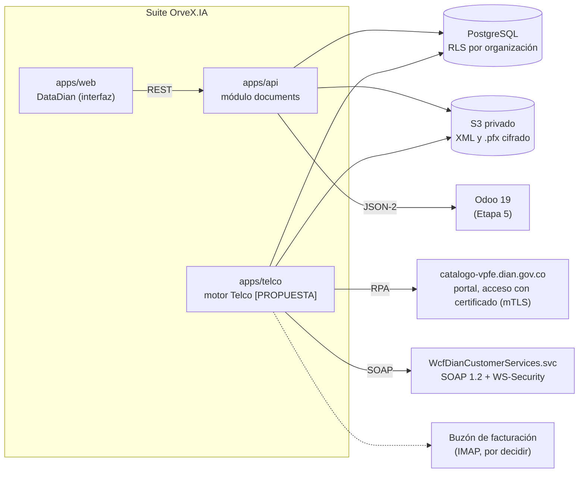
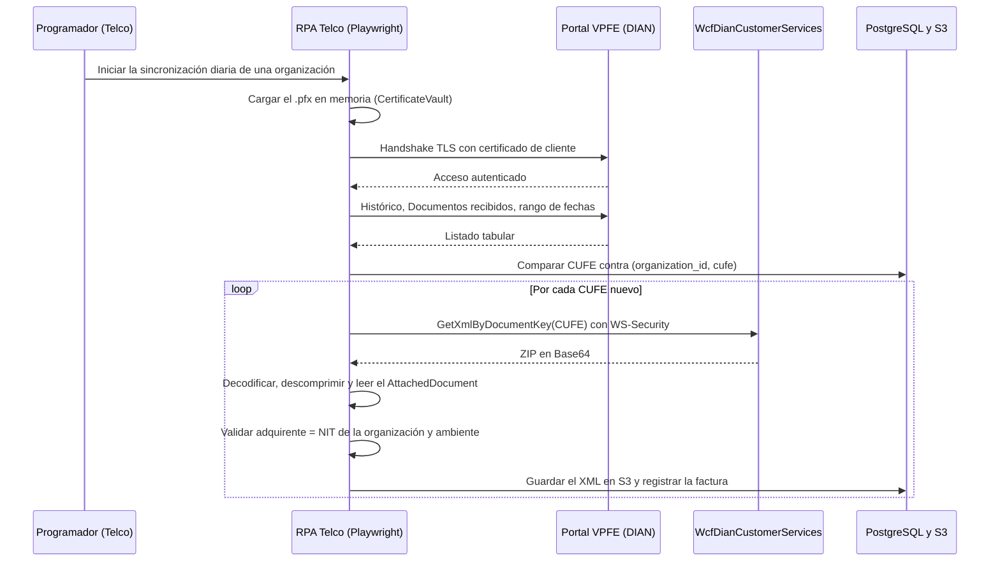
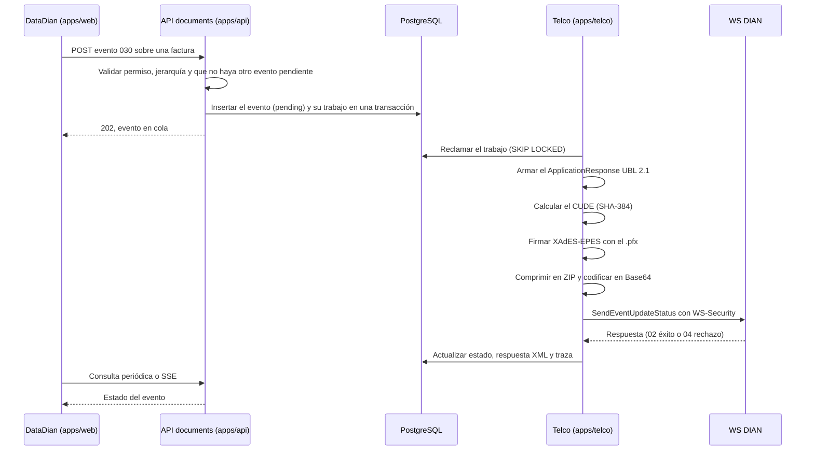
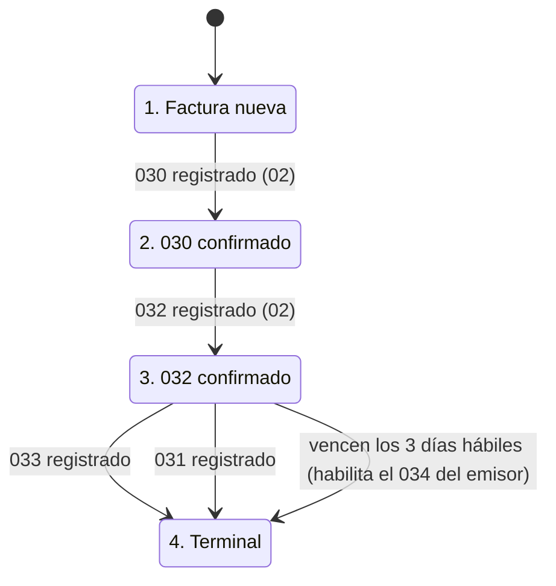

# Arquitectura de DataDian y Telco

| Campo | Valor |
|---|---|
| Estado | **Arquitectura oficial del módulo 04**, adoptada el 12-nov-2026 ([ADR-014](../../decisions/ADR-014-arquitectura-datadian-telco.md)). Es la **visión general**: el detalle de cada etapa está en [ARQUITECTURA_DB_DATADIAN.md](ARQUITECTURA_DB_DATADIAN.md) (Etapa 2), [ARQUITECTURA_FRONTEND_DATADIAN.md](ARQUITECTURA_FRONTEND_DATADIAN.md) (Etapa 3) y [ARQUITECTURA_BACKEND_DATADIAN.md](ARQUITECTURA_BACKEND_DATADIAN.md) (Etapa 4), y el orden de trabajo en [RUTA_DE_TRABAJO_DATADIAN.md](RUTA_DE_TRABAJO_DATADIAN.md). Donde este documento y uno de esos chocan, manda el más específico. Lo marcado **[PROPUESTA]** es una adaptación al stack de la suite, pendiente de confirmar. Lo marcado **[POR VERIFICAR n]** remite al punto n de la §10 |
| Fecha | 12 de noviembre de 2026 |
| Blueprint | [`DataDian/arquitectura Eventos RADIAN DIAN.md`](DataDian/arquitectura%20Eventos%20RADIAN%20DIAN.md) (fuente oficial) |
| Informes de soporte | [`Automatización Eventos RADIAN DIAN.md`](DataDian/Automatizaci%C3%B3n%20Eventos%20RADIAN%20DIAN.md), [`Facturación Electrónica DIAN Colombia.md`](DataDian/Facturaci%C3%B3n%20Electr%C3%B3nica%20DIAN%20Colombia.md) y [`especificacion_certificado_pfx_telco.md`](DataDian/especificacion_certificado_pfx_telco.md) |
| Base de la suite | ADR-004 (RLS), ADR-008 (convenciones), ADR-009 (cola, archivos y secretos), ADR-011 (alcance RADIAN v1), ADR-013 (nombre DataDian), Documento madre §4.4, §10 y §14 (D-12, D-14, D-15, D-16) |
| Módulo | 04. Nombre visible: **DataDian**. Identificador interno: `documents` |

Este documento traslada el blueprint a la suite sin cambiar su contenido funcional. Donde el
blueprint choca con el stack (multiempresa, convenciones, cola, archivos) se propone una
adaptación. Donde el blueprint o sus informes de soporte tienen datos dudosos, no se copian como
hechos: quedan en la §10 para verificarlos contra la fuente primaria.

---

## 1. Visión general

### 1.1 Los dos componentes

| Componente | Qué es | En la suite |
|---|---|---|
| **DataDian** | Interfaz de usuario: bandeja de recepción, vista de detalle con auditoría temporal y acciones sobre los eventos RADIAN. Es donde los usuarios operativos trabajan con los documentos | Frontend en `apps/web` (`features/datadian`) y API REST en el módulo `documents` del monolito NestJS (`apps/api`) |
| **Telco** | Motor en segundo plano. Hace toda la interoperabilidad con la DIAN (RPA sobre el portal, IMAP, SOAP), la criptografía (SHA-384, XAdES-EPES), el cumplimiento UBL 2.1 y la comunicación oficial con los servidores de la DIAN | **[PROPUESTA]** Aplicación TypeScript aparte dentro del monorepo, `apps/telco` (ADR-014). Comparte PostgreSQL, S3 y `packages/contracts` con la API |

"Telco" es el nombre del motor. No se refiere a un operador de telecomunicaciones ni a un sistema
de tarificación (ver §10.9).

### 1.2 Componentes y conexiones

La API nunca habla con la DIAN ni descifra el certificado para usarlo: deja trabajos en la cola
de PostgreSQL (§3.4) y Telco los ejecuta. Telco no expone puertos hacia el navegador.

### 1.3 Principios

1. **Inmutabilidad.** Una factura no muta: se le asocian eventos nuevos. Los datos que vienen de
   la DIAN no se editan en la suite y los eventos no se borran.
2. **El XML oficial es la fuente de verdad.** El listado del portal solo sirve para descubrir
   CUFE. Los datos de cada factura salen del `AttachedDocument` que entrega
   `GetXmlByDocumentKey`.
3. **Confirmado significa registrado por la DIAN.** Un evento cuenta para la jerarquía solo cuando
   la DIAN lo registró con éxito (código 02), no cuando se envió.
4. **Jerarquía en tres capas.** La interfaz no ofrece eventos fuera de orden (RF7), la API los
   rechaza (Etapa 4, con los disparadores de la Etapa 2 como respaldo) y la DIAN tiene la última
   palabra.
5. **Aislamiento por organización.** Toda tabla de negocio lleva `organization_id` con RLS
   (ADR-004). El NIT del certificado debe coincidir con el de la organización.
6. **Secretos fuera de alcance.** El `.pfx`, su contraseña y el PIN del software nunca van en texto
   plano, en registros, en Git ni hacia el navegador (D-12).
7. **Habilitación antes de producción.** Todo envío se prueba primero en el ambiente de
   habilitación de la DIAN. El ambiente de la organización manda: un CUFE de un ambiente no existe
   en el otro.
8. **La suite es adquirente.** Registra 030, 031, 032 y 033. El 034 (aceptación tácita) lo
   registra el emisor; la suite solo calcula su plazo y lo detecta (D-15).

---

## 2. Requerimientos

### 2.1 Funcionales (RF)

| ID | Requerimiento (blueprint) | Adaptación en la suite | Etapa |
|---|---|---|---|
| RF1 | **Ingesta activa RPA.** Un script *headless* de Telco se autentica en `catalogo-vpfe.dian.gov.co` con el certificado digital de la empresa, sin depender del enlace de acceso que el portal envía al correo del representante legal | Playwright 1.46 o superior en TypeScript, con `clientCertificates` y el `.pfx` como `Buffer` en memoria (§5.5). **[POR VERIFICAR 7]** | 4.3 |
| RF2 | **Extracción de histórico.** El bot navega a "Histórico" → "Documentos recibidos", filtra por fechas, descarga el listado tabular y extrae los CUFE pendientes | El listado se lee con `xlsx-reader.ts` (conservado). Los CUFE se comparan contra la clave única `(organization_id, cufe)` | 4.3 |
| RF3 | **Descarga oficial por API.** Telco consume `GetXmlByDocumentKey` por cada CUFE descubierto, decodifica el ZIP en Base64, extrae el `AttachedDocument` y lo almacena | XML en S3 con su SHA-256 (§3.2). Antes de registrar se valida que el adquirente sea el NIT de la organización y que el ambiente coincida | Cliente: 4.2. Uso masivo: 4.3 |
| RF4 | **Generación UBL 2.1.** Telco arma los eventos RADIAN con el esquema `ApplicationResponse` | Plantillas validadas contra el XSD oficial. **[POR VERIFICAR 3]** | 4.4 |
| RF5 | **Cálculo del CUDE.** SHA-384 sobre una cadena plana que concatena variables estrictas según el anexo técnico | `node:crypto`, salida hexadecimal de 96 caracteres, con vectores de prueba del anexo. **[POR VERIFICAR 2]** | 4.1 (estrategia) y 4.4 (fórmula verificada) |
| RF6 | **Firma y transmisión.** Firma XAdES-EPES, envío por SOAP con WS-Security y lectura de la respuesta: 02 (éxito) o 04 (rechazo) | La operación real es `SendEventUpdateStatus`, no `SendEvent`. **[POR VERIFICAR 1]**. Firma en la subetapa 4.1, transmisión en la 4.4 | 4.1 y 4.4 |
| RF7 | **Jerarquía en la interfaz.** 030 (acuse), luego 032 (recibo del bien) y por último 033 (aceptación) o 031 (reclamo) | Máquina de estados en la interfaz (§7.3) y la misma regla en la API. **[POR VERIFICAR 5]** | 2 (base de datos), 3 (interfaz) y 4.5 (API) |

### 2.2 No funcionales (RNF)

| ID | Requerimiento (blueprint) | Adaptación en la suite | Etapa |
|---|---|---|---|
| RNF1 | **Seguridad SOAP.** WS-Security con `BinarySecurityToken` firmado con el certificado X.509 hacia los servicios WCF de la DIAN | Cabecera de §5.4 | 4.2 |
| RNF2 | **Tolerancia a fallos.** Encolar las transmisiones con un broker (RabbitMQ o Kafka) o con colas de base de datos, porque la DIAN puede caerse | **[PROPUESTA]** Cola en PostgreSQL (§3.4), con reintentos y espera exponencial | 2.7 (cola) y 4.1 (`JobRunner`) |
| RNF3 | **Control temporal RADIAN.** Contar exactamente 3 días hábiles desde la confirmación del 032. Cumplido el plazo, el proveedor puede registrar el 034 y la factura queda bloqueada localmente para notas débito o crédito | Calendario de días hábiles de Colombia en la base de datos. La suite no emite el 034 (D-15): lo detecta con `GetStatusEvent`. **[POR VERIFICAR 4]** | 2.2 y 2.6 (cálculo en la base) y 4.5 |

---

## 3. Modelo de datos

El blueprint propone tres tablas (`datadian_empresa`, `datadian_factura` y `datadian_evento`).
En la suite se adaptan al modelo multiempresa:

- `organization_id NOT NULL` en todas, con `ENABLE` y `FORCE ROW LEVEL SECURITY` y la política
  `tenant_isolation` sobre `app.org_id`, igual que `0001_rls.sql` (ADR-004);
- nombres de tablas y columnas en inglés (ADR-008);
- claves únicas compuestas por organización;
- secretos con cifrado envolvente AES-256-GCM (ADR-009, D-12, `CredentialsCipher`);
- archivos en S3 con hash (ADR-009; ADR-013, punto 6);
- cambios solo con migraciones nuevas. Las aplicadas no se editan.

Los nombres de esta sección son **[PROPUESTA]**. El esquema definitivo es el de la Etapa 2, en
[ARQUITECTURA_DB_DATADIAN.md](ARQUITECTURA_DB_DATADIAN.md), que manda sobre esta sección.

### 3.1 `datadian_empresa` → `dian_settings` (configuración DIAN por organización)

Una fila por organización, con el mismo patrón que `odoo_connections`.

| Blueprint | Suite | Nota |
|---|---|---|
| `id_empresa` UUID, PK | `organization_id` uuid, PK y FK a `organizations` | — |
| `nit` VARCHAR(15), UNIQUE, NOT NULL | `nit` text NOT NULL, sin dígito de verificación | Debe coincidir con el NIT del certificado (§6.4). Es único entre organizaciones, a cambio de revelar que el NIT ya existe (decisión aceptada el 12-nov-2026, Etapa 2) |
| `keystore_path` VARCHAR(255) | `keystore_object_key` text | Referencia al `.pfx` **cifrado** en S3 privado (§6.3). El binario nunca va en la base de datos |
| `keystore_pwd` VARCHAR(255) | `keystore_password` jsonb (`EncryptedSecret`) | Contraseña con cifrado envolvente |
| `software_id` VARCHAR(100) | `software_id` text, nulable | Identificador del software habilitado ante la DIAN |
| `software_pin` VARCHAR(10) | `software_pin` jsonb (`EncryptedSecret`), nulable | Es secreto: entra en el cálculo del CUDE |
| — | `environment` text: `'1'` producción, `'2'` habilitación | Valor de `cbc:ProfileExecutionID` |
| — | `certificate_subject_nit`, `certificate_not_before`, `certificate_not_after`, `certificate_sha256` | Metadatos leídos al cargar el certificado. Permiten avisar el vencimiento sin descifrarlo |
| — | `updated_by`, `created_at`, `updated_at` | Convención del repositorio |

`software_id` y `software_pin` son nulables a propósito: la ingesta (RF1 a RF3) solo necesita el
certificado; el envío de eventos necesita además el software habilitado, que depende de D-14.

### 3.2 `datadian_factura` → `received_documents` (conservada y adaptada)

La tabla `received_documents` ya existe con RLS forzada, la clave única
`received_documents_organization_id_cufe_key` sobre `(organization_id, cufe)` y permisos que
impiden modificar los datos de origen. **[PROPUESTA]** Se adapta en la Etapa 2 (subetapa 2.5) para cumplir el
papel de `datadian_factura`, con migraciones nuevas.

| Blueprint | Suite | Nota |
|---|---|---|
| `cufe` VARCHAR(100), PK | `cufe` text NOT NULL; PK `id` uuid | La unicidad es `(organization_id, cufe)` |
| `id_empresa` FK | `organization_id` NOT NULL, RLS | — |
| `nit_emisor` | `issuer_nit` | Desde el XML |
| `razon_social_emisor` | `issuer_name` | Desde el XML |
| `fecha_emision` TIMESTAMP | `issue_date` y, nueva, `dian_validated_at` | El blueprint la describe como "fecha en la que la DIAN validó la factura". Se separan la fecha de emisión (`cbc:IssueDate`) y la de validación (respuesta de la DIAN dentro del `AttachedDocument`) |
| `valor_total` DECIMAL(18,2) | `total` numeric(18,2) | Desde el XML |
| `xml_base64` TEXT | `xml_object_key` y `xml_sha256` | El XML va a S3 por el servicio interno de archivos, no dentro de la fila |
| — | `payment_type` (existente) | Forma de pago leída del XML (contado o crédito). **[POR VERIFICAR 8]** |
| — | `received_at` (existente, migración 0008) | Se conserva. Su fuente en el modelo nuevo se define en la Etapa 2 |

Columnas existentes que se revisan en la Etapa 2:

- las descriptivas (`folio`, `prefix`, `payment_method`, `iva`, `inc` y similares) se llenan desde
  el XML; las que no tengan fuente en el XML se retiran con una migración nueva;
- `pdf_*`, `import_id` y la tabla `received_document_imports` no tienen papel en el modelo nuevo
  (el visor del blueprint genera la representación gráfica a partir del XML, §7.2). Se retiran con
  migraciones nuevas cuando no quede código que las lea;
- la decisión interna (`status`, `decided_by`, `decided_at`, `decision_reason`, `rejection_code`)
  y el envío a Odoo (`odoo_*`) se conservan (§8).

### 3.3 `datadian_evento` → `radian_events`

Tabla nueva, solo de inserción, con un registro por evento.

| Blueprint | Suite | Nota |
|---|---|---|
| `cude` VARCHAR(100), PK | PK `id` uuid (v7); `cude` text nulable; UNIQUE `(organization_id, cude)` | La fila nace en cola, antes de que Telco calcule el CUDE. Los eventos que registran otros (por ejemplo, el 034 del emisor) traen el CUDE de la DIAN |
| `cufe_factura` FK | `received_document_id` con FK compuesta `(organization_id, received_document_id)` | Mismo patrón que `received_documents_import_fk` |
| `codigo_evento` VARCHAR(3) | `event_code` text, CHECK en `030`, `031`, `032`, `033`, `034` | — |
| `fecha_evento` TIMESTAMP | `event_at` (fecha y hora del evento, con huso `-05:00`) y `dian_registered_at` (registro según la DIAN) | El plazo de RNF3 depende de cuál de las dos fechas cuenta. **[POR VERIFICAR 4]** |
| `estado_dian` VARCHAR(3): 01, 02, 04 | `status` text: `pending` (01), `accepted` (02), `rejected` (04) | 01 es un estado local de cola, no un código de la DIAN |
| `xml_response` TEXT | `dian_response_xml` text | Respuesta `ApplicationResponse` de la DIAN |
| `traza_error` TEXT | `error_trace` text | Mensaje de rechazo legible |
| — | `claim_code` text (`01` a `04`), solo para el 031 | Concepto del reclamo. **[POR VERIFICAR 3]** |
| — | `origin` text: `suite` o `dian` | `dian` = evento descubierto con `GetStatusEvent` (034 del emisor o evento registrado fuera de la suite) |
| — | `requested_by`, `attempts`, `sent_at`, `created_at` | Trazabilidad y reintentos |

Restricciones **[PROPUESTA]**:

- un índice único parcial impide dos eventos del mismo código por factura en estado `pending` o
  `accepted`;
- `app_user` puede consultar e insertar eventos, pero no actualizarlos ni borrarlos;
- solo el rol de Telco actualiza el estado y la respuesta de la DIAN.

### 3.4 Cola de trabajos de Telco (RNF2)

**[PROPUESTA]** Una tabla de trabajos en PostgreSQL en lugar de un broker. Los trabajos son:
sincronizar recibidos, descargar un XML, enviar un evento y consultar los eventos de una factura.

- La API inserta el evento y su trabajo **en la misma transacción**: no hay doble escritura ni
  eventos perdidos si la DIAN o un proceso caen. Es el mismo patrón de outbox de ADR-009 y E2-13.
- Telco reclama trabajos con `FOR UPDATE SKIP LOCKED`, reintenta con espera exponencial y, al
  agotar los intentos, marca el trabajo como fallido y avisa en DataDian.
- Telco trabaja cada trabajo dentro de `withTenant` con la organización del trabajo, con un rol de
  base de datos propio y sin `BYPASSRLS`. Cómo reclama trabajos de todas las organizaciones sin
  saltarse RLS (una función `SECURITY DEFINER` acotada que solo devuelve id, tipo y organización, o
  una tabla de cola sin datos de negocio) se decidió en la Etapa 2: rol `app_worker` con una sola
  excepción entre organizaciones, `telco_jobs` (aceptado el 12-nov-2026).
- Telco no necesita Valkey ni BullMQ.

---

## 4. Flujos

### 4.1 Ingesta: descubrimiento y descarga de facturas

Fiel al diagrama 4.1 del blueprint, con las validaciones de la suite al final de cada iteración.

**[PROPUESTA]** Después de registrar una factura, Telco consulta sus eventos con
`GetStatusEvent` para no repetir eventos ya registrados y para detectar el 034 del emisor.

**Canal IMAP.** La visión del blueprint incluye IMAP en la capa de interoperabilidad de Telco, y
el informe «Automatización Eventos RADIAN DIAN» lo propone como canal complementario: leer el
buzón donde los proveedores envían el `AttachedDocument` y tomar de allí el CUFE. El XML de
registro siempre sale de `GetXmlByDocumentKey`. La Etapa 2 ya prevé los buzones
(`imap_mailboxes`) y la subetapa 4.3 lo construye, junto con el punto 7 de la §10.

### 4.2 Generación y transmisión de un evento RADIAN

Fiel al diagrama 4.2 del blueprint. Cambian la operación SOAP (§10.1), la cola y el aviso a la
interfaz.

El blueprint avisa a la interfaz por WebSocket o consulta periódica. En la suite se usa consulta
periódica y, cuando exista, el canal SSE de E2-4 **[PROPUESTA]**.

Si la DIAN responde la regla 90 (*Documento procesado anteriormente*), Telco no reenvía: concilia
el estado con `GetStatusEvent`.

### 4.3 Plazo de la aceptación tácita (RNF3)

1. Cuando el 032 queda `accepted`, la base de datos (Etapa 2) calcula la fecha en que se cumplen los 3 días hábiles
   con el calendario de Colombia. **[POR VERIFICAR 4]**
2. DataDian muestra la cuenta regresiva y avisa antes del vencimiento para que el usuario emita
   033 o 031 a tiempo.
3. Al vencer, la factura pasa al estado terminal (§7.3). Telco confirma con `GetStatusEvent` si el
   emisor registró el 034 y, si lo hizo, lo guarda con `origin = 'dian'`.
4. Con 033 o 034 registrados, la factura queda marcada como aceptada: la suite advierte que no
   admite notas crédito ni débito. DataDian no emite notas (D-15).

---

## 5. Especificaciones de Telco

### 5.1 El evento `ApplicationResponse` (UBL 2.1)

| Elemento | Blueprint | Observación |
|---|---|---|
| Código del evento | `/ApplicationResponse/cbc:CustomizationID` (030, 032…) | En duda: otro informe y la referencia de APIDIAN lo ponen en `cac:DocumentResponse/cac:Response/cbc:ResponseCode`. **[POR VERIFICAR 3]** |
| Ambiente | `/ApplicationResponse/cbc:ProfileExecutionID`: 1 producción, 2 pruebas | Sale de `dian_settings.environment` |
| Referencia a la factura | `cac:DocumentReference/cbc:UUID` (CUFE) | Los informes agregan el número (`cbc:ID`), el tipo de documento y la fecha de emisión de la factura |
| Actores | — (informe «Automatización») | `cac:SenderParty`: la organización, que emite el evento. `cac:ReceiverParty`: el proveedor. Con NIT, responsabilidades tributarias y esquema |
| Concepto del reclamo (031) | El modal inyecta el código en el nodo `ResponseCode` | Códigos `01` a `04` en la referencia de APIDIAN. **[POR VERIFICAR 3]** |
| Extensiones | — (informe del `.pfx`) | `ext:UBLExtensions`: la primera con `sts:DianExtensions` y la segunda con la única `ds:Signature` |

Las plantillas se validan contra el XSD oficial antes de firmar. No se formatea el XML después de
firmarlo.

### 5.2 CUDE (RF5)

El blueprint pide concatenar, en orden y sin espacios, y aplicar SHA-384:

1. NumFac: número de la factura original;
2. FecFac: fecha de la factura;
3. ValFac: valor total sin impuestos;
4. CodImp y ValImp, por cada grupo de impuestos;
5. ValTot: valor total con impuestos;
6. NIT del facturador original;
7. NIT del adquirente (la organización);
8. NIT del emisor del evento (el adquirente, para 030 a 033);
9. tipo de evento (por ejemplo, 030);
10. PIN del software (`dian_settings.software_pin`).

**Esta lista no se implementa tal cual.** Se parece a la fórmula del CUFE o de las notas, no a la
de un evento, y el informe «Automatización» da otra lista. **[POR VERIFICAR 2]** La función se
escribe en la Etapa 4 (subetapas 4.1 y 4.4) con la fórmula del anexo técnico vigente y con sus ejemplos como pruebas
unitarias. Se calcula con `node:crypto` (`createHash('sha384')`) y la salida es hexadecimal de 96
caracteres.

### 5.3 Firma XAdES-EPES

Según el informe del `.pfx`, §4:

- firma *enveloped* XAdES-EPES (ETSI TS 101 903), en el segundo `ext:UBLExtension`, una sola
  `ds:Signature` por documento;
- tres referencias en `ds:SignedInfo`: el documento completo (transformación *enveloped
  signature*), `xades:SignedProperties` y `ds:KeyInfo`;
- algoritmos de la familia SHA-2, coherentes con el certificado;
- `xades:SignaturePolicyIdentifier` con la URL
  `https://facturaelectronica.dian.gov.co/politicadefirma/v2/politicadefirmav2.pdf`, la descripción
  oficial y un `SigPolicyHash` **calculado a partir de los bytes del PDF oficial**, no copiado de
  un ejemplo;
- `xades:SigningTime` con la hora legal de Colombia (`-05:00`);
- `xades:SignerRole`: `supplier` si la organización firma con software propio, `third party` si
  firma un proveedor tecnológico. Depende de D-14.

Se usa una librería XMLDSig y XAdES auditada para TypeScript (por ejemplo `xadesjs` o
`xml-crypto`). La canonicalización y los digest no se arman concatenando texto.

### 5.4 Mensajería SOAP con WS-Security (RNF1)

Las llamadas a `WcfDianCustomerServices.svc` son SOAP 1.2, no REST. Habilitación:
`https://vpfe-hab.dian.gov.co/WcfDianCustomerServices.svc`; producción: `https://vpfe.dian.gov.co/WcfDianCustomerServices.svc`.

| Parte de la cabecera | Contenido (blueprint §5.3 e informe del `.pfx` §5.2) |
|---|---|
| WS-Addressing | `wsa:Action` con la operación del contrato WCF y `wsa:To` con la URL del servicio y un `wsu:Id` único. `wsa:To` es lo que se firma |
| `wsu:Timestamp` | `wsu:Created` y `wsu:Expires` en UTC, contra ataques de repetición. El formato exacto se confirma en habilitación |
| `wsse:BinarySecurityToken` | Certificado público X.509 en Base64, sin cabeceras PEM ni saltos de línea, `ValueType` X509v3 y un `wsu:Id` único |
| `ds:Signature` | Canonicalización exclusiva (`xml-exc-c14n#`, `PrefixList="wsa soap wcf"`), RSA-SHA256 con la llave privada del `.pfx`, referencia a `#wsu:Id` de `wsa:To` y `KeyInfo` con `wsse:SecurityTokenReference` hacia el token |

| Operación | Uso | Necesita |
|---|---|---|
| `GetXmlByDocumentKey` | XML de un documento por su CUFE. La respuesta trae el ZIP en `XmlBytesBase64` | Certificado |
| `GetStatusEvent` | Eventos registrados de un documento | Certificado |
| `SendEventUpdateStatus` | Envío de un evento firmado, como ZIP en Base64 | Certificado, `SoftwareID` y PIN (D-14) |

Los nombres de las operaciones y sus campos de respuesta (`IsValid`, `StatusCode`,
`StatusMessage`, `ErrorMessage`) se confirman contra el WSDL de habilitación. **[POR VERIFICAR 1]**

### 5.5 RPA sobre el portal (RF1 y RF2)

- Playwright 1.46 o superior en Node.js/TypeScript: es la primera versión con `clientCertificates`,
  que acepta el `.pfx` como `Buffer` con su contraseña y el `origin` exacto
  (`https://catalogo-vpfe.dian.gov.co`). Así el navegador no muestra el diálogo nativo de selección
  de certificado, que el RPA no podría controlar.
- El informe del `.pfx` advierte que los bindings de Python tienen brechas en este soporte. Por eso
  Telco es TypeScript.
- Un rango que devuelva cero documentos de forma inesperada genera una alerta: un cambio de formato
  del portal puede vaciar el listado sin error (ver la lección del Extractor V2 en
  [`apidian/ANALISIS_APIDIAN.md`](apidian/ANALISIS_APIDIAN.md) §4).
- No se resuelven captchas con servicios de terceros ni con modelos de visión. **[POR VERIFICAR 7]**

### 5.6 Módulos internos de Telco

| Módulo | Responsabilidad | Etapa |
|---|---|---|
| `CertificateVault` | Descifra la contraseña, lee el `.pfx` en memoria, extrae llave privada, certificado y cadena, y corre las validaciones de §6.4 | 4.1 |
| `CudeCalculator` **[PROPUESTA]** | Cadena del CUDE y SHA-384 | 4.1 y 4.4 |
| `XadesEpesSigner` | Firma un `ApplicationResponse` sin firmar y devuelve el XML firmado | 4.1 |
| `SoapWsSecurityClient` | Arma la cabecera de §5.4 y llama a `WcfDianCustomerServices.svc` | 4.2 |
| `AttachedDocumentParser` **[PROPUESTA]** | Descomprime, extrae la factura embebida y la normaliza | 4.3 |
| `RpaMtlsWorker` | Acceso al portal con `clientCertificates` y descarga del listado | 4.3 |
| `JobRunner` y programador **[PROPUESTA]** | Reclama trabajos de la cola, reintenta y programa la sincronización diaria | 4.1 (cola en la 2.7) |
| `ApplicationResponseBuilder` **[PROPUESTA]** | Plantillas del evento y validación contra el XSD | 4.4 |

---

## 6. Certificado digital `.pfx` (PKCS#12)

### 6.1 Por qué es obligatorio

Con software propio, Telco necesita el archivo `.pfx` y su contraseña para firmar, autenticarse
por WS-Security y negociar mTLS en el portal. El certificado debe cumplir la Circular 03-2016 de
la ONAC (informe del `.pfx`, §1.3): firma de la familia SHA-2, `KeyUsage` marcado como crítico con
`Digital Signature` y `Non Repudiation`, vigencia que cubra la fecha del documento y la cadena
completa hasta la raíz. La renovación se puede pedir hasta 3 meses antes del vencimiento.

### 6.2 Los cuatro puntos de invocación

| # | Dónde | Protocolo | Parte del `.pfx` | Para qué |
|---|---|---|---|---|
| 1 | `RpaMtlsWorker` | TLS con certificado de cliente (mTLS) | Certificado y llave privada | Entrar a `catalogo-vpfe.dian.gov.co` por la opción "Certificado" |
| 2 | `SoapWsSecurityClient` (`GetXmlByDocumentKey`) | SOAP 1.2 y WS-Security 1.1 | Certificado público y llave privada | `BinarySecurityToken` y firma de `wsa:To` para descargar el XML |
| 3 | `XadesEpesSigner` | XMLDSig *enveloped*, XAdES-EPES | Llave privada y cadena completa | Firmar el `ApplicationResponse` (030, 031, 032 o 033) |
| 4 | `SoapWsSecurityClient` (`SendEventUpdateStatus`) | SOAP 1.2 y WS-Security 1.1 | Certificado público y llave privada | Autenticar el envío del evento firmado. El informe lo llama `SendEvent` (§10.1) |

### 6.3 Custodia en reposo

Del informe del `.pfx`, §2.1, adaptado a la suite:

- **El binario nunca va** en Git, en carpetas públicas ni en la base de datos. El informe admite
  un volumen privado cifrado con permisos `0400` o `0600` del usuario de Telco, o almacenamiento de
  objetos privado y cifrado. **[PROPUESTA]** En la suite, el `.pfx` se cifra con cifrado
  envolvente antes de subirlo a un prefijo privado de S3, y `dian_settings.keystore_object_key`
  guarda solo la referencia.
- **La contraseña** va cifrada con AES-256-GCM y una llave maestra fuera de la base de datos: es el
  `CredentialsCipher` de D-12, con `CREDENTIALS_MASTER_KEY`. El PIN del software se guarda igual.
- **Cero escritura temporal.** El `.pfx` se descifra solo en memoria. Está prohibido escribir
  llaves `.key` o `.pem` sin contraseña en `/tmp` o en cualquier disco.
- **Quién lo descifra.** **[PROPUESTA]** La API valida el archivo en memoria al cargarlo (§6.4) y
  lo guarda cifrado. Solo Telco lo descifra para usarlo.
- **Registros.** Ningún registro incluye el certificado, su contraseña ni el PIN.

### 6.4 Validaciones previas a cada uso (*pre-flight*)

| Validación | Regla |
|---|---|
| Vigencia | La fecha actual dentro de `NotBefore` y `NotAfter`. Aviso en DataDian cuando falten menos de 90 días |
| Atributos ONAC | `KeyUsage` crítico con `Digital Signature` y `Non Repudiation`, firma SHA-2 |
| Identidad | El NIT del `Subject` o `SERIALNUMBER` del certificado = `dian_settings.nit` = NIT del `cac:SenderParty` del evento. Impide firmar el evento de una organización con el certificado de otra |
| Reloj | Servidor de Telco sincronizado por NTP con la hora legal de Colombia (`UTC-05:00`), porque `xades:SigningTime` y `wsu:Timestamp` dependen de ella |

### 6.5 Lista de chequeo en habilitación

Antes de cambiar `ProfileExecutionID` a 1 (producción):

1. el `.pfx` carga en memoria sin archivos temporales y pasa las validaciones de §6.4;
2. `GetXmlByDocumentKey` y `GetStatusEvent` responden sin error de WS-Security y el ZIP se
   descomprime;
3. un 030 de prueba firmado y enviado vuelve aprobado, sin errores de firma ni de política;
4. el acceso al portal de habilitación (`catalogo-vpfe-hab.dian.gov.co`) con certificado funciona
   sin intervención humana. **[POR VERIFICAR 7]**

---

## 7. Frontend DataDian

### 7.1 Bandeja de recepción (vista de tabla)

Tabla reactiva sobre `received_documents`, que evoluciona desde el tablero conservado
(`invoices-page.tsx`).

- **Columnas:** NIT del proveedor, proveedor, fecha de emisión, total y estado RADIAN actual
  (insignia de color).
- **Filtros:** rango de fechas (mes actual, mes anterior) y búsqueda por NIT o CUFE.
- **[PROPUESTA]** Columna o aviso con los días hábiles que faltan para el plazo de §4.3.

### 7.2 Detalle con auditoría temporal (vista dividida)

- **Panel izquierdo, visor documental:** el XML original o una representación gráfica generada
  desde el `AttachedDocument` con hojas de estilo XSLT.
- **Panel derecho, línea de tiempo RADIAN:** los eventos de `radian_events`, de ambos orígenes
  (`suite` y `dian`), con su estado, fecha y traza de error.

### 7.3 Máquina de estados de las acciones

La interfaz habilita o bloquea botones según los eventos **registrados por la DIAN**. Así evita
el rechazo "Evento fuera de secuencia".

| Estado | Botones (colores del blueprint) |
|---|---|
| **1. Factura nueva** | Solo **"Acuse de recibo (030)"**, azul |
| **2. 030 confirmado** | El 030 se oculta o bloquea. Se habilita **"Recibo del bien (032)"**, naranja |
| **3. 032 confirmado** | **"Aceptación expresa (033)"**, verde, y **"Reclamo (031)"**, rojo, a la vez |
| **4. Terminal** | Con 033 o 031 registrados, o vencido el plazo del 034, todos los botones desaparecen o quedan inactivos de forma permanente |

- **Modal del reclamo (031).** Al pulsar "Reclamo" se abre un modal que obliga a elegir el concepto
  oficial (por ejemplo, mercancía no entregada) antes de enviar. El código elegido va al
  `ResponseCode` del XML. **[POR VERIFICAR 3 y 5]**
- **[PROPUESTA] Evento en curso.** Mientras un evento está `pending`, todos los botones quedan
  inactivos y se muestra "en cola" o "enviando". Un rechazo (04) devuelve la factura a su estado
  anterior y muestra la traza.
- **[PROPUESTA] Estado derivado.** El estado se calcula con los eventos de ambos orígenes: un 030
  registrado fuera de la suite también lleva la factura al estado 2.
- **[POR VERIFICAR 8] Contado.** Si la forma de pago es contado, los eventos no son obligatorios.
  Qué muestra la interfaz en ese caso se decide en la Etapa 3.
- Los colores del blueprint se traducen a los tokens de la paleta oficial (ADR-007).

### 7.4 API REST de DataDian

**[PROPUESTA]** Bajo `/api/v1/documents`, con las convenciones del repositorio:

| Método y ruta | Uso |
|---|---|
| `GET /received` y `GET /received/:id` | Bandeja y ficha (existentes, se adaptan) |
| `GET /received/:id/xml` | XML para el visor, con URL prefirmada |
| `GET /received/:id/events` | Línea de tiempo |
| `POST /received/:id/events` | Pedir un evento (`030`, `031` con concepto, `032` o `033`). Responde `202` |
| `GET` y `PUT /settings/dian` | Certificado, ambiente y software |

Los permisos por acción se definen en las Etapas 2 y 3 sobre los existentes (`documents:view`,
`documents:decide`, `documents:configure`).

---

## 8. Lo conservado y cómo encaja

| Pieza conservada | Papel en la arquitectura nueva | Etapa |
|---|---|---|
| `received_documents`, `received-documents.service.ts`, `received-documents.controller.ts` y el contrato `received-document.ts` | Base de `datadian_factura` (§3.2) y de la bandeja | 2 (2.5), 3 y 4 |
| Decisión interna (aprobar o rechazar con motivo e historial) | Se conserva como registro de quién decidió y por qué. **[PROPUESTA]** Rechazar abre el modal del reclamo 031 y aprobar lleva a la aceptación 033; la relación exacta se define en las Etapas 3 y 5. Los `REJECTION_CODES` `01` a `04` coinciden con los conceptos de reclamo de la referencia de APIDIAN | 3 y 5 |
| Tablero (`invoices-page.tsx`, `invoice-detail.tsx`, `document-status.tsx`, `reject-dialog.tsx`) | Bandeja (§7.1), vista dividida (§7.2) y modal del reclamo (§7.3) | 3 |
| `xlsx-reader.ts` | Lectura del listado tabular que descarga el RPA (RF2). Pasa a Telco o a un paquete compartido | 4.3 |
| `odoo.client.ts`, `odoo-vendor-bill.ts` y la tabla `odoo_connections` | Borrador de factura de proveedor en Odoo 19 (API JSON-2) | 5 |
| `documents-settings.*` y `settings-page.tsx` | Configuración de Odoo. En la Etapa 3 se le suma la configuración DIAN (§7.4) | 3 y 5 |
| Columna `received_documents.received_at` | Se conserva (§3.2) | 2 |

**Integración con Odoo (Etapa 5).** **[PROPUESTA]** El disparador del borrador es la aceptación
expresa (033) **registrada por la DIAN**, pendiente de confirmar con el usuario. El envío a Odoo
pasa a ser un trabajo en segundo plano, no una llamada dentro de la petición.

**Riesgos vigentes en el código conservado** (registrados en [`PENDIENTES.md`](../../PENDIENTES.md)):

| Riesgo | Dónde | Etapa |
|---|---|---|
| La llamada a Odoo ocurre dentro de la transacción de la base de datos: un Odoo lento la retiene y, si la transacción se revierte, el borrador queda en Odoo sin registro en la suite | `received-documents.service.ts`, `odoo-vendor-bill.ts` | 5 |
| SSRF: la URL de Odoo es configurable y solo se exige `https://` en producción, sin restringir el host | `documents-settings.service.ts` | 5 |
| Un objeto subido a S3 dentro de una transacción queda huérfano si la transacción se revierte | Toda escritura en S3 dentro de `withTenant`. Aplica al guardado del XML | 4 y 5 |

---

## 9. Mapa de etapas

La Etapa 1 (Fundaciones) está cerrada. El 12-nov-2026 el usuario fijó el orden definitivo de
DataDian: primero la base de datos, después el frontend contra contratos y mocks, y por último el
backend ([ADR-014](../../decisions/ADR-014-arquitectura-datadian-telco.md), enmienda del
12-nov-2026). El plan del blueprint (§7: núcleo criptográfico, SOAP, RPA, base de datos, UBL y
frontend) queda repartido entre las Etapas 2, 3 y 4. Subetapas, dependencias, bloqueos y estado:
[RUTA_DE_TRABAJO_DATADIAN.md](RUTA_DE_TRABAJO_DATADIAN.md).

| Etapa | Nombre | Especificación completa | Ficha | Contenido |
|---|---|---|---|---|
| 2 | Base de datos de DataDian (2.1 a 2.9) | [ARQUITECTURA_DB_DATADIAN.md](ARQUITECTURA_DB_DATADIAN.md) | [`ETAPA_2_BASE_DE_DATOS.md`](../../etapas/ETAPA_2_BASE_DE_DATOS.md) | Esquema de §3 con RLS, inmutabilidad, eventos RADIAN y su orden, calendario de festivos y plazos (RNF3), cola de Telco en PostgreSQL (RNF2), rol `app_worker`. **En curso: 2.1 y 2.2 implementadas** |
| 3 | Frontend de DataDian (3.1 a 3.8) | [ARQUITECTURA_FRONTEND_DATADIAN.md](ARQUITECTURA_FRONTEND_DATADIAN.md) | [`ETAPA_3_FRONTEND.md`](../../etapas/ETAPA_3_FRONTEND.md) | Contratos (zod y OpenAPI), mocks, bandeja, vista dividida, línea de tiempo, máquina de estados de los botones, modal del reclamo, configuración DIAN, sincronizaciones |
| 4 | Backend: Telco y API (4.1 a 4.6) | [ARQUITECTURA_BACKEND_DATADIAN.md](ARQUITECTURA_BACKEND_DATADIAN.md) | [`ETAPA_4_BACKEND.md`](../../etapas/ETAPA_4_BACKEND.md) | 4.1 núcleo criptográfico (custodia D-12, validaciones previas, XAdES-EPES); 4.2 SOAP con WS-Security; 4.3 RPA, IMAP y XML por CUFE; 4.4 UBL y transmisión (D-14); 4.5 reglas, plazos y State Tracker; 4.6 E2E con el frontend y paso a producción |
| 5 | Integración con Odoo 19 | [`ETAPA_5_INTEGRACION_ODOO.md`](../../etapas/ETAPA_5_INTEGRACION_ODOO.md) | La misma | Borrador de factura de proveedor. Disparador propuesto: 033 registrado por la DIAN, pendiente de confirmar. D-16 |
| 6 | CRM y notificaciones | [`ETAPA_6_ESPECIFICACION.md`](../../etapas/ETAPA_6_ESPECIFICACION.md) | La misma | Fuera de DataDian. Conserva los identificadores E2-1 a E2-13 |

---

## 10. Puntos por verificar contra fuentes primarias

Ningún dato de esta lista se implementa hasta contrastarlo con la fuente primaria indicada. Las
fuentes primarias son el anexo técnico vigente, el WSDL de la DIAN, la política de firma y el
[Instructivo de RADIAN](../../Instructivo-RADIAN.pdf). Los puntos 1 a 8 se siguen en
[`PENDIENTES.md`](../../PENDIENTES.md) §7.1 como PV-1 a PV-8; la lista completa, del 1 al 20, es la de
[ARQUITECTURA_BACKEND_DATADIAN.md](ARQUITECTURA_BACKEND_DATADIAN.md) §14.

| # | Punto | Qué dicen las fuentes | Qué falta | Fuente primaria | Bloquea |
|---|---|---|---|---|---|
| 1 | **Operación de envío de eventos** | El blueprint y los informes dicen `SendEvent`. El código de referencia de APIDIAN lee la respuesta `SendEventUpdateStatusResponse` (`apidian/repositorio-original/apidian/app/Http/Controllers/AcceptRejectDocumentController.php:169` y `Api/SendEventController.php`); `SendEvent` es solo el nombre de su clase PHP. También existe `GetStatusEvent` (`StateController.php:888`) | Confirmar los nombres de las operaciones, su `wsa:Action` y los campos de la respuesta | WSDL de `WcfDianCustomerServices.svc` en habilitación | Subetapas 4.2 y 4.4 |
| 2 | **Fórmula del CUDE** | La lista del blueprint (§5.2) usa NumFac, ValFac, impuestos y ValTot: se parece a la del CUFE o a la de las notas, no a la de un evento `ApplicationResponse`. El informe «Automatización» da otra: NIT del emisor de la factura, NIT del emisor y del receptor del evento, código del evento, fecha y hora con huso y PIN del software | Tomar la fórmula exacta y sus ejemplos del anexo | Anexo técnico T5.1 (Resolución 000227 de 2025), sección de eventos | Subetapa 4.4 |
| 3 | **Dónde va el código del evento** | El blueprint lo pone en `cbc:CustomizationID`. «Facturación Electrónica DIAN Colombia» lo pone en `cac:DocumentResponse/cac:Response/cbc:ResponseCode`. La plantilla de referencia de APIDIAN (`apidian/repositorio-original/apidian/resources/templates/xml/88.blade.php`) usa `CustomizationID` = 1, el código en `ResponseCode` y el concepto del reclamo en el atributo `listID` | Fijar la estructura exacta del evento y del concepto del reclamo | Anexo técnico T5.1 y su XSD | Subetapa 4.4 |
| 4 | **Cómputo del plazo** | El blueprint dice "3 días hábiles" (RNF3, §6.3) y también "72 horas hábiles" (plan de etapas). Los informes repiten ambas formas | Definir desde qué instante cuenta (fecha del 032 o su registro en la DIAN), la hora de corte, si el sábado es hábil y los festivos de Colombia. Aplica también al plazo del reclamo 031 | Instructivo de RADIAN, Resolución 000085 de 2022 y normativa comercial | Subetapa 4.5 (la 2.2 usa la regla por defecto aceptada) |
| 5 | **Requisito previo del 031** | El blueprint y el informe del `.pfx` exigen el 032 antes del 031. Pero conceptos de reclamo como "mercancía no entregada totalmente" o "servicio no prestado" no encajan con un recibo del bien previo | Confirmar si el 031 exige el 032 o basta con el 030 | Instructivo de RADIAN y anexo técnico | Ninguna: es la regla `requires` del 031 (subetapa 2.6) |
| 6 | **Normativa vigente** | El blueprint cita el anexo 1.9 y proyectos de norma de 2019. El vigente es el anexo T5.1 de la Resolución 000227 de 2025, que compila la 000165 de 2023. RADIAN es la Resolución 000085 de 2022 (el Documento madre §4.4 la registra dentro de la compilación de la 000227) | Contrastar cada regla con la norma vigente. El Instructivo de RADIAN del repositorio aún no se ha contrastado | Resolución 000227 de 2025 (anexo T5.1), Resolución 000085 de 2022, `docs/Instructivo-RADIAN.pdf` | Todas |
| 7 | **Acceso automatizado al portal** | El blueprint supone que el acceso con certificado evita las comprobaciones anti-robot. El comunicado de la DIAN del 23-jul-2026 anuncia el bloqueo de robots, automatizaciones y agentes de IA en el catálogo desde el 28-jul-2026, con comprobación humana. La revisión legal de los términos de uso sigue abierta | Probar el acceso con certificado en habilitación y hacer la revisión legal. **No se recomienda** resolver captchas con servicios de terceros, aunque el informe «Automatización» lo mencione | Comunicado de la DIAN, términos de uso del portal, prueba en habilitación | Subetapa 4.3 en producción |
| 8 | **Obligatoriedad según la forma de pago** | Los eventos solo son obligatorios en ventas a crédito (informe «Automatización», §1). La forma de pago se lee del XML | Confirmar el campo (se espera `cac:PaymentMeans/cbc:ID`: 1 contado, 2 crédito) y qué hace la suite con las facturas de contado | Anexo técnico T5.1 | Ninguna (se guarda `payment_form`; Etapas 3 y 4 deciden qué mostrar) |

**Otras precisiones sobre los informes de soporte:**

9. «Facturación Electrónica DIAN Colombia» interpreta "Motor Telco" como el núcleo de tarificación
   de una empresa de telecomunicaciones y describe la **emisión** de facturas (`SendBillAsync`,
   `GetStatusZip`, contingencia). No aplica: DataDian no emite facturas (D-15) y Telco es el motor
   de interoperabilidad del blueprint.
10. El informe del `.pfx` escribe los métodos de firma como `xmldsig-more#rsasha256`. El
    identificador estándar (RFC 6931) lleva guion: `xmldsig-more#rsa-sha256`, `#rsa-sha384` y
    `#rsa-sha512`. Se confirma con la política de firma.
11. El estado `01` de `estado_dian` no es un código de la DIAN: es el estado local de cola.
12. Los informes citan sobre todo blogs y proveedores. Sus datos cuentan como verificados solo
    después de contrastarlos.

---

## 11. Fuentes

**Blueprint y soporte** (carpeta [`DataDian/`](DataDian/), de solo lectura):

| Archivo | Papel |
|---|---|
| `arquitectura Eventos RADIAN DIAN.md` | **Blueprint oficial**: componentes, RF y RNF, modelo de datos, flujos, Telco, frontend y plan por etapas |
| `Automatización Eventos RADIAN DIAN.md` | Contexto de RADIAN, catálogo de eventos 030 a 034, canales de ingesta (IMAP y RPA) y microservicios |
| `Facturación Electrónica DIAN Colombia.md` | Estándar UBL 2.1, `AttachedDocument`, `ApplicationResponse`, CUFE y CUDE, WS-Security |
| `especificacion_certificado_pfx_telco.md` | Certificado `.pfx`: requisitos ONAC, custodia, cuatro puntos de invocación, XAdES-EPES, WS-Security y mTLS en Playwright |

**Fuente primaria en el repositorio:** [`docs/Instructivo-RADIAN.pdf`](../../Instructivo-RADIAN.pdf),
pendiente de contrastar con esta arquitectura.

**Referencia de comportamiento:** APIDIAN Community, en
[`apidian/ANALISIS_APIDIAN.md`](apidian/ANALISIS_APIDIAN.md) §5 (eventos) y §12 (cómo habla con la
DIAN y licencias). Su firma y su cliente SOAP están en una librería LGPL-3.0: no se copian ni se
traducen.

**Fuentes primarias externas por consultar:**

- DIAN, Resolución 000227 de 2025 y su anexo técnico T5.1 de factura electrónica.
- DIAN, Resolución 000085 de 2022 (RADIAN).
- DIAN, WSDL de `WcfDianCustomerServices.svc` en habilitación.
- DIAN, política de firma v2: <https://facturaelectronica.dian.gov.co/politicadefirma/v2/politicadefirmav2.pdf>
- DIAN, comunicado del 23-jul-2026 sobre la seguridad del catálogo de factura electrónica: <https://www.dian.gov.co/Prensa/Paginas/ng-dian-fortalece-seguridad-de-catalogo-de-factura-electronica.aspx>
- Playwright, `clientCertificates` en `browser.newContext` (versión 1.46 o superior).
- Odoo 19, External JSON-2 API (Etapa 5): <https://www.odoo.com/documentation/19.0/developer/reference/external_api.html>
