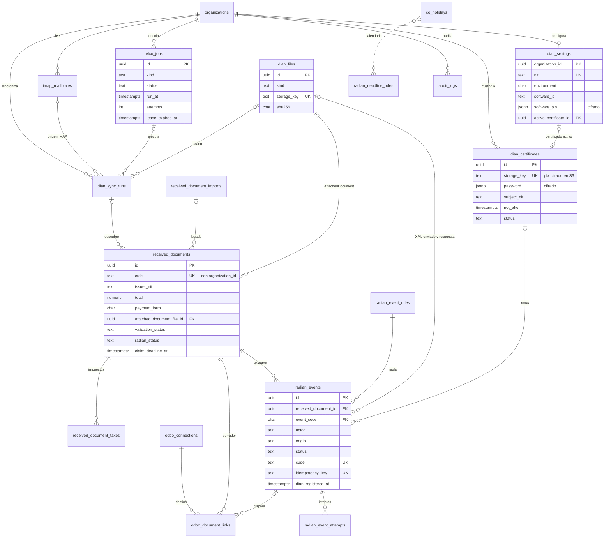

# Arquitectura de base de datos de DataDian

| Campo | Valor |
|---|---|
| Fecha | 12 de noviembre de 2026 |
| Módulo | 04, **DataDian**. Identificador interno: `documents` |
| Etapa | **Etapa 2: Base de datos**, la primera del orden fijado por el usuario el 12-nov-2026 (§1.1) |
| Estado | **En implementación.** El usuario aceptó las decisiones 1 a 9 de la §12 el 12-nov-2026 y ordenó implementar. Las subetapas **2.1 y 2.2 están implementadas y en auditoría** (migración `0010` aplicada en local); siguen la 2.3 a la 2.9 (§10.2). Las desviaciones de la implementación respecto de este diseño están en la §10.3 |
| Base | Blueprint oficial [`arquitectura Eventos RADIAN DIAN.md`](<DataDian/arquitectura Eventos RADIAN DIAN.md>) §3; soporte: [`Automatización Eventos RADIAN DIAN.md`](<DataDian/Automatización Eventos RADIAN DIAN.md>), [`Facturación Electrónica DIAN Colombia.md`](<DataDian/Facturación Electrónica DIAN Colombia.md>) y [`especificacion_certificado_pfx_telco.md`](DataDian/especificacion_certificado_pfx_telco.md); [ADR-004](../../decisions/ADR-004-multi-tenancy.md), [ADR-008](../../decisions/ADR-008-convenciones.md), [ADR-009](../../decisions/ADR-009-datos-e-infraestructura.md), [ADR-014](../../decisions/ADR-014-arquitectura-datadian-telco.md); migraciones `0001_rls.sql` y `0005` a `0009` |
| Criterio de salida | Las migraciones `0010` a `0017` aplicadas en la CI, con las pruebas de RLS, de restricciones, de cola concurrente y de plazos de la §10 en verde |

Las etiquetas siguen la convención de [ARQUITECTURA_DATADIAN_TELCO.md](ARQUITECTURA_DATADIAN_TELCO.md): **[PROPUESTA]** es una decisión de diseño que el usuario debe confirmar y **[POR VERIFICAR n]** remite a la §11 de este documento, donde cada dato regulatorio tiene su fuente primaria pendiente.

---

## 1. Alcance

### 1.1 Orden de etapas

El 12-nov-2026 el usuario fijó este orden para DataDian:

| Etapa | Contenido |
|---|---|
| **2** | **Base de datos** (este documento) |
| 3 | Frontend |
| 4 | Backend: Telco y API |
| 5 | Integración con Odoo 19 |
| 6 | CRM y notificaciones |

Cada etapa se divide en subetapas (2.1, 2.2…). [ADR-014](../../decisions/ADR-014-arquitectura-datadian-telco.md) (enmienda del 12-nov-2026) y [ARQUITECTURA_DATADIAN_TELCO.md](ARQUITECTURA_DATADIAN_TELCO.md) §9 ya usan este orden. La ruta completa, con dependencias y bloqueos, está en [RUTA_DE_TRABAJO_DATADIAN.md](RUTA_DE_TRABAJO_DATADIAN.md). Donde este documento dice "Etapa n", usa el orden de la tabla anterior.

### 1.2 Qué entra y qué no

**Entra en la Etapa 2:** el modelo lógico y físico, las migraciones `0010` a `0017`, los esquemas Drizzle de las tablas nuevas, las funciones y disparadores de PostgreSQL, las políticas RLS y los privilegios, los datos semilla (festivos y reglas), el rol de base de datos de Telco y las pruebas de base de datos. También los enumerados de `packages/contracts` que el frontend de la Etapa 3 necesita.

**No entra:** endpoints de la API, el código de Telco (firma, SOAP, RPA, IMAP), pantallas ni la llamada a Odoo. La Etapa 2 deja la base lista para que las etapas 3 a 5 solo la usen.

---

## 2. Principios

### 2.1 Multiempresa con RLS forzada

Igual que `0001_rls.sql` y ADR-004:

- toda tabla de negocio lleva `organization_id uuid NOT NULL` con FK a `organizations` y `ON DELETE CASCADE`;
- `ENABLE` y `FORCE ROW LEVEL SECURITY`, con la condición `organization_id = NULLIF(current_setting('app.org_id', true), '')::uuid`: sin contexto no se ve ni se escribe nada (falla cerrado);
- claves únicas y FK compuestas por organización (`(organization_id, id)`), como `received_documents_import_fk`. Una fila nunca puede apuntar a una fila de otra organización, aunque el código se equivoque de identificador;
- ningún rol de aplicación tiene `BYPASSRLS`.

Las tablas globales (catálogos y calendario) no llevan `organization_id` ni RLS, como `permissions`, y son de solo lectura para los roles de aplicación.

### 2.2 Inmutabilidad RADIAN

La factura no cambia y los eventos se agregan, nunca se reescriben (blueprint §3; informe «Automatización» §4). En la base de datos eso se traduce en:

- **sin `DELETE` para nadie** en facturas, eventos, intentos y archivos: ni privilegio para los roles de aplicación ni política de `DELETE`, así que con `FORCE` tampoco `app_owner` borra por SQL. Las filas solo desaparecen en cascada al borrar la organización, igual que `audit_logs`;
- **datos de origen de una sola escritura:** los campos que vienen del XML de la DIAN quedan congelados en cuanto la factura tiene su `AttachedDocument` (§5.6);
- **eventos con transiciones cerradas:** un evento pasa de `pending` a un estado final y ahí se queda. Un rechazo de la DIAN no se corrige: se pide un evento nuevo (§6.3);
- **archivos en S3 con su hash**, nunca dentro de la fila, con versionado del bucket (ADR-009).

### 2.3 Secretos cifrados

- Cifrado envolvente AES-256-GCM con el formato `EncryptedSecret` de `apps/api/src/common/credentials-cipher.ts` (ADR-009, D-12). La llave maestra (KEK, hoy `CREDENTIALS_MASTER_KEY`) vive fuera de la base de datos.
- **El `.pfx` nunca va a la base de datos.** La fila guarda la referencia al objeto en un almacenamiento privado, su hash y la llave de datos envuelta. El objeto en S3 es el `.pfx` **ya cifrado** con esa llave de datos: quien robe solo el bucket o solo la base no obtiene la llave privada (§5.2).
- Las columnas secretas no se pueden leer con `app_user`: el privilegio `SELECT` se otorga por columna y las excluye (§9). Solo el rol de Telco las lee, porque solo Telco firma.

### 2.4 Inquilinos reales: matriz y Uniones Temporales

Cada Unión Temporal y la matriz son **una organización de la suite**, con su NIT, su configuración DIAN y su `.pfx`. El informe del certificado (§2) pide aislar las firmas por inquilino; el modelo lo garantiza en tres capas:

1. RLS: Telco trabaja cada trabajo dentro del contexto de la organización del trabajo;
2. el certificado activo de una organización debe tener en su `subject` el mismo NIT de la configuración (disparador de §5.1);
3. cada evento guarda qué certificado lo firmó.

Una factura dirigida a la matriz que llegue al buzón de una UT no se mueve de organización: queda `invalid` con el motivo "adquirente distinto" (§5.6).

---

## 3. Del blueprint a la suite

| Blueprint (§3) | Suite | Cambio principal |
|---|---|---|
| `datadian_empresa` | `dian_settings` y `dian_certificates` | El certificado sale a una tabla propia con historial (§5.2) |
| `datadian_factura` | `received_documents` **evolucionada**, con `received_document_taxes` | Decisión en §4 |
| `datadian_evento` | `radian_events` y `radian_event_attempts` | PK `id` (uuid v7) en lugar del CUDE; cada intento de envío queda registrado |
| `xml_base64`, `xml_response` | `dian_files` (S3 con hash) | Nada de XML dentro de las filas |
| — (RNF2) | `telco_jobs` | Cola en PostgreSQL con `FOR UPDATE SKIP LOCKED` |
| — (RF1, RF2) | `dian_sync_runs` e `imap_mailboxes` | Registro de cada sincronización |
| — (RNF3) | `co_holidays`, `co_holiday_years`, `radian_deadline_rules`, `radian_event_rules` | Calendario y reglas parametrizables |
| — | `odoo_document_links` | Vínculo con el movimiento de Odoo (Etapa 5) |

Nombres en inglés (ADR-008). Marcas de tiempo `timestamptz(3)` con `createdAt()`/`updatedAt()` de `columns.ts`; identificadores `uuid` con `uuidv7()`; importes `numeric(18,2)`; listas cerradas con `oneOf()`.

---

## 4. Decisión: `received_documents` se evoluciona

**Decisión [PROPUESTA]: se evoluciona `received_documents` con migraciones aditivas (expandir ahora, contraer en la Etapa 4). No se crea una tabla nueva.**

### 4.1 Por qué

| Criterio | Evolucionar | Tabla nueva con migración de datos |
|---|---|---|
| Identidad | Ya tiene `UNIQUE (organization_id, cufe)`, RLS forzada y el patrón de privilegios por columna (DD-12) | Habría que repetirlo todo |
| Lo que el usuario conserva | Conserva la tabla, `received_at`, la decisión interna, el PDF y los campos de Odoo, como pide ADR-014 punto 3 | Obliga a copiar y a reapuntar todo |
| Código y contratos | `received-documents.service.ts`, el contrato `receivedDocument` y el tablero siguen funcionando mientras las Etapas 3 y 4 se construyen | Rompe todo a la vez o exige dos tablas vivas y sincronizadas |
| Costo en PostgreSQL | Columnas nulables o con default constante: no reescriben la tabla | Copia completa y bloqueo durante la copia |
| Riesgo | Columnas de la etapa anterior que quedan como legado hasta la Etapa 4 | Doble fuente de verdad durante la transición |

Una tabla nueva solo compensaría si el modelo anterior fuera incompatible. No lo es: la clave de negocio (organización y CUFE) es la misma y lo que falta se agrega.

### 4.2 Impacto

1. **Columnas nuevas** (§5.6), todas nulables o con default constante. Las restricciones nuevas sobre datos existentes se crean `NOT VALID` y se validan aparte, sin bloquear escrituras.
2. **`import_id` pasa a nulable.** Las facturas nuevas entran por una ejecución de sincronización (`sync_run_id`). Un `CHECK (num_nonnulls(import_id, sync_run_id) = 1)` exige exactamente uno de los dos: las filas antiguas cumplen con `import_id`. `received_document_imports` queda como legado de solo lectura y se retira en la contracción de la Etapa 4.
3. **Filas existentes:** reciben `ingestion_source = 'manual'` (el Excel se subía a mano), `validation_status = 'pending_xml'` (no tienen XML) y `radian_status = 'none'`. Que no haya eventos en la suite no significa que no existan en la DIAN: en la Etapa 4 Telco consulta los eventos de cada una y los registra con `origin = 'dian'`.
4. **Políticas:** la política `tenant_isolation` (que hoy cubre también `DELETE`) se reemplaza por políticas por comando sin `DELETE` (§9).
5. **Disparador de inmutabilidad** (§5.6): hoy los datos de la DIAN están protegidos solo porque `app_user` no tiene `UPDATE` sobre ellos. Como Telco debe completarlos una vez al llegar el XML, la protección pasa a un disparador que también frena a `app_owner`.
6. **Columnas del Excel** (`dian_status`, `dian_group`, `cost_center`, `acknowledgment_status`, `invoice_reference`, `observations`, `payment_method`, `payment_type`, `iva`, `inc`): se conservan como legado. Las que no tengan fuente en el XML se retiran en la Etapa 4.
7. **Odoo:** `odoo_status`, `odoo_move_id`, `odoo_attachment_id`, `odoo_error` y `odoo_sent_at` se copian a `odoo_document_links` (§7.6) y siguen vivas hasta que la Etapa 5 cambie el código.
8. **Compatibilidad:** las pruebas actuales de `apps/api/test/documents.test.ts` deben seguir pasando sin cambios después de la `0013`. Es criterio de aceptación de la subetapa 2.5.

---

## 5. Modelo físico: configuración, archivos e ingesta

Notación de las tablas: **PK** clave primaria, **FK** clave foránea, **UQ** único, **CK** restricción `CHECK`. Las FK hacia otra tabla de negocio son compuestas con `organization_id`. Todas las tablas de esta sección tienen RLS forzada salvo que se diga lo contrario.

### 5.1 `dian_settings`: configuración DIAN por organización

Una fila por organización, con el patrón de `odoo_connections`.

| Columna | Tipo | Nulo | Default | Reglas |
|---|---|---|---|---|
| `organization_id` | uuid | no | — | **PK**; FK `organizations` `ON DELETE CASCADE` |
| `nit` | text | no | — | Sin dígito de verificación. **CK** `^[0-9]{5,15}$`. **UQ global** (ver nota) |
| `nit_dv` | char(1) | sí | — | **CK** `^[0-9]$` |
| `environment` | char(1) | no | `'2'` | **CK** `('1','2')`: `1` producción, `2` habilitación. Valor de `cbc:ProfileExecutionID` |
| `operation_mode` | text | no | `'own_software'` | **CK** `('own_software','technology_provider')`. Depende de D-14 |
| `software_id` | text | sí | — | Identificador del software habilitado. **CK** formato UUID |
| `software_pin` | jsonb | sí | — | `EncryptedSecret`. Entra en el CUDE **[POR VERIFICAR 2]** |
| `test_set_id` | text | sí | — | Set de pruebas de habilitación, si la DIAN lo exige para eventos **[POR VERIFICAR 10]** |
| `active_certificate_id` | uuid | sí | — | **FK** `(organization_id, active_certificate_id)` → `dian_certificates (organization_id, id)` |
| `rpa_enabled` | boolean | no | `false` | Sincronización por el portal |
| `imap_enabled` | boolean | no | `false` | Sincronización por correo |
| `sync_lookback_days` | smallint | no | `30` | **CK** `between 1 and 92`. Ventana de fechas del listado |
| `updated_by` | uuid | no | — | — |
| `created_at`, `updated_at` | timestamptz(3) | no | `now()` | — |

Restricciones adicionales:

- **CK** `(software_id IS NULL) = (software_pin IS NULL)`: el software va completo o no va. La ingesta solo necesita el certificado; el envío de eventos necesita además el software (D-14).
- **Disparador `dian_settings_certificate_guard`** (`BEFORE INSERT OR UPDATE OF active_certificate_id, nit`): el certificado activo debe estar en estado `valid`, con `subject_nit = nit` y `not_after > now()`. Si no, `DD010`. Es la segunda capa del aislamiento de §2.4: impide a nivel de base de datos firmar por una UT con el certificado de otra.

**Nota sobre el NIT único global [PROPUESTA].** Dos organizaciones con el mismo NIT enviarían eventos duplicados a la DIAN por la misma empresa. La unicidad global lo impide, a cambio de que una organización sepa que el NIT ya está registrado en otra (el mensaje de error no dice cuál). Se prefiere la unicidad. Es una decisión del usuario (§12).

### 5.2 `dian_certificates`: custodia del `.pfx`

Tabla aparte de `dian_settings` **[PROPUESTA]**, en lugar de las columnas del certificado dentro de la configuración, por tres razones: la DIAN permite renovar hasta 3 meses antes del vencimiento (informe del `.pfx` §1.3), así que dos certificados válidos conviven; cada evento debe decir qué certificado lo firmó; y un certificado reemplazado no se borra, se retira.

| Columna | Tipo | Nulo | Default | Reglas |
|---|---|---|---|---|
| `id` | uuid | no | `uuidv7()` | **PK**. **UQ** `(organization_id, id)` |
| `organization_id` | uuid | no | — | FK `organizations` |
| `storage_key` | text | no | — | Llave del objeto en el almacenamiento privado (§5.2.1). **UQ** |
| `pfx_data_key` | jsonb | no | — | Llave de datos AES-256-GCM con la que se cifró el objeto, envuelta con la KEK (mismo formato que `EncryptedSecret.key`) |
| `pfx_sha256` | char(64) | no | — | Hash del `.pfx` original. **CK** hex. **UQ** `(organization_id, pfx_sha256)` |
| `pfx_size_bytes` | integer | no | — | **CK** `> 0 and <= 65536` |
| `password` | jsonb | no | — | `EncryptedSecret` de la contraseña del `.pfx` |
| `status` | text | no | `'pending_validation'` | **CK** `('pending_validation','valid','invalid','retired')` |
| `serial_number` | text | sí | — | Metadatos que llena la validación previa de Telco |
| `subject_nit` | text | sí | — | NIT del `Subject`/`SERIALNUMBER` |
| `subject_dn`, `issuer_dn` | text | sí | — | — |
| `not_before`, `not_after` | timestamptz(3) | sí | — | Vigencia. Base de la alerta de 90 días |
| `signature_algorithm` | text | sí | — | Debe ser de la familia SHA-2 |
| `key_usage_ok`, `chain_ok` | boolean | sí | — | `KeyUsage` crítico con *Digital Signature* y *Non Repudiation*; cadena completa |
| `validation_errors` | jsonb | no | `'[]'` | Motivos de un `invalid` |
| `uploaded_by` | uuid | no | — | — |
| `validated_at`, `retired_at` | timestamptz(3) | sí | — | — |
| `created_at`, `updated_at` | timestamptz(3) | no | `now()` | — |

Restricciones:

- **CK** `status <> 'valid' OR (serial_number, subject_nit, not_before, not_after IS NOT NULL AND key_usage_ok AND chain_ok)`;
- **CK** `not_after > not_before` cuando ambos existen;
- **CK** `status <> 'retired' OR retired_at IS NOT NULL`;
- disparador de una sola escritura: `storage_key`, `pfx_*` y `password` no cambian nunca (un certificado nuevo es una fila nueva) y los metadatos se congelan al salir de `pending_validation`;
- índice `(organization_id, not_after)` para la alerta de vencimiento.

**Flujo de datos:** la API guarda el objeto cifrado, inserta la fila en `pending_validation` y encola `certificate_check`. Telco descifra en memoria, valida (vigencia, `KeyUsage`, algoritmo, cadena y NIT) y llena los metadatos. La API nunca descifra el certificado (ADR-014).

**Alerta de 90 días:** la vista `dian_certificate_status` (§8.2) calcula `days_to_expiry` y `expiry_state` (`ok`, `due_soon` con 90 días o menos, `expired`). No es una columna generada porque depende de `now()`.

#### 5.2.1 Almacenamiento privado del `.pfx` [PROPUESTA]

- Un bucket o prefijo de S3 distinto al de las facturas, sin acceso público, con versionado y con acceso solo desde la identidad de Telco y de la API (para la carga).
- El objeto es `AES-256-GCM(pfx, llave de datos)`; la llave de datos va envuelta en `pfx_data_key`. Robar el bucket no basta sin la base y la KEK, y robar la base no basta sin el bucket.
- Telco lo descifra solo en memoria (informe del `.pfx` §2.1, punto 3).

### 5.3 `imap_mailboxes`: buzones de recepción

Configuración y cursor de cada buzón que Telco lee (blueprint RF y informe «Automatización» §8.1).

| Columna | Tipo | Nulo | Default | Reglas |
|---|---|---|---|---|
| `id` | uuid | no | `uuidv7()` | **PK**. **UQ** `(organization_id, id)` |
| `organization_id` | uuid | no | — | FK `organizations` |
| `host` | text | no | — | — |
| `port` | integer | no | `993` | **CK** `between 1 and 65535` |
| `use_tls` | boolean | no | `true` | — |
| `username` | text | no | — | — |
| `auth_method` | text | no | `'password'` | **CK** `('password','oauth2')`. Muchos proveedores de correo ya no aceptan contraseña básica **[POR VERIFICAR 12]** |
| `secret` | jsonb | no | — | `EncryptedSecret`: contraseña o token de actualización |
| `folder` | text | no | `'INBOX'` | — |
| `uid_validity`, `last_uid` | bigint | sí | — | Cursor IMAP: permite reanudar sin releer el buzón |
| `enabled` | boolean | no | `true` | — |
| `updated_by` | uuid | no | — | — |
| `created_at`, `updated_at` | timestamptz(3) | no | `now()` | — |

**UQ** `(organization_id, host, username, folder)`.

### 5.4 `dian_files`: archivos en S3 con su hash

Registro de solo inserción de cada archivo que guarda DataDian. Reemplaza al `xml_base64` y al `xml_response` del blueprint.

| Columna | Tipo | Nulo | Default | Reglas |
|---|---|---|---|---|
| `id` | uuid | no | `uuidv7()` | **PK**. **UQ** `(organization_id, id)` |
| `organization_id` | uuid | no | — | FK `organizations` |
| `kind` | text | no | — | **CK** `('attached_document','invoice_pdf','event_request','event_response','status_response','dian_listing')` |
| `storage_key` | text | no | — | **UQ** |
| `sha256` | char(64) | no | — | **CK** hex en minúsculas |
| `size_bytes` | bigint | no | — | **CK** `> 0` |
| `content_type` | text | no | — | — |
| `original_name` | text | sí | — | Nombre del adjunto o del archivo subido |
| `created_by` | uuid | sí | — | Usuario, o el actor de sistema de Telco (§7.7) |
| `created_at` | timestamptz(3) | no | `now()` | — |

**UQ** `(organization_id, kind, sha256)`: el mismo archivo no se guarda dos veces. Sin `UPDATE` ni `DELETE` para nadie. Se recomienda S3 *Object Lock* en modo *governance* para `attached_document`, `event_request` y `event_response` cuando se fije la retención legal **[POR VERIFICAR 11]**.

### 5.5 `dian_sync_runs`: ejecuciones de sincronización

Una fila por ejecución de RPA, de IMAP o de carga manual, con su resultado. Reemplaza a `received_document_imports` para todo lo nuevo.

| Columna | Tipo | Nulo | Default | Reglas |
|---|---|---|---|---|
| `id` | uuid | no | `uuidv7()` | **PK**. **UQ** `(organization_id, id)` |
| `organization_id` | uuid | no | — | FK `organizations` |
| `channel` | text | no | — | **CK** `('rpa','imap','manual')` |
| `trigger` | text | no | — | **CK** `('schedule','user','system')` |
| `requested_by` | uuid | sí | — | **CK** `trigger <> 'user' OR requested_by IS NOT NULL` |
| `job_id` | uuid | sí | — | **FK** `(organization_id, job_id)` → `telco_jobs` |
| `mailbox_id` | uuid | sí | — | **FK** `(organization_id, mailbox_id)` → `imap_mailboxes`. **CK** `(channel = 'imap') = (mailbox_id IS NOT NULL)` |
| `period_start`, `period_end` | date | sí | — | Rango del listado (RPA). **CK** `period_end >= period_start` |
| `status` | text | no | `'queued'` | **CK** `('queued','running','succeeded','partial','failed')` |
| `started_at`, `finished_at` | timestamptz(3) | sí | — | **CK** `(status IN ('succeeded','partial','failed')) = (finished_at IS NOT NULL)` |
| `listed_count` | integer | no | `0` | CUFE vistos en el listado o en el buzón |
| `new_count`, `existing_count` | integer | no | `0` | Facturas creadas y ya existentes |
| `xml_downloaded_count` | integer | no | `0` | XML obtenidos |
| `failed_count` | integer | no | `0` | CUFE que fallaron |
| `listing_file_id` | uuid | sí | — | **FK** → `dian_files` (listado descargado) |
| `error_message` | text | sí | — | — |
| `details` | jsonb | no | `'{}'` | Errores por CUFE, acotados en tamaño por Telco |
| `created_at`, `updated_at` | timestamptz(3) | no | `now()` | — |

**CK** todos los contadores `>= 0`. Índices: `(organization_id, created_at, id)` para el cursor y `(organization_id, channel, status)`.

### 5.6 `received_documents` evolucionada: facturas recibidas

Columnas **nuevas** (las existentes se conservan, §4.2):

| Columna | Tipo | Nulo | Default | Origen o regla |
|---|---|---|---|---|
| `issued_at` | timestamptz(3) | sí | — | `cbc:IssueDate` + `cbc:IssueTime` con huso. `issue_date` se conserva |
| `due_date` | date | sí | — | `cbc:PaymentDueDate` |
| `dian_validated_at` | timestamptz(3) | sí | — | Validación previa, del `ApplicationResponse` dentro del `AttachedDocument` |
| `buyer_nit` | text | sí | — | NIT del adquirente. Debe ser el de `dian_settings.nit` |
| `currency` | char(3) | sí | — | `cbc:DocumentCurrencyCode` |
| `subtotal` | numeric(18,2) | sí | — | `cbc:LineExtensionAmount` |
| `tax_total` | numeric(18,2) | sí | — | Suma de `cac:TaxTotal` |
| `payment_form` | char(1) | sí | — | **CK** `('1','2')`: 1 contado, 2 crédito, de `cac:PaymentMeans/cbc:ID` **[POR VERIFICAR 8]**. Decide si se esperan eventos |
| `payment_means_code` | text | sí | — | `cbc:PaymentMeansCode` |
| `ubl_type_code` | text | sí | — | `cbc:InvoiceTypeCode` |
| `profile_execution_id` | char(1) | sí | — | Ambiente de la factura. **CK** `('1','2')` |
| `attached_document_file_id` | uuid | sí | — | **FK** `(organization_id, attached_document_file_id)` → `dian_files`. El XML con su hash |
| `ingestion_source` | text | no | `'manual'` | **CK** `('rpa','imap','manual')`. El default solo sirve para la carga de filas existentes y se quita en la misma migración |
| `sync_run_id` | uuid | sí | — | **FK** `(organization_id, sync_run_id)` → `dian_sync_runs` |
| `validation_status` | text | no | `'pending_xml'` | **CK** `('pending_xml','pending_validation','valid','invalid')` |
| `validation_errors` | jsonb | no | `'[]'` | Por ejemplo `buyer_mismatch`, `cufe_mismatch`, `signature_invalid`, `environment_mismatch` |
| `validated_at` | timestamptz(3) | sí | — | — |
| `pre_xml_snapshot` | jsonb | sí | — | Valores del listado que el XML sobrescribió. Lo escribe solo el disparador |
| `radian_status` | text | no | `'none'` | **CK** `('none','acknowledged','goods_received','claimed','accepted_express','accepted_tacit')`. Caché que mantiene el disparador de eventos (§6.4) |
| `radian_status_at` | timestamptz(3) | sí | — | Registro en la DIAN del evento que fijó el estado |
| `claim_deadline_at` | timestamptz(3) | sí | — | Vencimiento del plazo de reclamo y de la aceptación tácita (§7.4) |
| `deadline_rule_version` | integer | sí | — | Versión de la regla que calculó el vencimiento |

Cambios sobre lo existente:

- `import_id` deja de ser `NOT NULL`; **CK** `num_nonnulls(import_id, sync_run_id) = 1`;
- **UQ** `(organization_id, id)`, que necesitan las FK compuestas de eventos, impuestos y vínculos con Odoo;
- **CK** `cufe ~ '^[0-9a-f]{96}$'` (SHA-384 en hexadecimal) creada `NOT VALID`. Se valida cuando se revisen las filas antiguas, que pueden traer mayúsculas o CUFE anteriores al SHA-384 **[POR VERIFICAR 9]**. Telco guarda el CUFE en minúsculas;
- **CK** `validation_status <> 'valid' OR attached_document_file_id IS NOT NULL`;
- **CK** `issuer_nit` y `buyer_nit` con el patrón del NIT cuando no son nulos.

Índices nuevos: `(organization_id, radian_status, created_at, id)` para la bandeja por estado; `(organization_id, claim_deadline_at) WHERE radian_status = 'goods_received'` para las alertas de vencimiento; `(organization_id, issuer_nit)` para buscar por proveedor; `(organization_id, issue_date, id)` para el filtro por fechas; `(organization_id, validation_status) WHERE validation_status <> 'valid'`.

**Disparador `received_documents_guard`** (`BEFORE UPDATE`):

| Caso | Regla |
|---|---|
| Siempre | `id`, `organization_id`, `cufe` y `created_at` no cambian (`DD005`) |
| Sin XML (`attached_document_file_id` antes y después nulo) | Los datos de origen son provisionales (vienen del listado) y se pueden actualizar |
| Llega el XML (de nulo a no nulo) | Única transición en la que los datos de origen cambian. El disparador guarda en `pre_xml_snapshot` los valores anteriores no nulos que difieran |
| Con XML | Los datos de origen y `attached_document_file_id` quedan congelados (`DD005`) |

Son "datos de origen": `document_type`, `folio`, `prefix`, `issue_date`, `issued_at`, `due_date`, `received_at`, `dian_validated_at`, `issuer_nit`, `issuer_name`, `buyer_nit`, `currency`, `subtotal`, `tax_total`, `iva`, `inc`, `total`, `payment_form`, `payment_means_code`, `ubl_type_code` y `profile_execution_id`.

`received_at` conserva su significado: la fecha de recepción en la DIAN que trae el listado. `created_at` es la fecha de ingreso a la suite.

### 5.7 `received_document_taxes`: impuestos de la factura

Desglose de `cac:TaxTotal/cac:TaxSubtotal`, que necesita el borrador de Odoo en la Etapa 5 (la auditoría señaló que hoy faltan impuestos). Solo inserción, al adjuntar el XML.

| Columna | Tipo | Nulo | Reglas |
|---|---|---|---|
| `id` | uuid | no | **PK** |
| `organization_id` | uuid | no | FK `organizations` |
| `received_document_id` | uuid | no | **FK** `(organization_id, received_document_id)` → `received_documents` |
| `tax_scheme_id` | text | no | `cac:TaxScheme/cbc:ID` (01 IVA, 04 INC…) |
| `percent` | numeric(7,4) | sí | Tarifa |
| `taxable_amount` | numeric(18,2) | no | Base |
| `tax_amount` | numeric(18,2) | no | Valor |
| `is_withholding` | boolean | no | Retenciones (`cac:WithholdingTaxTotal`) |
| `created_at` | timestamptz(3) | no | — |

**UQ** `(organization_id, received_document_id, tax_scheme_id, is_withholding, coalesce(percent, -1))` como índice de expresión. Las líneas de la factura se agregan en la Etapa 5 si Odoo las necesita.

---

## 6. Modelo físico: eventos RADIAN

### 6.1 `radian_event_rules`: reglas de precedencia (global)

Catálogo global, sin RLS, de solo lectura para la aplicación y modificable solo por migración. Hace **parametrizables** las reglas que están por verificar, en especial si el 031 exige el 032.

| Columna | Tipo | Reglas |
|---|---|---|
| `event_code` | char(3) | **PK**. **CK** `('030','031','032','033','034')` |
| `name` | text | Nombre oficial |
| `actor` | text | **CK** `('buyer','issuer')` |
| `requires` | char(3)[] | Eventos que deben estar **aceptados** antes |
| `blocked_by` | char(3)[] | Eventos aceptados que impiden este |
| `terminal` | boolean | Si su aceptación cierra la factura para nuevos eventos de la suite |
| `claim_code_required` | boolean | Exige concepto de reclamo |
| `enforce_claim_deadline` | boolean | Si la base de datos rechaza el evento después de `claim_deadline_at` |
| `verified` | boolean | `false` hasta contrastar con la fuente primaria |
| `source` | text | Cita de la regla |
| `updated_at` | timestamptz(3) | — |

Semilla, tomada del blueprint y **sin verificar**:

| `event_code` | `actor` | `requires` | `blocked_by` | `terminal` | Notas |
|---|---|---|---|---|---|
| 030 Acuse de recibo | `buyer` | — | — | no | — |
| 032 Recibo del bien o servicio | `buyer` | 030 | — | no | — |
| 033 Aceptación expresa | `buyer` | 032 | 031, 034 | sí | — |
| 031 Reclamo | `buyer` | 032 | 033, 034 | sí | **[POR VERIFICAR 5]**: si basta el 030, la migración que lo confirme cambia `requires` a `{030}` sin tocar código. `enforce_claim_deadline = false` (§7.4) |
| 034 Aceptación tácita | `issuer` | 032 | 031, 033 | sí | Lo registra el emisor; la suite solo lo observa |

### 6.2 `radian_events`: cadena de eventos de cada factura

| Columna | Tipo | Nulo | Default | Reglas |
|---|---|---|---|---|
| `id` | uuid | no | `uuidv7()` | **PK**. **UQ** `(organization_id, id)` |
| `organization_id` | uuid | no | — | FK `organizations` |
| `received_document_id` | uuid | no | — | **FK** `(organization_id, received_document_id)` → `received_documents` |
| `event_code` | char(3) | no | — | **FK** → `radian_event_rules` |
| `actor` | text | no | — | **CK** `('buyer','issuer')`. `buyer` es la propia organización (adquirente); `issuer`, el proveedor |
| `origin` | text | no | — | **CK** `('suite','dian')`. `dian`: evento descubierto en la DIAN (el 034 del emisor o uno registrado fuera de la suite) |
| `environment` | char(1) | no | — | **CK** `('1','2')`. Ambiente en que se envió o se observó |
| `status` | text | no | `'pending'` | **CK** `('pending','accepted','rejected','failed')` (§6.3) |
| `claim_code` | char(2) | sí | — | Concepto del reclamo. **CK** `('01','02','03','04')` **[POR VERIFICAR 3]** |
| `claim_note` | text | sí | — | Texto libre del reclamo |
| `cude` | text | sí | — | **CK** `^[0-9a-f]{96}$`. **UQ** `(organization_id, cude)`. Nace nulo: Telco lo calcula al generar el XML |
| `generated_at` | timestamptz(3) | sí | — | Fecha y hora del evento en el XML (`cbc:IssueDate` + `cbc:IssueTime`) |
| `sent_at` | timestamptz(3) | sí | — | Último envío a la DIAN |
| `dian_registered_at` | timestamptz(3) | sí | — | Registro según la respuesta de la DIAN |
| `dian_status_code` | text | sí | — | Código crudo de la respuesta **[POR VERIFICAR 1]** |
| `request_file_id` | uuid | sí | — | **FK** → `dian_files` (`event_request`): XML firmado enviado |
| `response_file_id` | uuid | sí | — | **FK** → `dian_files` (`event_response`): respuesta de la DIAN |
| `certificate_id` | uuid | sí | — | **FK** `(organization_id, certificate_id)` → `dian_certificates`: con qué certificado se firmó |
| `error_message` | text | sí | — | Mensaje legible del último error |
| `error_trace` | jsonb | no | `'[]'` | Reglas incumplidas `[{code, message}]` |
| `attempts` | integer | no | `0` | **CK** `>= 0`. Copia del número de filas de `radian_event_attempts` |
| `idempotency_key` | text | no | — | **UQ** `(organization_id, idempotency_key)`. Para `origin = 'suite'` viene del encabezado `Idempotency-Key`; para `dian`, es `dian:` + CUDE |
| `requested_by` | uuid | sí | — | Usuario, o el actor de sistema de Telco |
| `created_at`, `updated_at` | timestamptz(3) | no | `now()` | — |

Restricciones de fila (`CHECK`):

- `(event_code = '034') = (actor = 'issuer')`: el 034 es del emisor y los demás del adquirente;
- `origin = 'dian' OR actor = 'buyer'`: la suite nunca emite como proveedor;
- `(event_code = '031') = (claim_code IS NOT NULL)` para `origin = 'suite'`;
- `origin <> 'suite' OR requested_by IS NOT NULL`;
- `status <> 'accepted' OR (cude IS NOT NULL AND dian_registered_at IS NOT NULL)`;
- `status <> 'rejected' OR response_file_id IS NOT NULL OR origin = 'dian'`;
- `status <> 'failed' OR error_message IS NOT NULL`.

Índices: `(organization_id, received_document_id, created_at, id)` para la línea de tiempo; `(organization_id, status) WHERE status = 'pending'`; el índice único parcial de §7.2.

### 6.3 Estados del evento

| `status` | Código del blueprint | Significado | ¿Final? |
|---|---|---|---|
| `pending` | 01 | En cola o en envío. **Es un estado local, no un código de la DIAN** | No |
| `accepted` | 02 | La DIAN lo registró | Sí |
| `rejected` | 04 | La DIAN lo rechazó; la traza queda en `error_trace` y en la respuesta | Sí |
| `failed` | — | Falla local sin veredicto de la DIAN: certificado inválido, intentos agotados antes de enviar | Sí |

Transiciones permitidas: `pending → accepted | rejected | failed`. Nada más (`DD004`). Un evento `rejected` o `failed` libera el lugar del código (§7.2) y el usuario pide uno nuevo.

**Regla para `failed` [PROPUESTA]:** si el evento ya se envió y el último intento terminó sin respuesta (tiempo de espera, caída de red), Telco **no** puede marcarlo `failed` sin antes consultar la DIAN: el evento pudo quedar registrado. Solo si la consulta confirma que no existe pasa a `failed`; si existe, pasa a `accepted` con los datos de la consulta.

### 6.4 `radian_event_attempts`: cada intento de envío

Solo inserción. Conserva la historia completa aunque el evento solo guarde el último resultado.

| Columna | Tipo | Nulo | Reglas |
|---|---|---|---|
| `id` | uuid | no | **PK** |
| `organization_id` | uuid | no | FK `organizations` |
| `radian_event_id` | uuid | no | **FK** `(organization_id, radian_event_id)` → `radian_events` |
| `attempt_no` | integer | no | **UQ** `(organization_id, radian_event_id, attempt_no)` |
| `job_id` | uuid | sí | Trabajo de Telco que lo hizo |
| `started_at`, `finished_at` | timestamptz(3) | no / sí | — |
| `outcome` | text | no | **CK** `('accepted','rejected','already_processed','transport_error','timeout','local_error')` |
| `http_status` | integer | sí | — |
| `dian_status_code` | text | sí | — |
| `request_file_id`, `response_file_id` | uuid | sí | **FK** → `dian_files` |
| `error_trace` | jsonb | no | `'[]'` |
| `duration_ms` | integer | sí | — |

### 6.5 Disparadores de `radian_events`

| Disparador | Momento | Qué hace |
|---|---|---|
| `radian_events_sequence_guard` | `BEFORE INSERT` | Bloquea la factura y valida la secuencia (§7.1) |
| `radian_events_update_guard` | `BEFORE UPDATE` | Columnas inmutables, columnas de una sola escritura y transiciones de estado (§6.3, §7.3) |
| `radian_events_status_sync` | `AFTER INSERT OR UPDATE OF status` | Cuando un evento queda `accepted`, actualiza `radian_status`, `radian_status_at` y, si es el 032, `claim_deadline_at` en `received_documents` (§7.4) |

Inmutables siempre: `organization_id`, `received_document_id`, `event_code`, `actor`, `origin`, `environment`, `claim_code`, `claim_note`, `idempotency_key`, `requested_by`, `created_at`. De una sola escritura (de nulo a valor, y luego fijos): `cude`, `generated_at`, `request_file_id`, `certificate_id`. Así, un reintento reenvía **el mismo XML con el mismo CUDE**: Telco debe guardar el XML firmado y el CUDE **antes** de llamar a la DIAN.

Los disparadores que escriben en otras tablas son `SECURITY DEFINER`, propiedad de `app_owner`, con `SET search_path = app, pg_temp`. Corren dentro de la transacción del llamador y con su `app.org_id`, así que RLS sigue aplicando.

---

## 7. Restricciones de integridad, cola, plazos y vínculos

### 7.1 Orden 030 → 032 → 033 o 031: disparador, no `CHECK`

**Elección: disparador `BEFORE INSERT` con bloqueo de la factura, respaldado por un índice único parcial.**

- Un `CHECK` solo ve la fila que se inserta; el orden depende de otras filas y de la tabla de reglas.
- Una restricción de exclusión (`EXCLUDE`) expresa "no dos filas iguales a la vez", no "debe existir otra antes".
- Validar solo en la API no basta: escriben la API y Telco, y la base es la última barrera. La DIAN rechaza los eventos fuera de orden, pero cada rechazo cuesta un envío y deja ruido en la historia.
- Bajo `READ COMMITTED`, dos transacciones simultáneas podrían ver la misma factura sin 031 ni 033 e insertar los dos. Por eso el disparador empieza con `SELECT … FROM received_documents WHERE … FOR UPDATE`: serializa los eventos **de la misma factura** sin frenar al resto. No se usa `SERIALIZABLE`, que obligaría a reintentar en todo el código.

Lógica del disparador (esbozo de diseño, no es la migración):

```sql
-- radian_events_sequence_guard: BEFORE INSERT, SECURITY DEFINER
-- 1. Serializa por factura.
PERFORM 1 FROM app.received_documents d
 WHERE d.organization_id = NEW.organization_id AND d.id = NEW.received_document_id
 FOR UPDATE;

-- 2. Los eventos observados en la DIAN se registran siempre: son la realidad.
IF NEW.origin = 'dian' THEN RETURN NEW; END IF;

-- 3. Eventos aceptados de la factura en el mismo ambiente.
accepted := ARRAY(SELECT event_code FROM app.radian_events
  WHERE organization_id = NEW.organization_id
    AND received_document_id = NEW.received_document_id
    AND environment = NEW.environment AND status = 'accepted');

-- 4. Factura válida, ambiente igual al configurado, reglas.
--    validation_status <> 'valid'                 -> DD007
--    NEW.environment <> dian_settings.environment -> DD008
--    alguna regla terminal ya aceptada            -> DD003 (estado terminal)
--    NOT (rule.requires <@ accepted)              -> DD001 (fuera de secuencia)
--    rule.blocked_by && accepted                  -> DD002 (bloqueado; el 034 bloquea 031 y 033)
--    rule.enforce_claim_deadline AND now() > claim_deadline_at -> DD009
```

Los errores usan `SQLSTATE` propios de la clase `DD` para que la API los traduzca a *problem details* sin leer el texto:

| Código | Significado |
|---|---|
| `DD001` | Evento fuera de secuencia: falta un evento previo aceptado |
| `DD002` | Evento bloqueado por otro ya aceptado (por ejemplo, 034 contra 031 o 033) |
| `DD003` | La factura está en estado terminal |
| `DD004` | Transición de estado no permitida |
| `DD005` | Dato inmutable |
| `DD006` | El calendario de festivos no cubre el año pedido |
| `DD007` | La factura no tiene XML válido |
| `DD008` | Ambiente distinto al configurado |
| `DD009` | Plazo de reclamo vencido (solo si la regla lo hace obligatorio) |
| `DD010` | Certificado activo inválido o de otro NIT |

**Orden temporal.** El disparador de actualización exige además que `generated_at` de un evento de la suite sea posterior al `generated_at` de sus requisitos aceptados: la DIAN rechaza, por ejemplo, un 032 con fecha anterior al 030 (informe «Automatización» §7).

### 7.2 Un solo evento exitoso por código y factura

Índice único parcial:

```sql
CREATE UNIQUE INDEX radian_events_one_live_per_code
  ON app.radian_events (organization_id, received_document_id, event_code, environment)
  WHERE status IN ('pending', 'accepted');
```

Cubre dos reglas a la vez: nunca hay dos eventos aceptados del mismo código, y no se puede encolar un 030 mientras otro 030 está en curso (doble clic, dos pestañas). Funciona aunque el disparador tuviera un error, porque es una restricción del motor.

**Reconciliación con la DIAN.** Si Telco observa en la DIAN un evento que la suite tiene `pending` (el usuario lo hizo también en el portal), primero pasa el suyo a `failed` con el motivo `superseded_by_external` y luego inserta el observado con `origin = 'dian'`, en la misma transacción.

### 7.3 El 034 bloquea el 031 y el 033; estado terminal

- **034:** está en `blocked_by` del 031 y del 033 (§6.1). Si el 034 llega mientras un 031 o un 033 de la suite está `pending`, la DIAN rechazará el de la suite (04). La base no lo cancela por su cuenta: Telco revisa los eventos aceptados justo antes de enviar y, si encuentra el 034, marca el suyo `failed` sin enviarlo.
- **Terminal:** con 031, 033 o 034 aceptados, el disparador rechaza cualquier evento nuevo de la suite para esa factura (`DD003`). `radian_status` queda en `claimed`, `accepted_express` o `accepted_tacit`.
- **Notas crédito y débito:** con 033 o 034 aceptados la factura es título valor y no admite notas (informe «Facturación» §CreditNote). DataDian no emite notas (D-15); la vista de §8.2 expone `notes_blocked` para avisarlo.

### 7.4 Vencimiento del plazo: función parametrizable y columna guardada

El plazo para reclamar (031) y, a la vez, el momento en que el emisor puede registrar la aceptación tácita (034) se cuentan desde el 032. Los informes dicen "3 días hábiles" y también "72 horas hábiles" **[POR VERIFICAR 4]**. El diseño no elige: lo deja en parámetros.

**`radian_deadline_rules` (global, solo lectura para la aplicación):**

| Columna | Tipo | Reglas |
|---|---|---|
| `key` | text | Por ahora `claim_window`. **PK** `(key, version)` |
| `version` | integer | **CK** `> 0` |
| `unit` | text | **CK** `('business_days','business_hours')` |
| `amount` | integer | **CK** `> 0` |
| `anchor_event` | char(3) | `032` en la semilla. **CK** entre `030` y `034` |
| `anchor_field` | text | **CK** `('dian_registered_at','generated_at')`: desde el registro en la DIAN o desde la fecha del evento |
| `start_mode` | text | **CK** `('next_business_day','same_instant')`. Con `business_days`, el conteo empieza el día hábil siguiente al ancla. **CK** de combinación: `business_days` va siempre con `next_business_day` y `business_hours` con `same_instant` |
| `cutoff_local` | time(3) | Hora de corte del último día. Default `23:59:59.999` (fin del día) |
| `non_working_isodow` | smallint[] | Días no hábiles de la semana (ISO: 6 sábado, 7 domingo). Default `{6,7}`. **CK** valores entre 1 y 7 y menos de 7 elementos |
| `timezone` | text | `America/Bogota` |
| `active` | boolean | **UQ** parcial `(key) WHERE active`: una sola versión activa |
| `verified` | boolean | `false` hasta verificar |
| `source` | text | Cita. Obligatoria (`NOT NULL`) |
| `created_at` | timestamptz(3) | — |

**Semilla [PROPUESTA]:** versión 1 activa con `business_days`, `amount = 3`, ancla `dian_registered_at` del 032, `next_business_day`, corte al final del día y sábado no hábil. Versión 2 inactiva con `business_hours` y `amount = 72` desde el mismo instante. Cambiar de una a otra es una migración de datos, sin tocar código.

**Función `app.radian_deadline(p_anchor timestamptz, p_key text DEFAULT 'claim_window', p_version integer DEFAULT NULL) RETURNS (deadline timestamptz, rule_version integer)`**, `STABLE`. Con `p_version` nulo usa la versión activa de la regla; con un número, esa versión (sirve para probar la versión 2 sin activarla). Si la regla o la versión no existen, falla con el `SQLSTATE` `P0002` (`no_data_found`):

- `business_days`: toma la fecha local del ancla, avanza día a día contando solo los hábiles (ni `non_working_isodow` ni festivos) hasta llegar a `amount`, y devuelve ese día a la hora de corte, en hora local;
- `business_hours`: avanza desde el ancla consumiendo horas solo dentro de días hábiles (24 h por día hábil; sin horario laboral, que también quedaría por verificar).
- Si algún día del recorrido, **incluido el día del ancla**, cae en un año que no está en `co_holiday_years`, falla con `DD006`. **Preferible a calcular un plazo equivocado en silencio.**

**Dónde se guarda: columna normal escrita por el disparador, no columna generada ni solo vista.**

| Opción | Por qué no o por qué sí |
|---|---|
| Columna generada | Exige funciones `IMMUTABLE`, y el cálculo lee la tabla de festivos y de reglas. Declararla inmutable sería mentirle al motor: el valor no se recalcularía al corregir un festivo |
| Solo una vista | Calcula en cada lectura y no permite indexar "vence en las próximas 24 horas", que necesitan las alertas de la Etapa 6 |
| **Columna `claim_deadline_at` + disparador** | Se calcula una vez, cuando el 032 queda `accepted`; se indexa; guarda `deadline_rule_version` para saber con qué regla se calculó |

Cuando cambie una regla o un festivo, la migración que lo cambie llama a `app.radian_recompute_deadlines(p_key)`, que recalcula las facturas en `goods_received` y actualiza la versión. El estado que depende de la hora (`open`, `due_soon`, `expired`) no se guarda: lo calcula la vista de §8.2 con `now()`.

**Ejemplo de prueba (con la semilla propuesta):** 032 registrado el viernes 13-nov-2026 a las 10:00 (hora de Bogotá). El lunes 16-nov-2026 es festivo (Independencia de Cartagena, trasladado). Con `business_days = 3` vence el **jueves 19-nov-2026 a las 23:59:59.999**. Con `business_hours = 72` vence el **jueves 19-nov-2026 a las 10:00**. La diferencia muestra por qué el punto 4 debe verificarse.

### 7.5 Calendario de festivos de Colombia

**`co_holidays` (global):** `day date` **PK**, `name text`, `rule text` (**CK** `('fixed','emiliani','easter','manual')`), `legal_basis text` (obligatoria), `created_at`. Una fila por día: si dos festivos caen el mismo lunes, la fila lleva los dos nombres.

**`co_holiday_years` (global):** `year smallint` **PK**, `source text` (`computed` o `manual`), `verified_at timestamptz` nulo hasta contrastar con el calendario oficial, `seeded_at`. Es la lista de años cubiertos: la función de plazos falla si falta el año.

**Función `app.co_holidays_compute(p_year int)`**, `IMMUTABLE`, devuelve los festivos de la Ley 51 de 1983 **[POR VERIFICAR 7]**: 18 nombres que, en la mayoría de los años, son 18 días. **En 2025 y en 2030 son 17 días**, porque San Pedro y San Pablo trasladado coincide con el Sagrado Corazón (30-jun-2025 y 1-jul-2030); esos días quedan en una sola fila con los dos nombres:

| Grupo | Festivos | Regla |
|---|---|---|
| Fijos | 1 de enero, 1 de mayo, 20 de julio, 7 de agosto, 8 de diciembre, 25 de diciembre | No se trasladan |
| Ley Emiliani | Reyes (6 ene), San José (19 mar), San Pedro y San Pablo (29 jun), Asunción (15 ago), Día de la Raza (12 oct), Todos los Santos (1 nov), Independencia de Cartagena (11 nov) | Se trasladan al lunes siguiente si no caen en lunes |
| Según la Pascua | Jueves y Viernes Santo (Pascua − 3 y − 2); Ascensión (Pascua + 43), Corpus Christi (Pascua + 64) y Sagrado Corazón (Pascua + 71) | Los tres últimos ya caen en lunes |

La Pascua se calcula con el algoritmo gregoriano anónimo (Meeus/Jones/Butcher) en la función auxiliar `app.co_easter_sunday(p_year int)`. Esa función y `co_holidays_compute` solo las puede ejecutar `app_owner` (la migración revoca `EXECUTE` a `PUBLIC`); `app_user` y `app_worker` ejecutan `is_business_day` y `radian_deadline`. **La tabla, no la función, es la fuente de verdad:** la migración `0010` siembra 2020 a 2035 con la función y luego cualquier corrección (un festivo nuevo por ley) se agrega como fila `manual`. Telco revisa cada 1 de octubre que el año siguiente esté sembrado y, si no, avisa.

**Función `app.is_business_day(p_day date, p_non_working smallint[])`**, `STABLE`: falso si el día ISO está en `p_non_working` o en `co_holidays`; `DD006` si el año no está cubierto.

### 7.6 Cola de trabajos de Telco en PostgreSQL (RNF2)

**`telco_jobs`:**

| Columna | Tipo | Nulo | Default | Reglas |
|---|---|---|---|---|
| `id` | uuid | no | `uuidv7()` | **PK**. **UQ** `(organization_id, id)` |
| `organization_id` | uuid | no | — | FK `organizations`. Todo trabajo es de una organización |
| `kind` | text | no | — | **CK** `('rpa_sync','imap_sync','xml_fetch','xml_ingest','radian_event_send','radian_status_query','certificate_check','odoo_push')` |
| `payload` | jsonb | no | `'{}'` | **CK** `jsonb_typeof(payload) = 'object'`. Solo identificadores, **nunca secretos** |
| `status` | text | no | `'queued'` | **CK** `('queued','running','succeeded','dead','cancelled')` |
| `priority` | smallint | no | `100` | Menor número, antes |
| `run_at` | timestamptz(3) | no | `now()` | No se ejecuta antes |
| `attempts` | integer | no | `0` | **CK** `between 0 and max_attempts` |
| `max_attempts` | integer | no | `8` | **CK** `> 0` |
| `lease_owner` | text | sí | — | Instancia de Telco que lo tiene |
| `leased_at`, `lease_expires_at` | timestamptz(3) | sí | — | **CK** `(status = 'running') = (lease_owner IS NOT NULL AND lease_expires_at IS NOT NULL)` |
| `backoff_base_seconds` | integer | no | `30` | — |
| `backoff_max_seconds` | integer | no | `3600` | — |
| `recurrence_seconds` | integer | sí | — | Trabajos periódicos que se reprograman (§7.6.3) |
| `dedupe_key` | text | sí | — | **UQ** parcial `(organization_id, kind, dedupe_key) WHERE status IN ('queued','running')` |
| `last_error` | text | sí | — | — |
| `last_error_at` | timestamptz(3) | sí | — | — |
| `result` | jsonb | sí | — | — |
| `created_by` | uuid | sí | — | — |
| `created_at`, `updated_at` | timestamptz(3) | no | `now()` | — |
| `finished_at` | timestamptz(3) | sí | — | **CK** `(status IN ('succeeded','dead','cancelled')) = (finished_at IS NOT NULL)` |

Índices: `(priority, run_at, id) WHERE status = 'queued'` para reclamar; `(lease_expires_at) WHERE status = 'running'` para recuperar; `(organization_id, created_at, id)` para el cursor; `(organization_id, kind) WHERE status = 'dead'` para la bandeja de errores.

#### 7.6.1 Reclamar, renovar, terminar y recuperar

Esbozo de diseño de las sentencias que usará Telco:

```sql
-- Reclamar hasta $1 trabajos. Transacción corta: se confirma enseguida y el trabajo
-- se hace FUERA de la transacción (lección del riesgo R-2 de la auditoría).
WITH next AS (
  SELECT id FROM app.telco_jobs
   WHERE status = 'queued' AND run_at <= now()
   ORDER BY priority, run_at, id
   FOR UPDATE SKIP LOCKED
   LIMIT $1
)
UPDATE app.telco_jobs j
   SET status = 'running', attempts = j.attempts + 1, lease_owner = $2,
       leased_at = now(), lease_expires_at = now() + $3::interval, updated_at = now()
  FROM next WHERE j.id = next.id
RETURNING j.id, j.organization_id, j.kind, j.payload, j.attempts;

-- Renovar el arrendamiento mientras trabaja (latido), por ejemplo cada tercio de $3.
UPDATE app.telco_jobs SET lease_expires_at = now() + $3::interval
 WHERE id = $1 AND status = 'running' AND lease_owner = $2 AND attempts = $4;

-- Terminar. (lease_owner, attempts) es el token de exclusión: si otra instancia recuperó
-- el trabajo, esta sentencia afecta 0 filas y el resultado se descarta.
UPDATE app.telco_jobs SET status = 'succeeded', finished_at = now(), result = $5, ...
 WHERE id = $1 AND status = 'running' AND lease_owner = $2 AND attempts = $4;

-- Fallo con reintento o paso a la cola de muertos (dead-letter).
UPDATE app.telco_jobs
   SET status = CASE WHEN attempts >= max_attempts THEN 'dead' ELSE 'queued' END,
       run_at = now() + app.telco_backoff(attempts, backoff_base_seconds, backoff_max_seconds),
       lease_owner = NULL, leased_at = NULL, lease_expires_at = NULL,
       last_error = $5, last_error_at = now(),
       finished_at = CASE WHEN attempts >= max_attempts THEN now() END
 WHERE id = $1 AND status = 'running' AND lease_owner = $2 AND attempts = $4;

-- Recuperar arrendamientos vencidos (instancia caída o reiniciada). Lo corre cualquier
-- instancia antes de reclamar; SKIP LOCKED evita que dos lo hagan con la misma fila.
UPDATE app.telco_jobs SET status = CASE WHEN attempts >= max_attempts THEN 'dead' ELSE 'queued' END,
       run_at = now() + app.telco_backoff(attempts, backoff_base_seconds, backoff_max_seconds),
       lease_owner = NULL, leased_at = NULL, lease_expires_at = NULL,
       last_error = 'lease expired', last_error_at = now(),
       finished_at = CASE WHEN attempts >= max_attempts THEN now() END
 WHERE id IN (SELECT id FROM app.telco_jobs
               WHERE status = 'running' AND lease_expires_at < now()
               FOR UPDATE SKIP LOCKED LIMIT 100);
```

**Espera exponencial:** `app.telco_backoff(attempts, base, max)` devuelve `least(max, base · 2^(attempts − 1))` segundos multiplicado por un factor aleatorio entre 0,5 y 1 (*jitter*), para que una caída de la DIAN no haga reintentar a todos a la vez. Con los valores por defecto: 30 s, 1 min, 2 min, 4 min… hasta 1 h; 8 intentos cubren algo más de 2 horas.

**Cola de muertos:** un trabajo `dead` se queda en la tabla, visible en DataDian. Un usuario con permiso puede reencolarlo (`dead → queued`, con `attempts = 0`), y queda en la auditoría.

**Aviso inmediato [PROPUESTA]:** un disparador `AFTER INSERT` hace `pg_notify('telco_jobs', kind)` para despertar a Telco sin esperar al siguiente sondeo. El sondeo periódico sigue siendo la garantía.

#### 7.6.2 Por qué es seguro con varias instancias

1. **`FOR UPDATE SKIP LOCKED`** bloquea las filas elegidas y hace que otra transacción que llegue al mismo tiempo **las salte** en lugar de esperar o de tomarlas. Dos instancias nunca reclaman el mismo trabajo, y ninguna se queda esperando a la otra.
2. **La reclamación es atómica y corta:** el cambio a `running` se confirma de inmediato. El trabajo (llamar a la DIAN, abrir Chromium) ocurre fuera de la transacción, así que no se retienen bloqueos ni conexiones durante minutos.
3. **El arrendamiento vence:** si una instancia muere o se reinicia, su trabajo no queda colgado en `running`; al vencer `lease_expires_at`, otra lo recupera. Es lo que faltaba en el candado en memoria de la implementación anterior (riesgo R-3 de la auditoría).
4. **Token de exclusión:** cada reclamación incrementa `attempts`, y las sentencias de latido y de cierre exigen `(lease_owner, attempts)`. Una instancia "zombi" que despierta tarde no puede pisar el resultado de la que recuperó el trabajo.
5. **Efectos idempotentes:** como un trabajo puede ejecutarse más de una vez (caída justo antes de confirmar), cada efecto externo es repetible: el evento reenvía el mismo XML con el mismo CUDE (§6.5) y la DIAN responde "procesado anteriormente"; los archivos se deduplican por hash (§5.4); las facturas, por `(organization_id, cufe)`.
6. **Outbox:** la API inserta el evento y su trabajo `radian_event_send` **en la misma transacción**. O existen los dos o ninguno.

#### 7.6.3 Trabajos periódicos sin lectura entre organizaciones

La sincronización diaria de cada organización (RPA, IMAP) y la revisión del certificado son trabajos con `recurrence_seconds`. Al habilitar la sincronización, la API encola el primero con `dedupe_key = 'recurring'`; al terminar, Telco encola el siguiente con `run_at = now() + recurrence_seconds`. El índice único parcial impide duplicados. Así el programador **no necesita leer `dian_settings` de todas las organizaciones**.

#### 7.6.4 Relación con ADR-009

ADR-009 eligió BullMQ sobre Valkey más un outbox en PostgreSQL. ADR-014 propone, y este documento adopta, que **la cola de Telco sea la propia tabla de PostgreSQL** (el outbox consumido directamente), como admite el RNF2 del blueprint: la transacción del evento y del trabajo es una sola y Telco no depende de Valkey. Esto requiere confirmar ADR-014 o enmendar ADR-009 (§12).

### 7.7 Auditoría con `audit_logs`

Se usa la tabla existente, sin cambios de estructura. Telco obtiene `SELECT, INSERT` (§9). Acciones nuevas:

| `action` | `resource_type` | Quién |
|---|---|---|
| `datadian.settings.update` | `dian_settings` | Usuario |
| `datadian.certificate.upload`, `.validate`, `.activate`, `.retire` | `dian_certificate` | Usuario o Telco |
| `datadian.mailbox.update` | `imap_mailbox` | Usuario |
| `datadian.sync.request`, `.finish` | `dian_sync_run` | Usuario o Telco |
| `datadian.invoice.ingest`, `.xml_attach`, `.validate` | `received_document` | Telco |
| `datadian.event.request` | `radian_event` | Usuario |
| `datadian.event.accepted`, `.rejected`, `.failed`, `.observed` | `radian_event` | Telco |
| `datadian.job.retry`, `.cancel` | `telco_job` | Usuario |

`actor_user_id` es `NOT NULL` y no tiene FK a `users`. Las acciones de Telco usan un **actor de sistema** con un UUID fijo publicado en `packages/contracts` (`SYSTEM_ACTOR_TELCO`) y `metadata.actor = 'telco'` **[PROPUESTA]**. `correlation_id` lleva el `id` del trabajo. Nunca se registran secretos ni el XML en `metadata`.

### 7.8 Vínculo con Odoo: `odoo_document_links` (para la Etapa 5)

Reemplaza la búsqueda del CUFE en `narration`, que la auditoría calificó de frágil (R-2).

| Columna | Tipo | Nulo | Reglas |
|---|---|---|---|
| `id` | uuid | no | **PK** |
| `organization_id` | uuid | no | **FK** → `odoo_connections (organization_id)`. Sin `DELETE` sobre `odoo_connections` (ya hoy `app_user` no lo tiene), así que la conexión no se borra con vínculos vivos |
| `received_document_id` | uuid | no | **FK** `(organization_id, received_document_id)` → `received_documents` |
| `odoo_base_url`, `odoo_database` | text | no | Copia de la conexión al crear el vínculo: si la organización cambia de Odoo, el `move_id` viejo no se confunde con uno del Odoo nuevo |
| `move_id` | integer | sí | `account.move` |
| `attachment_id` | integer | sí | `ir.attachment` |
| `state` | text | no | **CK** `('pending','created','failed','cancelled')` |
| `trigger_event_id` | uuid | sí | **FK** `(organization_id, trigger_event_id)` → `radian_events`. Evento que disparó el borrador (propuesto: 033 aceptado) |
| `last_error` | text | sí | — |
| `created_at`, `updated_at` | timestamptz(3) | no | — |

**UQ** `(organization_id, received_document_id, odoo_database)`: un movimiento por factura y por base de Odoo. **UQ** `(organization_id, odoo_database, move_id) WHERE move_id IS NOT NULL`. La `0016` copia a esta tabla los datos de `received_documents.odoo_*`.

---

## 8. Diagrama entidad-relación y vistas

### 8.1 Diagrama



### 8.2 Vistas

Todas con `WITH (security_invoker = true)`. Sin esa opción, una vista corre con los privilegios de su dueño y **se saltaría RLS**; la prueba de §10 lo comprueba.

| Vista | Contenido |
|---|---|
| `received_documents_radian` | Factura con `radian_status`, `claim_deadline_at`, `deadline_state` (`none`, `open`, `due_soon` si faltan menos de 24 h, `expired`), `events_expected` (`payment_form = '2'`, **[POR VERIFICAR 8]**) y `notes_blocked` (033 o 034 aceptados) |
| `dian_certificate_status` | Certificados con `days_to_expiry` y `expiry_state` (`ok`, `due_soon` con 90 días o menos, `expired`). Sin columnas secretas |

---

## 9. RLS, roles y privilegios

### 9.1 Rol nuevo `app_worker` [PROPUESTA]

Telco se conecta con un rol propio, **`app_worker`**, `LOGIN NOBYPASSRLS`, sin privilegios por defecto (como `app_user`). Hace falta porque Telco debe reclamar trabajos de **todas** las organizaciones y ningún rol puede hacerlo bajo la política `tenant_isolation`.

Se descartó una función `SECURITY DEFINER` de reclamación: con `FORCE`, RLS aplica también a `app_owner`, dueño de la función, así que habría que darle a `app_owner` una política abierta (o `BYPASSRLS`), que es peor. Con `app_worker`, la única excepción entre organizaciones es **una tabla sin datos de negocio** (`telco_jobs`, cuyo `payload` solo lleva identificadores). Todo lo demás, Telco lo hace dentro de `withTenant` con la organización del trabajo.

**Implementado en la 2.1:** `init.sql` crea `app_worker` con `LOGIN` si existe `APP_WORKER_PASSWORD` y como `NOLOGIN` si no; luego `infra/compose/postgres/app-worker.sql`, idempotente, le da la contraseña y el `LOGIN`. Lo corren `pnpm local` y la CI. **En un entorno existente hay que correr `app-worker.sql` con `APP_WORKER_PASSWORD` antes de aplicar la `0010`.**

El rol se crea en `infra/compose/postgres/init.sql` para volúmenes nuevos y con un script de operación para los entornos existentes: `app_owner` no tiene `CREATEROLE` y las migraciones no manejan contraseñas. La `0010` comprueba que el rol existe y falla con un mensaje claro si no.

### 9.2 Políticas

Patrón base, igual que `0001` y `0005`, con la condición `T` = `organization_id = NULLIF(current_setting('app.org_id', true), '')::uuid`. **Ninguna tabla de esta etapa tiene política de `DELETE`, salvo la purga de `telco_jobs`.**

| Tabla | Políticas |
|---|---|
| `dian_settings`, `dian_certificates`, `imap_mailboxes`, `dian_sync_runs` | `FOR SELECT`, `FOR INSERT` y `FOR UPDATE` con `T` (todos los roles) |
| `dian_files`, `received_document_taxes`, `radian_event_attempts` | `FOR SELECT` y `FOR INSERT` con `T`. Sin `UPDATE` |
| `received_documents` | Se borra `tenant_isolation` (cubría `DELETE`) y se crean `FOR SELECT`, `FOR INSERT` y `FOR UPDATE` con `T` |
| `radian_events` | `FOR SELECT` con `T`; `FOR INSERT TO app_user` con `T AND origin = 'suite' AND status = 'pending' AND cude IS NULL AND dian_registered_at IS NULL`; `FOR INSERT TO app_worker` con `T`; `FOR UPDATE TO app_worker` con `T` |
| `telco_jobs` | `TO app_user`: `SELECT` y `UPDATE` con `T`, `INSERT` con `T AND status = 'queued' AND attempts = 0`. `TO app_worker`: `SELECT` y `UPDATE` con `USING (true)`, `INSERT` con `T`, `DELETE` solo con `status IN ('succeeded','cancelled') AND finished_at < now() - interval '30 days'` (purga) |
| `odoo_document_links` | `FOR SELECT`, `FOR INSERT` y `FOR UPDATE` con `T` |
| Globales (`co_holidays`, `co_holiday_years`, `radian_event_rules`, `radian_deadline_rules`) | Sin RLS, como `permissions` |

Las cascadas desde `organizations` no las frena RLS (las acciones referenciales del motor no pasan por las políticas), igual que hoy con `audit_logs`.

`telco_jobs` lleva además un disparador de transiciones que mira `current_user`: `app_user` solo puede `queued → cancelled` y `dead → queued` (con `attempts = 0`); `app_worker` puede `queued → running`, `running → queued | succeeded | dead` y `queued → cancelled`.

### 9.3 Privilegios por columna

Siguiendo `0005` y `0006`: los privilegios van tabla por tabla y, donde importa, columna por columna. "Todas menos X" se escribe listando las columnas, para que una columna nueva no quede expuesta por accidente.

| Tabla | `app_user` | `app_worker` |
|---|---|---|
| `dian_settings` | `SELECT` (todas menos `software_pin`), `INSERT`, `UPDATE (nit, nit_dv, environment, operation_mode, software_id, software_pin, test_set_id, active_certificate_id, rpa_enabled, imap_enabled, sync_lookback_days, updated_by, updated_at)` | `SELECT` |
| `dian_certificates` | `SELECT` (todas menos `password` y `pfx_data_key`), `INSERT`, `UPDATE (status, retired_at, updated_at)` | `SELECT`, `UPDATE (status, serial_number, subject_nit, subject_dn, issuer_dn, not_before, not_after, signature_algorithm, key_usage_ok, chain_ok, validation_errors, validated_at, updated_at)` |
| `imap_mailboxes` | `SELECT` (todas menos `secret`), `INSERT`, `UPDATE` (configuración y `secret`) | `SELECT`, `UPDATE (uid_validity, last_uid, updated_at)` |
| `dian_files` | `SELECT`, `INSERT` | `SELECT`, `INSERT` |
| `dian_sync_runs` | `SELECT`, `INSERT` | `SELECT`, `INSERT`, `UPDATE` (estado, fechas, contadores, `listing_file_id`, `error_message`, `details`, `job_id`, `updated_at`) |
| `received_documents` | Lo de hoy: `SELECT`, `INSERT` y `UPDATE` de la decisión, del PDF y de Odoo. Nada nuevo | `SELECT`, `INSERT`, `UPDATE` (datos de origen, `attached_document_file_id`, `validation_status`, `validation_errors`, `validated_at`, `sync_run_id`, `updated_at`) |
| `received_document_taxes` | `SELECT` | `SELECT`, `INSERT` |
| `radian_events` | `SELECT`, `INSERT` | `SELECT`, `INSERT`, `UPDATE (status, cude, generated_at, sent_at, dian_registered_at, dian_status_code, request_file_id, response_file_id, certificate_id, error_message, error_trace, attempts, updated_at)` |
| `radian_event_attempts` | `SELECT` | `SELECT`, `INSERT` |
| `telco_jobs` | `SELECT`, `INSERT`, `UPDATE (status, run_at, attempts, finished_at, updated_at)` | `SELECT`, `INSERT`, `UPDATE` (todas las mutables), `DELETE` |
| `odoo_document_links` | `SELECT` | `SELECT`, `INSERT`, `UPDATE (move_id, attachment_id, state, last_error, updated_at)` |
| `audit_logs` | Sin cambios | `SELECT`, `INSERT` |
| `organizations`, `odoo_connections` | Sin cambios | `SELECT` |
| Tablas globales | `SELECT` | `SELECT` |

Nadie tiene `UPDATE` sobre `radian_status`, `radian_status_at`, `claim_deadline_at`, `deadline_rule_version` ni `pre_xml_snapshot`: solo los escriben los disparadores `SECURITY DEFINER`.

**Funciones:** `REVOKE ALL ON FUNCTION … FROM PUBLIC` en todas (PostgreSQL da `EXECUTE` a `PUBLIC` por defecto) y `GRANT EXECUTE` solo de `radian_deadline`, `is_business_day` y `telco_backoff` a `app_user` y `app_worker`. `radian_recompute_deadlines` queda solo para `app_owner` (migraciones).

**Consecuencia para Drizzle:** con `SELECT` por columna, consultar una tabla entera falla (`42501`). La API consulta `dian_settings`, `dian_certificates` e `imap_mailboxes` con selecciones explícitas, sin las columnas secretas, y no usa `RETURNING *` sobre ellas.

### 9.4 Permisos de la suite

Se agregan al catálogo de `packages/contracts/src/permissions.ts` y se siembran en los roles existentes con el patrón de `0005` y `0006` **[PROPUESTA]**:

| Permiso | Uso | Roles semilla |
|---|---|---|
| `documents:events` | Pedir eventos 030 a 033 | `owner`, `accountant` |
| `documents:sync` | Lanzar sincronizaciones, subir XML, reencolar trabajos | `owner`, `accountant` |
| `documents:configure` (existente) | Configuración DIAN, certificado y buzones | `owner` |

---

## 10. Migraciones y subetapas de la Etapa 2

### 10.1 Estrategia

- **Numeración desde `0010`.** La `0009` es la limpieza de la vía anterior.
- Las tablas se declaran en Drizzle (`apps/api/src/database/schema/`) y `drizzle-kit generate` produce el DDL. Las políticas, los privilegios, las funciones, los disparadores y las semillas se agregan a mano al final de cada migración, como en `0005`.
- **Reversibilidad.** Drizzle no tiene migraciones de bajada y el repositorio aplica solo hacia adelante. Por eso: cada migración de esta etapa es **aditiva** (fase de expansión) y su PR trae el **SQL de reverso** probado en la CI (aplicar, revertir y volver a aplicar sobre una base desechable). Revertir en un entorno real es una migración nueva con ese SQL. La contracción (quitar `import_id`, `received_document_imports`, las columnas del Excel y `odoo_*`) se hace en la Etapa 4 o 5, cuando el código ya no las use, y **no es reversible**: exige respaldo previo.
- Cada migración corre en una transacción. Si una levanta `FORCE` para sembrar (como `0005`), lo restablece en la misma.
- Las restricciones nuevas sobre datos existentes se crean `NOT VALID` y se validan en una sentencia aparte.
- Semillas en la migración: festivos de 2020 a 2035, reglas de eventos y de plazos, y permisos.

| Migración | Contenido | Reverso |
|---|---|---|
| `0010_datadian_calendar.sql` | Comprueba `app_worker`; `co_holidays`, `co_holiday_years`, `radian_deadline_rules`; funciones de festivos, día hábil y plazo; semillas | `DROP` de funciones y tablas |
| `0011_datadian_settings.sql` | `dian_settings`, `dian_certificates`, `imap_mailboxes`; disparadores; RLS; privilegios | `DROP` |
| `0012_datadian_files_sync.sql` | `dian_files`, `dian_sync_runs` | `DROP` |
| `0013_datadian_received_documents_v2.sql` | Columnas nuevas, `UNIQUE (organization_id, id)`, `import_id` nulable, CHECK, índices, disparador de inmutabilidad, políticas por comando, `received_document_taxes`, privilegios de `app_worker`, carga de filas existentes | Quitar columnas y disparador, restaurar `NOT NULL` y `tenant_isolation` |
| `0014_datadian_radian_events.sql` | `radian_event_rules` con semilla, `radian_events`, `radian_event_attempts`, disparadores, índice único parcial | `DROP` |
| `0015_datadian_telco_jobs.sql` | `telco_jobs`, `telco_backoff`, disparador de transiciones, `pg_notify`, políticas de `app_worker`; FK de `dian_sync_runs.job_id` | `DROP` |
| `0016_datadian_odoo_links.sql` | `odoo_document_links` y copia de `odoo_*`; privilegios de `audit_logs`, `organizations` y `odoo_connections` para `app_worker` | `DROP`, `REVOKE` |
| `0017_datadian_views_permissions.sql` | Vistas `security_invoker`, permisos `documents:events` y `documents:sync` en el catálogo y en los roles semilla | `DROP`, `DELETE` de permisos |

### 10.2 Subetapas

Las pruebas van en `apps/api/test/` con el patrón de `rls.test.ts`: dos organizaciones, pool de una conexión para detectar fugas de contexto y `pgErrorOf` para leer el `SQLSTATE`. Se agrega `workerDatabase()` en `test/support/database.ts`.

#### 2.1 Preparación

**Estado (12-nov-2026):** implementada; en auditoría.

| Entregables | Criterios de aceptación |
|---|---|
| Rol `app_worker` en `init.sql`, en la acción de servicios de la CI y en `.env.example` (`DATABASE_WORKER_URL`); script de operación para entornos existentes; `workerDatabase()`; convención de `SQLSTATE` `DD0xx` en un solo lugar de `packages/contracts`; actor de sistema `SYSTEM_ACTOR_TELCO` | Prueba: `app_worker` existe, es `NOBYPASSRLS` y sin privilegios no lee ninguna tabla de negocio. La CI levanta los tres roles. `pnpm db:migrate` sigue verde |

#### 2.2 Calendario y plazos (`0010`)

**Estado (12-nov-2026):** implementada; en auditoría. `0010_datadian_calendar.sql` y `0010_datadian_calendar.reverse.sql` aplicados en local. Desviaciones en la §10.3.

| Entregables | Criterios de aceptación |
|---|---|
| Tablas del calendario y de reglas de plazo, `co_easter_sunday`, `co_holidays_compute`, `is_business_day`, `radian_deadline`, semillas de 2020 a 2035 | 2025 y 2030 tienen 17 días festivos (coincidencia de San Pedro y San Pablo con el Sagrado Corazón). Los 18 festivos de 2026 coinciden con: 1 ene, 12 ene, 23 mar, 2 abr, 3 abr, 1 may, 18 may, 8 jun, 15 jun, 29 jun, 20 jul, 7 ago, 17 ago, 12 oct, 2 nov, 16 nov, 8 dic y 25 dic. El Domingo de Pascua de 2024 a 2030 es correcto. Tabla de vectores de plazo (fines de semana, festivo intermedio, ancla en festivo, cruce de año, ancla a las 23:59 de Bogotá) para ambas reglas, incluido el ejemplo de §7.4. Un ancla en 2036 falla con `DD006`. `app_user` y `app_worker` no pueden escribir en las tablas globales |

#### 2.3 Configuración DIAN y certificados (`0011`)

| Entregables | Criterios de aceptación |
|---|---|
| `dian_settings`, `dian_certificates`, `imap_mailboxes`, disparadores, RLS, privilegios por columna, esquemas Drizzle | RLS: A no ve ni escribe lo de B, y sin contexto no hay filas. `app_user` falla con `42501` al leer `software_pin`, `password`, `pfx_data_key` o `secret`; `app_worker` los lee. Activar un certificado `pending_validation`, vencido o de otro NIT falla con `DD010`. El mismo NIT en dos organizaciones falla por la clave única. Cambiar `storage_key` o `password` de un certificado falla con `DD005`. Nadie puede borrar un certificado |

#### 2.4 Archivos y sincronizaciones (`0012`)

| Entregables | Criterios de aceptación |
|---|---|
| `dian_files`, `dian_sync_runs` | Un hash inválido o un tamaño 0 fallan. El mismo archivo dos veces falla por la clave única. `UPDATE` y `DELETE` sobre `dian_files` fallan para todos los roles. Un `succeeded` sin `finished_at` falla. Una ejecución `imap` sin buzón falla |

#### 2.5 Facturas recibidas evolucionadas (`0013`)

| Entregables | Criterios de aceptación |
|---|---|
| Columnas nuevas, disparador de inmutabilidad, políticas por comando, `received_document_taxes`, carga de filas existentes, contrato actualizado en `packages/contracts` | **Las 21 pruebas de `documents.test.ts` pasan sin cambios.** Las filas existentes quedan con `ingestion_source = 'manual'`, `validation_status = 'pending_xml'` y `radian_status = 'none'`. Sin XML se pueden corregir los datos del listado; al adjuntar el XML, los valores que cambian quedan en `pre_xml_snapshot`; con XML, cambiar `total`, `issuer_nit` o el XML falla con `DD005`, también como `app_owner`. Cambiar el CUFE falla. `DELETE` falla para todos. Una factura sin `import_id` ni `sync_run_id`, o con los dos, falla. `app_user` no puede escribir `radian_status` ni `claim_deadline_at` |

#### 2.6 Eventos RADIAN (`0014`)

| Entregables | Criterios de aceptación |
|---|---|
| `radian_event_rules` con semilla, `radian_events`, `radian_event_attempts`, los tres disparadores, el índice único parcial, la caché y el cálculo del vencimiento | **Matriz de secuencia:** para cada código y cada combinación de eventos aceptados previos, el resultado coincide con la tabla de §6.1 (`DD001`, `DD002`, `DD003` o éxito). 034 aceptado bloquea 031 y 033. Con 031, 033 o 034 aceptados, cualquier evento nuevo de la suite falla con `DD003`. Dos 030 `pending` para la misma factura fallan por la clave única. **Concurrencia:** dos conexiones insertan a la vez un 031 y un 033 sobre la misma factura con el 032 aceptado; tras aceptar uno, el otro pedido posterior falla, y nunca quedan los dos aceptados (prueba repetida 50 veces). Transiciones no permitidas (`accepted → pending`, `rejected → accepted`) fallan con `DD004`. Cambiar `cude` ya escrito falla con `DD005`. `app_user` no puede insertar un evento `accepted` ni con `origin = 'dian'` (política). Un 032 aceptado deja `claim_deadline_at` y `deadline_rule_version` según §7.4; activar la versión 2 de la regla y llamar a `radian_recompute_deadlines` cambia el valor. Un evento observado (`origin = 'dian'`) se registra aunque rompa la secuencia local |

#### 2.7 Cola de Telco (`0015`)

| Entregables | Criterios de aceptación |
|---|---|
| `telco_jobs`, `telco_backoff`, disparador de transiciones, notificación, políticas de `app_worker` | **Concurrencia:** 8 conexiones de `app_worker` reclaman en bucle 1 000 trabajos de 3 organizaciones; cada trabajo se reclama exactamente una vez y ninguno queda `queued`. **Recuperación:** un trabajo con arrendamiento vencido vuelve a `queued` con `run_at` en el futuro, y pasa a `dead` al agotar `max_attempts`. **Exclusión:** el cierre con un `attempts` viejo afecta 0 filas. La espera crece de forma exponencial dentro de los límites con *jitter*. Un segundo trabajo recurrente con la misma `dedupe_key` falla. `app_user` solo ve los trabajos de su organización y solo puede cancelar o reencolar un `dead`. `app_worker` solo purga trabajos terminados hace más de 30 días |

#### 2.8 Vínculo con Odoo y privilegios de Telco (`0016`)

| Entregables | Criterios de aceptación |
|---|---|
| `odoo_document_links`, copia de `odoo_*`, privilegios de `app_worker` sobre `audit_logs`, `organizations` y `odoo_connections`, catálogo de acciones de auditoría en `packages/contracts` | El número de vínculos copiados coincide con las filas que tenían `odoo_move_id`. Dos vínculos para la misma factura y la misma base de Odoo fallan. `app_worker` inserta en `audit_logs` dentro de `withTenant` y no puede actualizarlos ni borrarlos |

#### 2.9 Vistas, permisos y cierre (`0017`)

| Entregables | Criterios de aceptación |
|---|---|
| Vistas `security_invoker`, permisos `documents:events` y `documents:sync`, enumerados en `packages/contracts`, README de `migrations/` y de `schema/` actualizados, `graphify update .` | Las vistas devuelven solo filas de la organización activa y 0 filas sin contexto. `deadline_state` pasa de `open` a `due_soon` y a `expired` al mover el reloj de la prueba. Un certificado a 89 días sale `due_soon` y uno a 91, `ok`. `drizzle-kit check` no detecta diferencias entre los esquemas y las migraciones. Los reversos de `0010` a `0017` se aplican y se vuelven a aplicar en la CI |

### 10.3 Desviaciones de la implementación (2.1 y 2.2)

Lo que la implementación del 12-nov-2026 cambió o precisó frente al diseño. Las secciones citadas ya lo recogen.

| # | Desviación | Dónde |
|---|---|---|
| 1 | 2025 y 2030 tienen **17** días festivos, no 18: San Pedro y San Pablo coincide con el Sagrado Corazón (30-jun-2025 y 1-jul-2030). Una fila por día con los dos nombres | §7.5 |
| 2 | `radian_deadline(timestamptz, text, integer p_version DEFAULT NULL)`: con `NULL` usa la regla activa | §7.4 |
| 3 | Función auxiliar `app.co_easter_sunday` (Meeus/Jones/Butcher), que solo puede ejecutar `app_owner` | §7.5 |
| 4 | Restricciones adicionales en `radian_deadline_rules` y `co_holidays`: combinación unidad e inicio (`business_days` con `next_business_day`, `business_hours` con `same_instant`); `non_working_isodow` entre 1 y 7 con menos de 7 elementos; `anchor_event` entre `030` y `034`; `version > 0`; `legal_basis` y `source` obligatorios; `cutoff_local` por defecto `23:59:59.999` | §7.4 y §7.5 |
| 5 | Una regla o versión inexistente falla con el `SQLSTATE` `P0002` (`no_data_found`), no con un `DD0xx` | §7.4 |
| 6 | El día del ancla también debe estar en un año sembrado; si no, `DD006` | §7.4 |
| 7 | Sin `APP_WORKER_PASSWORD`, `init.sql` crea `app_worker` como `NOLOGIN`; después corre `infra/compose/postgres/app-worker.sql`, idempotente, que usan `pnpm local` y la CI | §9.1 |
| 8 | El reverso de la `0010` se prueba dentro de una transacción en las pruebas de la API. La prueba de aplicar, revertir y volver a aplicar en una base desechable de la CI (§10.1) queda para la 2.9 | §10.1 y 2.9 |
| 9 | `drizzle-kit generate` falla si `meta/README.md` está dentro de `migrations/meta/`. Es un problema que ya existía; está en `PENDIENTES.md` | §10.1 |

**Verificación de la 2.1 y la 2.2 (12-nov-2026):** `0010_datadian_calendar.sql` aplicada en local; pruebas de la API 13 archivos y 94 de 94; `packages/contracts` 17 de 17; `pnpm typecheck` en verde; `drizzle-kit check`: "Everything's fine". Falta la auditoría de las dos subetapas.

---

## 11. Puntos por verificar contra fuentes primarias

Ningún dato de esta lista se toma como hecho. El diseño los deja en parámetros, en catálogos o en columnas nulables para que verificarlos no exija cambiar la estructura. Los números 1 a 8 coinciden con la §10 de [ARQUITECTURA_DATADIAN_TELCO.md](ARQUITECTURA_DATADIAN_TELCO.md).

| # | Punto | Lo que dicen los informes | Cómo lo absorbe la base de datos | Fuente primaria |
|---|---|---|---|---|
| 1 | Operación de envío de eventos | Los informes dicen `SendEvent`. El nombre real es `SendEventUpdateStatus` | Ninguna columna depende del nombre. `dian_status_code` guarda el código crudo de la respuesta, cuyo formato falta confirmar | WSDL de `WcfDianCustomerServices.svc` |
| 2 | Fórmula del CUDE de eventos | El blueprint y el informe «Automatización» dan fórmulas distintas; ninguna está confirmada | `cude` es texto de 96 hexadecimales calculado por Telco; `software_pin` se guarda cifrado por si entra en la fórmula | Anexo técnico T5.1 (Resolución 000227 de 2025), sección de eventos |
| 3 | Código del evento y concepto del reclamo | `cbc:CustomizationID` según el blueprint; `cbc:ResponseCode` según «Facturación». Se contradicen | `event_code` y `claim_code` son datos de la fila; dónde van en el XML lo decide la Etapa 4. Los conceptos `01` a `04` del reclamo se toman de `REJECTION_CODES` hasta confirmarlos | Anexo técnico T5.1 y su XSD |
| 4 | 72 horas frente a 3 días hábiles | El blueprint usa las dos formas | `radian_deadline_rules`: unidad, cantidad, ancla (`dian_registered_at` o `generated_at`), inicio, corte y días no hábiles | Código de Comercio art. 773, Decreto 1074 de 2015 (modificado por el 1154 de 2020), Resolución 000085 de 2022 |
| 5 | Si el 031 exige el 032 | El blueprint y el informe del `.pfx` lo exigen; algunos conceptos de reclamo ("mercancía no entregada") no encajan | `radian_event_rules.requires` del 031 | Anexo técnico T5.1, Instructivo de RADIAN |
| 6 | Normativa vigente | Los informes citan el anexo 1.9 y proyectos de 2019 | `source` y `verified` en las tablas de reglas registran la cita | Resolución 000227 de 2025, anexo T5.1 (compila la 000165 de 2023); Resolución 000085 de 2022 |
| 7 | Festivos y sábado | Los informes hablan de festivos de Colombia sin listarlos | `co_holidays` con filas `manual` y `co_holiday_years.verified_at`; `non_working_isodow` decide si el sábado es hábil | Ley 51 de 1983 y calendario oficial de cada año |
| 8 | Obligatoriedad según la forma de pago | Los eventos serían obligatorios solo a crédito | `payment_form` guardado; `events_expected` en la vista, no en la estructura | Anexo técnico T5.1 |
| 9 | Formato del CUFE en facturas antiguas | — | `CHECK` del CUFE creado `NOT VALID` | Anexo técnico vigente al emitir cada factura |
| 10 | Set de pruebas para eventos en habilitación | — | `test_set_id` nulable | Instructivo de RADIAN, pruebas de habilitación |
| 11 | Retención legal del XML y del PDF | — | Sin `DELETE`; *Object Lock* propuesto | Estatuto Tributario, Código de Comercio y concepto legal |
| 12 | Autenticación IMAP | — | `auth_method` con `password` u `oauth2` | Proveedor del correo de cada organización |
| 13 | Cómo consultar los eventos de una factura (034 del emisor, eventos hechos fuera de la suite) | El informe «Automatización» menciona `GetStatusEvent` | `origin = 'dian'` y la reconciliación de §7.2 | WSDL de la DIAN |

---

## 12. Decisiones que debe tomar el usuario

**Estado (12-nov-2026):** el usuario **aceptó las decisiones 1 a 9** tal como están propuestas y ordenó implementar la Etapa 2. La 10 quedó resuelta con la enmienda de ADR-014 y la [ruta de trabajo](RUTA_DE_TRABAJO_DATADIAN.md). Las etiquetas **[PROPUESTA]** del cuerpo de este documento que corresponden a estas decisiones quedan aceptadas.

1. **Rol `app_worker`** para Telco, con una única excepción entre organizaciones en `telco_jobs` (§9.1). Exige un script en los entornos ya creados.
2. **Cola en PostgreSQL** en lugar de BullMQ y Valkey para Telco: confirmar ADR-014 o enmendar ADR-009 (§7.6.4).
3. **NIT único entre organizaciones** en `dian_settings`, a cambio de revelar que un NIT ya existe (§5.1).
4. **Certificados en tabla propia con historial** (`dian_certificates`) en lugar de columnas en la configuración, como proponía la arquitectura (§5.2).
5. **Regla de plazo por defecto mientras se verifica:** 3 días hábiles desde el registro del 032 en la DIAN, empezando el día hábil siguiente, con corte al final del día y sábado no hábil (§7.4).
6. **Si la base rechaza un 031 fuera de plazo** (`enforce_claim_deadline`). Se propone que no: la DIAN decide y un error en el calendario no debe impedir un reclamo legítimo.
7. **Requisito previo del 031:** se siembra 032, como el blueprint, hasta verificar el punto 5.
8. **Expandir ahora y contraer en la Etapa 4:** `received_document_imports`, `import_id`, las columnas del Excel y `odoo_*` conviven hasta que el código nuevo las reemplace (§4.2).
9. **Rango de festivos sembrados:** 2020 a 2035.
10. **Numeración de etapas:** ADR-014 y ARQUITECTURA_DATADIAN_TELCO.md ponían la base de datos en la Etapa 5; este documento sigue el orden del 12-nov-2026 (base de datos en la 2). **Resuelta el 12-nov-2026:** los dos documentos y `docs/etapas/` quedaron alineados.
