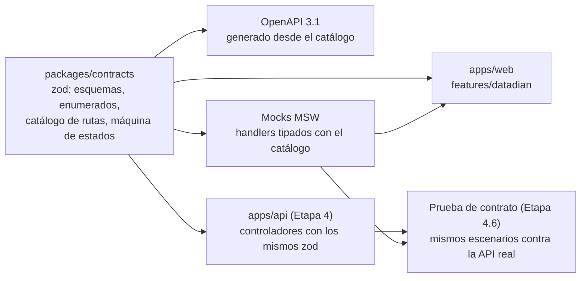
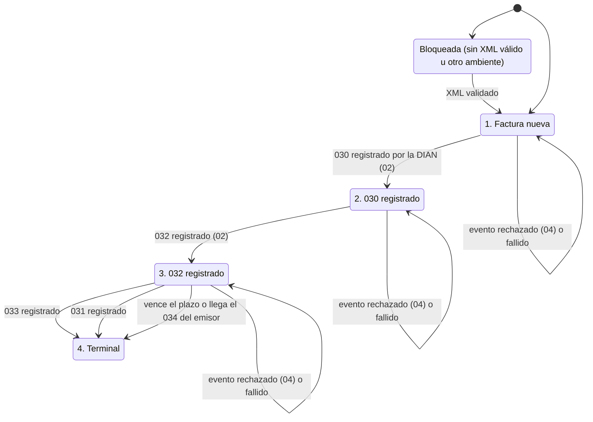

# Arquitectura del frontend de DataDian

| Campo | Valor |
|---|---|
| Fecha | 12 de noviembre de 2026 |
| Módulo | 04, **DataDian**. Identificador interno: `documents` |
| Etapa | **Etapa 3: Frontend**, del orden fijado por el usuario el 12-nov-2026 (§1.1) |
| Estado | **Diseño propuesto.** No se implementa hasta que el usuario lo ordene. No incluye código de producción |
| Base | Blueprint oficial [`arquitectura Eventos RADIAN DIAN.md`](<DataDian/arquitectura Eventos RADIAN DIAN.md>) §2 (RF7), §4.2 y §6; soporte: [`Automatización Eventos RADIAN DIAN.md`](<DataDian/Automatización Eventos RADIAN DIAN.md>), [`Facturación Electrónica DIAN Colombia.md`](<DataDian/Facturación Electrónica DIAN Colombia.md>) y [`especificacion_certificado_pfx_telco.md`](DataDian/especificacion_certificado_pfx_telco.md); [ARQUITECTURA_DB_DATADIAN.md](ARQUITECTURA_DB_DATADIAN.md) (Etapa 2: tablas, estados y códigos `DD0xx`); [ARQUITECTURA_DATADIAN_TELCO.md](ARQUITECTURA_DATADIAN_TELCO.md) §7; [ADR-003](../../decisions/ADR-003-frontend.md), [ADR-007](../../decisions/ADR-007-marca-y-ui.md), [ADR-014](../../decisions/ADR-014-arquitectura-datadian-telco.md); código conservado en `apps/web/src/features/datadian/` |
| Documento hermano | [ARQUITECTURA_BACKEND_DATADIAN.md](ARQUITECTURA_BACKEND_DATADIAN.md) (Etapa 4). Implementa los contratos de la §3 de este documento sin cambiarlos |
| Criterio de salida | Todas las pantallas de la §5 funcionan contra los mocks de la §4; los contratos de la §3 están publicados en `packages/contracts` (zod y OpenAPI); las pruebas unitarias, de componentes y E2E de la §9 pasan en la CI, sin violaciones graves de accesibilidad |

Las etiquetas siguen la convención de [ARQUITECTURA_DATADIAN_TELCO.md](ARQUITECTURA_DATADIAN_TELCO.md): **[PROPUESTA]** es una decisión de diseño que el usuario debe confirmar (resumen en la §13) y **[POR VERIFICAR n]** remite al punto n de la §12, donde cada dato regulatorio tiene su fuente primaria pendiente.

---

## 1. Alcance

### 1.1 Orden de etapas

El 12-nov-2026 el usuario fijó este orden para DataDian. Reemplaza cualquier otra numeración:

| Etapa | Contenido |
|---|---|
| 1 | Fundaciones (cerrada) |
| 2 | Base de datos ([ARQUITECTURA_DB_DATADIAN.md](ARQUITECTURA_DB_DATADIAN.md)) |
| **3** | **Frontend (este documento)** |
| 4 | Backend: Telco y API ([ARQUITECTURA_BACKEND_DATADIAN.md](ARQUITECTURA_BACKEND_DATADIAN.md)) |
| 5 | Integración con Odoo 19 |
| 6 | CRM y notificaciones |

Cada etapa se divide en subetapas (3.1, 3.2…). [ADR-014](../../decisions/ADR-014-arquitectura-datadian-telco.md), [ARQUITECTURA_DATADIAN_TELCO.md](ARQUITECTURA_DATADIAN_TELCO.md) §9 y la ficha anterior del frontend ponían el frontend después del backend. Desde el 12-nov-2026 los tres siguen este orden (enmienda de ADR-014); la ficha corta de esta etapa es [`ETAPA_3_FRONTEND.md`](../../etapas/ETAPA_3_FRONTEND.md) y la ruta completa, [RUTA_DE_TRABAJO_DATADIAN.md](RUTA_DE_TRABAJO_DATADIAN.md) (§13, decisión 14, resuelta).

### 1.2 Contrato primero

El frontend se construye **antes** que el backend. Para que eso no produzca dos verdades, el orden de trabajo es:



1. Los esquemas zod, los enumerados (alineados con los `CHECK` de la Etapa 2), el catálogo de rutas y la máquina de estados de los botones se escriben en `packages/contracts` (subetapa 3.1).
2. El OpenAPI de DataDian se **genera desde ese catálogo**, no desde los controladores (§3.1) **[PROPUESTA]**.
3. Los mocks validan cada respuesta con el mismo esquema zod antes de entregarla: un mock que no cumple el contrato rompe la prueba.
4. En la Etapa 4 la API importa los mismos esquemas en sus `ZodPipe` y una prueba de contrato ejecuta los escenarios de los mocks contra la API real (subetapa 4.6 del backend).

Si durante la Etapa 4 hace falta cambiar un contrato, el cambio se hace en `packages/contracts` y entra con su ajuste en los mocks y en la interfaz en el mismo PR.

### 1.3 Qué entra y qué no

**Entra en la Etapa 3:** los contratos de API de DataDian; los mocks; la bandeja, la vista dividida (visor y línea de tiempo), los botones según la máquina de estados, el modal de reclamo, el semáforo del plazo, la configuración DIAN por organización (certificado, ambiente, software, buzones), el estado de las sincronizaciones y de la cola, la traza de las respuestas 02 y 04 de la DIAN, el sondeo y el cliente SSE (desactivado hasta la 4.6), la accesibilidad, los textos es-CO y las pruebas.

**No entra:** la API real y Telco (Etapa 4); el borrador en Odoo, cuyo disparador se redefine en la Etapa 5 (la conexión con Odoo y la decisión interna actuales se conservan, §10); las notificaciones por correo y la campana de la Zona 0 (Etapa 6); la emisión del 034, que es del emisor (ADR-011).

---

## 2. Estructura del feature

### 2.1 Carpetas

`features/datadian/` crece de 6 a unos 35 archivos. Se agrupa por pantalla, con un `README.md` por carpeta como el resto del repositorio **[PROPUESTA]**:

```
apps/web/src/features/datadian/
├── README.md
├── api/            # llaves de consulta, queryOptions, mutaciones, reglas de sondeo
│   ├── keys.ts
│   ├── queries.ts
│   ├── mutations.ts      # incluye la generación de Idempotency-Key por intención
│   └── polling.ts
├── inbox/          # bandeja: página, columnas, filtros, cifras, parámetros de búsqueda
├── invoice/        # vista dividida: visor, línea de tiempo, traza DIAN, datos y plazo
├── actions/        # botones de eventos (usa la máquina de estados de contracts), modales
├── settings/       # DIAN (certificado, ambiente, software, buzones) y Odoo (conservado)
├── sync/           # sincronizaciones RPA/IMAP/manual, carga de XML y cola de trabajos
├── shared/         # insignias, semáforo, formateo de CUFE/CUDE, mapa de errores
├── live/           # cliente SSE e invalidaciones (§6)
└── mocks/          # handlers MSW, motor de escenarios y fixtures (§4); fuera del bundle de producción
```

La máquina de estados de los botones **no** vive en el feature: es una función pura en `packages/contracts` (§5.3) porque la usan la interfaz, los mocks y, en la Etapa 4, la API.

### 2.2 Rutas, submódulos y navegación

El shell resuelve `/app/$module/$submodule` con el mapa `PAGES` de `apps/web/src/app/module-pages.tsx` y filtra por permisos con `filterNavigation` de `packages/contracts/src/navigation.ts`. DataDian conserva ese mecanismo; los identificadores son estables porque van en URLs y permisos:

| Submódulo (`id`) | Texto visible | Permiso para ver | Ruta | Estado |
|---|---|---|---|---|
| `invoices` | Bandeja de recepción (hoy "Tablero de facturas") | `documents:view` | `/app/documents/invoices` | Existe; se rehace |
| `sync` | Sincronizaciones | `documents:view` | `/app/documents/sync` | **Nuevo** |
| `settings` | Configuración | `documents:configure` | `/app/documents/settings` | Existe; se amplía |

Se agrega `{ id: 'sync', permission: 'documents:view' }` a `NAVIGATION`, su texto en `t.navigation.documents.submodules` y su página perezosa en `PAGES`.

**Parámetros de búsqueda.** Los filtros y la factura abierta van en la URL, para compartir un enlace y para que "atrás" funcione. Cada página los valida con un esquema zod del feature (`inboxSearchSchema`) y usa valores por defecto si llegan mal **[PROPUESTA]**:

| Parámetro | Ejemplo | Uso |
|---|---|---|
| `from`, `to` | `2026-11-01` | Rango de fecha de emisión. Por defecto, el mes en curso |
| `q` | `800153993` o un CUFE | NIT del proveedor o CUFE (§5.1) |
| `radian` | `none,acknowledged` | Estados RADIAN, separados por coma |
| `deadline` | `due_soon` | Estado del plazo |
| `validation`, `source`, `payment` | `invalid`, `rpa`, `2` | Validación del XML, canal de ingesta, forma de pago |
| `invoice` | uuid | Factura abierta en la vista dividida |
| `view` | `content`, `xml`, `pdf` | Pestaña del visor |

### 2.3 Distribución en las zonas del shell

El blueprint pide que, al elegir una factura, "la pantalla se divida": visor a la izquierda y línea de tiempo a la derecha (§6.2). El shell ya tiene esa división: la Zona 2 (área de trabajo) a la izquierda y la Zona 3 (panel de contexto, ~28 %) a la derecha **[PROPUESTA]**:

| Situación | Zona 2 (`Workspace`) | Zona 3 (`ContextPanel`) |
|---|---|---|
| Bandeja sin factura elegida | Cifras, filtros y grilla | Ayuda breve y avisos (certificado, plazos que vencen) |
| Factura elegida (`?invoice=`) | **Visor documental** con pestañas, encabezado con número, proveedor, total y "Volver a la bandeja" | **Línea de tiempo RADIAN**, semáforo del plazo, botones de eventos y datos clave |
| Pantalla angosta (< 1024 px) | Visor | Pasa debajo del visor, como hace hoy el shell |

Así la vista dividida no inventa un diseño nuevo: reutiliza las zonas, su scroll propio y su `routeKey` para la animación.

### 2.4 Permisos (RBAC)

Se usan los permisos de la Etapa 2 (ARQUITECTURA_DB_DATADIAN.md §9.4). Dos son nuevos y se siembran en `owner` y `accountant` **[PROPUESTA]**:

| Permiso | Qué habilita en la interfaz |
|---|---|
| `documents:view` (existe) | Ver bandeja, cifras, visor, línea de tiempo, traza de la DIAN, plazos, reglas, estado de sincronizaciones y de la cola |
| `documents:events` (**nuevo**) | Botones 030, 032, 033 y 031, y el modal de reclamo |
| `documents:sync` (**nuevo**) | "Sincronizar ahora", subir XML a mano, reencolar o cancelar trabajos |
| `documents:configure` (existe) | Submódulo Configuración: DIAN, certificado, buzones IMAP y Odoo |
| `documents:decide` (existe) | Decisión interna heredada y reintento a Odoo, mientras la Etapa 5 no la redefina (§10) |

Reglas de presentación:

- **Sin permiso, no se muestra la acción.** Un usuario sin `documents:events` ve la línea de tiempo con un aviso "Solo lectura: su rol no puede registrar eventos".
- **Con permiso pero bloqueada por la máquina de estados, se muestra inactiva con el motivo escrito** (§5.3). Nunca un botón gris sin explicación.
- La interfaz no es la barrera: la API vuelve a comprobar el permiso y la base de datos la secuencia (Etapa 2, `radian_events_sequence_guard`). La interfaz solo evita que el usuario se equivoque.
- Los permisos se leen de `permissionsQuery` (ya existe) y se exponen con un *hook* `useDatadianPermissions()`.

---

## 3. Contratos de API

### 3.1 Dónde viven y cómo se publican

| Pieza | Ubicación | Notas |
|---|---|---|
| Enumerados, esquemas y tipos | `packages/contracts/src/schemas/datadian/*.ts` | Uno por recurso. `received-document.ts` se conserva y se extiende |
| Catálogo de rutas | `packages/contracts/src/datadian/routes.ts` | Por ruta: método, camino, permiso, esquemas de parámetros, cuerpo, respuesta y tipos de error |
| Máquina de estados | `packages/contracts/src/datadian/radian-actions.ts` | Función pura (§5.3) |
| OpenAPI | `packages/contracts/openapi/datadian.openapi.json` | Generado desde el catálogo con `z.toJSONSchema` (zod 4) por un script `pnpm --filter @telcobras/contracts openapi:datadian` **[PROPUESTA]** |
| Tipos del cliente HTTP | `pnpm --filter @telcobras/contracts generate:api` (ya existe, con `openapi-typescript`) | Reemplaza, para DataDian, el `paths` escrito a mano de `apps/web/src/lib/api-schema.ts` |

Hoy el OpenAPI del repositorio es *code-first*: `apps/api/src/openapi.ts` lo arma desde los controladores de Nest. Para DataDian eso no sirve, porque los controladores llegan en la Etapa 4. Por eso el OpenAPI de DataDian sale del catálogo; en la Etapa 4 una prueba compara las rutas del OpenAPI de Nest con el catálogo (§9.4).

Convenciones del repositorio que se mantienen: prefijo `/api/v1/documents`; paginación por cursor (`cursorPageQuerySchema`, `cursorPageSchema`); errores RFC 9457 (`problemDetailsSchema`); importes como texto decimal (`"77901.00"`); fechas ISO 8601 con desplazamiento; `Idempotency-Key` en mutaciones (`IdempotencyInterceptor`).

### 3.2 Enumerados

Todos copian literalmente los `CHECK` de la Etapa 2. Si la base cambia, cambia aquí en el mismo PR.

```ts
// packages/contracts/src/schemas/datadian/enums.ts
export const DIAN_ENVIRONMENTS = ['1', '2'] as const;               // 1 producción, 2 habilitación
export const RADIAN_EVENT_CODES = ['030', '031', '032', '033', '034'] as const;
export const REQUESTABLE_EVENT_CODES = ['030', '031', '032', '033'] as const; // la suite nunca pide el 034
export const RADIAN_EVENT_STATUSES = ['pending', 'accepted', 'rejected', 'failed'] as const;
export const RADIAN_EVENT_ORIGINS = ['suite', 'dian'] as const;
export const RADIAN_EVENT_ACTORS = ['buyer', 'issuer'] as const;
export const RADIAN_STATUSES = [
  'none', 'acknowledged', 'goods_received', 'claimed', 'accepted_express', 'accepted_tacit',
] as const;
export const VALIDATION_STATUSES = ['pending_xml', 'pending_validation', 'valid', 'invalid'] as const;
export const INGESTION_SOURCES = ['rpa', 'imap', 'manual'] as const;
export const DEADLINE_STATES = ['none', 'open', 'due_soon', 'expired'] as const; // vista received_documents_radian
export const PAYMENT_FORMS = ['1', '2'] as const;                    // 1 contado, 2 crédito [POR VERIFICAR 8]
export const CERTIFICATE_STATUSES = ['pending_validation', 'valid', 'invalid', 'retired'] as const;
export const CERTIFICATE_EXPIRY_STATES = ['ok', 'due_soon', 'expired'] as const; // due_soon: 90 días o menos
export const CERTIFICATE_CHECKS = [
  'format', 'validity', 'key_usage_critical', 'key_usage_purposes',
  'signature_algorithm', 'chain', 'nit_match',
] as const;
export const SYNC_CHANNELS = ['rpa', 'imap', 'manual'] as const;
export const SYNC_TRIGGERS = ['schedule', 'user', 'system'] as const;
export const SYNC_STATUSES = ['queued', 'running', 'succeeded', 'partial', 'failed'] as const;
export const TELCO_JOB_KINDS = [
  'rpa_sync', 'imap_sync', 'xml_fetch', 'xml_ingest', 'radian_event_send',
  'radian_status_query', 'certificate_check', 'odoo_push',
] as const;
export const TELCO_JOB_STATUSES = ['queued', 'running', 'succeeded', 'dead', 'cancelled'] as const;
export const EVENT_ATTEMPT_OUTCOMES = [
  'accepted', 'rejected', 'already_processed', 'transport_error', 'timeout', 'local_error',
] as const;
// Conceptos del reclamo 031: se reutiliza REJECTION_CODES ('01'…'04') de received-document.ts [POR VERIFICAR 19]
```

### 3.3 Esquemas principales

Esbozo de diseño; los nombres de campo son los de la Etapa 2 en *camelCase*.

```ts
// Factura de la bandeja. Extiende receivedDocumentSchema (se conservan sus campos, §3.7).
export const radianInvoiceSchema = receivedDocumentSchema.extend({
  importId: z.uuid().nullable(),                        // CAMBIO: nulable desde la migración 0013
  syncRunId: z.uuid().nullable(),
  ingestionSource: z.enum(INGESTION_SOURCES),
  issuedAt: z.iso.datetime({ offset: true }).nullable(),
  dueDate: z.iso.date().nullable(),
  dianValidatedAt: z.iso.datetime({ offset: true }).nullable(),
  buyerNit: z.string().nullable(),
  currency: z.string().length(3).nullable(),
  subtotal: amount.nullable(),
  taxTotal: amount.nullable(),
  paymentForm: z.enum(PAYMENT_FORMS).nullable(),
  paymentMeansCode: z.string().nullable(),
  ublTypeCode: z.string().nullable(),
  profileExecutionId: z.enum(DIAN_ENVIRONMENTS).nullable(),
  validationStatus: z.enum(VALIDATION_STATUSES),
  validationErrors: z.array(z.object({ code: z.string(), message: z.string() })),
  radianStatus: z.enum(RADIAN_STATUSES),
  radianStatusAt: z.iso.datetime({ offset: true }).nullable(),
  deadline: z.object({
    claimDeadlineAt: z.iso.datetime({ offset: true }).nullable(),
    state: z.enum(DEADLINE_STATES),
    businessDaysRemaining: z.int().min(0).nullable(),   // lo calcula el servidor con el calendario de la BD
    ruleVersion: z.int().nullable(),
    ruleVerified: z.boolean(),                          // radian_deadline_rules.verified
  }),
  eventsExpected: z.boolean().nullable(),               // payment_form = '2' [POR VERIFICAR 8]
  notesBlocked: z.boolean(),                            // 033 o 034 aceptados
  acceptedEventCodes: z.array(z.enum(RADIAN_EVENT_CODES)), // del ambiente configurado, ambos orígenes
  pendingEvent: z.object({ id: z.uuid(), eventCode: z.enum(REQUESTABLE_EVENT_CODES),
                           since: z.iso.datetime({ offset: true }) }).nullable(),
  hasAttachedDocument: z.boolean(),
});

// Detalle: lo anterior más impuestos y la instantánea del listado que corrigió el XML.
export const radianInvoiceDetailSchema = radianInvoiceSchema.extend({
  taxes: z.array(z.object({ taxSchemeId: z.string(), percent: z.string().nullable(),
    taxableAmount: amount, taxAmount: amount, isWithholding: z.boolean() })),
  listingSnapshot: z.record(z.string(), z.unknown()).nullable(),   // pre_xml_snapshot
});

// Evento de la línea de tiempo.
export const radianEventSchema = z.object({
  id: z.uuid(),
  receivedDocumentId: z.uuid(),
  eventCode: z.enum(RADIAN_EVENT_CODES),
  actor: z.enum(RADIAN_EVENT_ACTORS),
  origin: z.enum(RADIAN_EVENT_ORIGINS),
  environment: z.enum(DIAN_ENVIRONMENTS),
  status: z.enum(RADIAN_EVENT_STATUSES),
  claimCode: z.enum(REJECTION_CODES).nullable(),
  claimNote: z.string().nullable(),
  cude: z.string().regex(/^[0-9a-f]{96}$/).nullable(),
  generatedAt: z.iso.datetime({ offset: true }).nullable(),
  sentAt: z.iso.datetime({ offset: true }).nullable(),
  dianRegisteredAt: z.iso.datetime({ offset: true }).nullable(),
  dianStatusCode: z.string().nullable(),                 // código crudo [POR VERIFICAR 18]
  errorMessage: z.string().nullable(),
  errorTrace: z.array(z.object({ code: z.string(), message: z.string() })),
  attempts: z.int().min(0),
  requestedBy: z.object({ id: z.uuid(), name: z.string() }).nullable(),
  hasRequestXml: z.boolean(),
  hasResponseXml: z.boolean(),
  createdAt: z.iso.datetime({ offset: true }),
});

export const radianEventDetailSchema = radianEventSchema.extend({
  attemptsLog: z.array(z.object({
    attemptNo: z.int(), startedAt: z.iso.datetime({ offset: true }),
    finishedAt: z.iso.datetime({ offset: true }).nullable(),
    outcome: z.enum(EVENT_ATTEMPT_OUTCOMES), httpStatus: z.int().nullable(),
    dianStatusCode: z.string().nullable(), durationMs: z.int().nullable(),
    errorTrace: z.array(z.object({ code: z.string(), message: z.string() })),
  })),
});

// Pedido de un evento. Encabezado Idempotency-Key obligatorio.
const issuerPersonSchema = z.object({               // [POR VERIFICAR 12]: ¿lo exigen el 030 y el 032?
  idType: z.string().min(1).max(3), idNumber: z.string().regex(/^[0-9]{3,15}$/),
  firstName: z.string().trim().min(1).max(100), familyName: z.string().trim().min(1).max(100),
  jobTitle: z.string().trim().max(100).optional(), department: z.string().trim().max(100).optional(),
});
export const radianEventRequestSchema = z.discriminatedUnion('eventCode', [
  z.object({ eventCode: z.literal('030'), issuerPerson: issuerPersonSchema.optional() }),
  z.object({ eventCode: z.literal('032'), issuerPerson: issuerPersonSchema.optional() }),
  z.object({ eventCode: z.literal('033') }),
  z.object({ eventCode: z.literal('031'), claimCode: z.enum(REJECTION_CODES),
             claimNote: z.string().trim().max(1000).optional() }),
]);

// Configuración DIAN. El PIN se escribe y nunca se lee.
export const dianSettingsSchema = z.object({
  nit: z.string(), nitDv: z.string().nullable(),
  environment: z.enum(DIAN_ENVIRONMENTS),
  operationMode: z.enum(['own_software', 'technology_provider']),
  softwareId: z.uuid().nullable(), softwarePinSet: z.boolean(),
  testSetId: z.string().nullable(),
  activeCertificateId: z.uuid().nullable(),
  rpaEnabled: z.boolean(), imapEnabled: z.boolean(),
  syncLookbackDays: z.int().min(1).max(92),
  updatedAt: z.iso.datetime({ offset: true }),
});
export const dianSettingsInputSchema = z.object({
  nit: z.string().regex(/^[0-9]{5,15}$/), nitDv: z.string().regex(/^[0-9]$/).nullable(),
  environment: z.enum(DIAN_ENVIRONMENTS),
  operationMode: z.enum(['own_software', 'technology_provider']),
  softwareId: z.uuid().nullable(),
  softwarePin: z.string().trim().min(1).max(20).optional(), // ausente = conservar el guardado
  testSetId: z.string().trim().max(100).nullable(),
  rpaEnabled: z.boolean(), imapEnabled: z.boolean(),
  syncLookbackDays: z.int().min(1).max(92),
});

// Certificado. Nunca incluye la contraseña, la llave de datos ni el archivo.
export const dianCertificateSchema = z.object({
  id: z.uuid(), status: z.enum(CERTIFICATE_STATUSES), isActive: z.boolean(),
  pfxSha256: z.string().regex(/^[0-9a-f]{64}$/), pfxSizeBytes: z.int(),
  serialNumber: z.string().nullable(), subjectNit: z.string().nullable(),
  subjectDn: z.string().nullable(), issuerDn: z.string().nullable(),
  notBefore: z.iso.datetime({ offset: true }).nullable(),
  notAfter: z.iso.datetime({ offset: true }).nullable(),
  signatureAlgorithm: z.string().nullable(),
  checks: z.array(z.object({ check: z.enum(CERTIFICATE_CHECKS),
    status: z.enum(['pending', 'ok', 'failed']), detail: z.string().optional() })),
  daysToExpiry: z.int().nullable(), expiryState: z.enum(CERTIFICATE_EXPIRY_STATES).nullable(),
  uploadedBy: z.object({ id: z.uuid(), name: z.string() }),
  createdAt: z.iso.datetime({ offset: true }), validatedAt: z.iso.datetime({ offset: true }).nullable(),
  retiredAt: z.iso.datetime({ offset: true }).nullable(),
});
```

Los demás esquemas siguen el mismo patrón y se listan sin código: `invoiceContentSchema` (contenido normalizado para el visor: partes, líneas, impuestos, totales, forma y medio de pago, validación previa de la DIAN), `radianSummarySchema` (cifras por estado RADIAN, por estado del plazo y por validación, más las cifras heredadas), `radianRulesSchema` (copia de `radian_event_rules` y de la regla de plazo activa, con `verified` y `source`), `dianReadinessSchema` (lista de chequeo de habilitación, §5.6), `imapMailboxSchema` e `imapMailboxInputSchema` (el secreto solo se escribe), `syncRunSchema` y `syncRunRequestSchema`, `syncStatusSchema` (último y próximo trabajo por canal), `telcoJobSchema` (sin `payload`: tipo, estado, intentos, `runAt`, `lastError` saneado y el recurso relacionado), `datadianHealthSchema` (Zona 4) y `datadianStreamEventSchema` (§6).

### 3.4 Catálogo de endpoints

Todos bajo `/api/v1/documents`, con `SessionGuard` y `OrganizationGuard`. La columna "Etapa 4" indica qué subetapa del backend lo implementa.

| # | Método y ruta | Permiso | Entrada | Respuesta | Errores propios | Etapa 4 |
|---|---|---|---|---|---|---|
| E1 | `GET /received` | view | `radianInvoiceListQuery` (§5.1) | `CursorPage<RadianInvoice>` | 400 | 4.3 |
| E2 | `GET /received/summary` | view | — | `RadianSummary` | — | 4.5 |
| E3 | `GET /received/{id}` | view | — | `RadianInvoiceDetail` | 404 | 4.3 |
| E4 | `GET /received/{id}/content` | view | — | `InvoiceContent` | 404, 409 `xml-missing` | 4.3 |
| E5 | `GET /received/{id}/xml?part=attached\|invoice\|validation` | view | — | `application/xml` | 404 | 4.3 |
| E6 | `GET /received/{id}/pdf` | view | — | `application/pdf` (existe) | 404 | — |
| E7 | `GET /received/{id}/events` | view | — | `RadianEvent[]` (sin paginar: una factura tiene pocos eventos; tope 100) | 404 | 4.4 |
| E8 | `GET /received/{id}/events/{eventId}` | view | — | `RadianEventDetail` | 404 | 4.4 |
| E9 | `GET /received/{id}/events/{eventId}/xml?part=request\|response` | view | — | `application/xml` | 404 | 4.4 |
| E10 | `POST /received/{id}/events` | events | `RadianEventRequest` + `Idempotency-Key` | **202** `RadianEvent` (`pending`) | 400, 403, 404, 409, 422 (§3.5) | 4.4 |
| E11 | `GET /radian/rules` | view | — | `RadianRules` | — | 4.5 |
| E12 | `GET /settings` | view | — | `DocumentsSettings` = `{ odoo, dian }` (se amplía) | — | 4.1 |
| E13 | `PUT /settings/dian` | configure | `DianSettingsInput` | `DianSettings` | 409 `nit-taken`, 422 `production-not-ready` | 4.1 |
| E14 | `GET /settings/dian/readiness` | view | — | `DianReadiness` | — | 4.5 |
| E15 | `GET /settings/dian/certificates` | configure | — | `DianCertificate[]` | — | 4.1 |
| E16 | `POST /settings/dian/certificates` | configure | `multipart/form-data`: `file` (≤ 65 536 bytes) y `password` + `Idempotency-Key` | **202** `DianCertificate` (`pending_validation`) | 400 `bad-file`, 409 `duplicate-certificate`, 413 | 4.1 |
| E17 | `GET /settings/dian/certificates/{id}` | configure | — | `DianCertificate` | 404 | 4.1 |
| E18 | `POST /settings/dian/certificates/{id}/activate` | configure | — | `DianSettings` | 422 `certificate-invalid` (`DD010`) | 4.1 |
| E19 | `POST /settings/dian/certificates/{id}/retire` | configure | — | `DianCertificate` | 409 `certificate-active` | 4.1 |
| E20 | `GET /settings/dian/mailboxes` | configure | — | `ImapMailbox[]` | — | 4.3 |
| E21 | `POST /settings/dian/mailboxes` | configure | `ImapMailboxInput` | `ImapMailbox` | 409 `duplicate-mailbox` | 4.3 |
| E22 | `PUT /settings/dian/mailboxes/{id}` | configure | `ImapMailboxInput` (secreto opcional) | `ImapMailbox` | 404 | 4.3 |
| E23 | `GET /sync/status` | view | — | `SyncStatus` | — | 4.3 |
| E24 | `GET /sync-runs` | view | `channel`, `status`, cursor | `CursorPage<SyncRun>` | — | 4.3 |
| E25 | `GET /sync-runs/{id}` | view | — | `SyncRunDetail` (errores por CUFE) | 404 | 4.3 |
| E26 | `POST /sync-runs` | sync | `{ channel: 'rpa' \| 'imap', periodStart?, periodEnd?, mailboxId? }` + `Idempotency-Key` | **202** `SyncRun` | 409 `sync-running`, 422 `channel-disabled`, `certificate-missing` | 4.3 |
| E27 | `POST /received/xml-upload` | sync | `multipart`: `.xml` o `.zip` (≤ 5 MB) | **202** `SyncRun` (`manual`) | 400, 413 | 4.3 |
| E28 | `GET /jobs` | sync | `status`, `kind`, cursor | `CursorPage<TelcoJob>` | — | 4.5 |
| E29 | `POST /jobs/{id}/retry` | sync | — | `TelcoJob` (`dead → queued`) | 409 `job-not-dead` | 4.5 |
| E30 | `POST /jobs/{id}/cancel` | sync | — | `TelcoJob` (`queued → cancelled`) | 409 `job-not-queued` | 4.5 |
| E31 | `GET /status` | view | — | `DatadianHealth` (Zona 4) | — | 4.5 |
| E32 | `GET /stream` | view | — | `text/event-stream` (§6) | — | 4.6 |

Se conservan sin cambios de forma: `POST /received/{id}/decision`, `POST /received/{id}/odoo-sync`, `GET /received/{id}/history`, `PUT /settings/odoo` y `POST /settings/odoo/test`.

No hay `DELETE` en DataDian: facturas, eventos, certificados y buzones no se borran (Etapa 2, §2.2). Un certificado se retira y un buzón se desactiva.

### 3.5 Errores

Cuerpo `application/problem+json` con dos extensiones **[PROPUESTA]**: `code` (el `SQLSTATE` `DD0xx` de la Etapa 2 o un código de la API) y `type` con la forma `urn:telcobras:datadian:<slug>`. La interfaz decide por `code`, nunca por el texto.

| HTTP | `code` | `type` (slug) | Origen | Qué muestra la interfaz |
|---|---|---|---|---|
| 409 | `DD001` | `out-of-sequence` | Disparador de secuencia | "Falta un evento previo registrado por la DIAN" y refresca la factura |
| 409 | `DD002` | `event-blocked` | Disparador | "El proveedor ya registró la aceptación tácita (034)" u otro bloqueo |
| 409 | `DD003` | `invoice-terminal` | Disparador | "La factura ya no admite eventos" |
| 409 | `23505` en `radian_events_one_live_per_code` | `event-in-progress` | Índice único parcial | "Ya hay un evento igual en curso" |
| 422 | `DD007` | `invoice-not-valid` | Disparador | "La factura aún no tiene el XML oficial validado" |
| 422 | `DD008` | `environment-mismatch` | Disparador | "La factura es de otro ambiente de la DIAN" |
| 422 | `DD009` | `claim-deadline-expired` | Disparador, solo si la regla lo exige | "Venció el plazo del reclamo" |
| 422 | `DD010` | `certificate-invalid` | Disparador de configuración | "El certificado no es válido o es de otro NIT" |
| 422 | `API_SOFTWARE_MISSING` | `software-missing` | API | "Falta el SoftwareID y el PIN para enviar eventos" (D-14) |
| 422 | `API_PRODUCTION_NOT_READY` | `production-not-ready` | API | Lista de chequeo incompleta (§5.6) |
| 403 | — | `forbidden` | Permisos | Oculta la acción y refresca permisos |

`DD004`, `DD005` y `DD006` no deberían llegar a la interfaz en un uso normal: se muestran como error genérico con el `correlationId` para soporte.

### 3.6 Idempotencia y concurrencia en el cliente

- **Una llave por intención.** Al abrir la confirmación de un evento (o el modal de reclamo) se genera `crypto.randomUUID()`; los reintentos de red de esa misma confirmación reutilizan la llave; cerrar y volver a abrir genera otra. La API la guarda en Valkey 24 h (interceptor existente) y la Etapa 2 la usa como `radian_events.idempotency_key` (único por organización).
- **Doble clic y dos pestañas.** El botón se desactiva mientras la mutación está en curso; si otra pestaña ya pidió el evento, el índice único parcial responde 409 `event-in-progress` y la interfaz refresca la factura en lugar de mostrar un error.
- **Sin actualización optimista del estado RADIAN.** La respuesta 202 trae el evento `pending`, que se inserta en la línea de tiempo; el estado de la factura solo cambia cuando la DIAN registra el evento (principio 3 de la arquitectura).

### 3.7 Cambios sobre el contrato actual

| Cambio | Compatibilidad |
|---|---|
| `receivedDocumentSchema.importId` pasa a nulable | **Rompe** a quien asuma que siempre existe. Hoy solo lo usa la prueba `datadian.test.tsx` |
| `receivedDocumentListQuerySchema` gana filtros (`from`, `to`, `q`, `radianStatus`…) | Compatible: todos opcionales |
| `documentsSettingsSchema` gana `dian` | Compatible |
| Nuevos permisos `documents:events` y `documents:sync` en `PERMISSIONS` | Compatible; la siembra es de la migración `0017` |
| Nuevo submódulo `sync` en `NAVIGATION` | Compatible |

### 3.8 Lo que la interfaz necesita y la Etapa 2 todavía no tiene

Al escribir los contratos aparecieron dos huecos que dependen de puntos por verificar. Se dejan aquí para que el usuario decida antes de cerrar la Etapa 2:

1. **Datos de la persona en el 030 y el 032.** La referencia de APIDIAN (`send-event-data`) envía `issuer_party` con identificación, nombres, cargo y dependencia de quien recibe. Si el anexo lo exige **[POR VERIFICAR 12]**, `radian_events` necesita una columna (por ejemplo `issuer_person jsonb`, inmutable) y la organización un responsable por defecto. El contrato ya lo trae como opcional.
2. **Número del documento del evento (`cbc:ID`).** `radian_events` no tiene consecutivo. Si el anexo exige un consecutivo por emisor **[POR VERIFICAR 13]**, la base necesita una secuencia por organización. No afecta a la interfaz salvo para mostrarlo.

---

## 4. Estrategia de mocks

### 4.1 Herramienta: MSW

**[PROPUESTA]** Mock Service Worker 2 (`msw`, dependencia de desarrollo nueva) por tres razones: intercepta en la capa de red, así que el código de `features/datadian` usa el `api` real de `openapi-fetch` sin saber que hay un mock; el mismo juego de *handlers* sirve en el navegador (`msw/browser`), en Vitest (`msw/node`) y en Playwright; y soporta respuestas en *stream*, necesarias para probar el cliente SSE.

Hoy `datadian.test.tsx` reemplaza `api` con `vi.mock`. Ese patrón se sustituye por MSW en DataDian; las demás pruebas del repositorio no cambian.

### 4.2 Motor de escenarios

Los *handlers* no devuelven respuestas fijas: comparten un **estado en memoria** (`mocks/db.ts`) y un **reloj** controlable, y simulan lo que harán Telco y la DIAN:

| Situación simulada | Comportamiento del mock |
|---|---|
| Pedir un evento | Responde 202 con el evento `pending`; tras `latency` (por defecto 2 s) lo pasa a `accepted` con un CUDE de 96 hexadecimales generado y `dianRegisteredAt`; actualiza `radianStatus` y, si es el 032, `claimDeadlineAt` |
| Rechazo de la DIAN | En la factura marcada `scenario: 'dian-rejects'`, el evento pasa a `rejected` con `dianStatusCode: '04'` y una traza de ejemplo **marcada como ficticia** |
| Falla local | `scenario: 'telco-fails'`: el evento pasa a `failed` con `errorMessage` |
| Secuencia | Aplica `deriveRadianActions` (§5.3) con las reglas mock: un pedido fuera de orden responde 409 `DD001`, como la base de datos |
| 034 del emisor | `scenario: 'tacit-acceptance'`: al vencer el plazo aparece un 034 con `origin: 'dian'` |
| Certificado | Al subirlo queda `pending_validation` y a los 3 s pasa a `valid` o `invalid` según el nombre del archivo de prueba (`vencido.pfx`, `otro-nit.pfx`, `sin-no-repudio.pfx`) |
| Sincronización | `queued → running → succeeded` con contadores; `scenario: 'zero-rows'` termina `partial` con la advertencia de listado vacío |
| Plazo | El reloj del mock permite mover "ahora" para pasar de `open` a `due_soon` y a `expired` |

El motor es determinista con una semilla, para que las pruebas no dependan del azar. Las trazas de la DIAN que use deben ser textos del propio repositorio rotulados "ejemplo", nunca códigos de regla inventados presentados como reales.

### 4.3 Fixtures

- `mocks/fixtures/invoices.ts`: unas 40 facturas que cubren todos los estados RADIAN, de validación y de plazo, contado y crédito, los tres canales de ingesta y la factura heredada sin XML.
- `mocks/fixtures/content/*.json`: contenido normalizado para el visor. Los XML de ejemplo (`AttachedDocument`) se anonimizan (NIT y nombres ficticios) y se guardan en `mocks/fixtures/xml/`.
- Fábricas (`makeInvoice`, `makeEvent`) que **siempre** pasan por `schema.parse`: un fixture que no cumple el contrato falla al cargarse.

### 4.4 Modos de uso

| Modo | Cómo se activa | Uso |
|---|---|---|
| Desarrollo con mocks | `VITE_DATADIAN_MOCKS=1 pnpm --filter @telcobras/web dev` | Construir pantallas sin API. El *worker* se importa de forma dinámica solo si `import.meta.env.DEV` y la variable están activos: no entra en el bundle de producción (una prueba lo verifica buscando `msw` en `dist/`) |
| Pruebas de componentes | `setupServer` de `msw/node` en `test/datadian/setup.ts` | Vitest y Testing Library |
| E2E de la Etapa 3 | Playwright contra `vite preview` construido con los mocks | Recorridos completos sin backend |
| E2E de la Etapa 4.6 | Playwright contra la API real con Telco falso | Los mismos archivos `.spec.ts`; cambia solo la configuración |

Las sesiones, la organización y los permisos (`/api/v1/me/...`) también se simulan en los modos con mocks, con perfiles `owner`, `accountant` y `viewer`.

### 4.5 Garantías contra la deriva

1. Cada *handler* se escribe con el tipo de su entrada del catálogo (`DatadianRoute<'E10'>`): si cambia el contrato, el mock no compila.
2. Cada respuesta del mock pasa por el esquema zod de su ruta.
3. En la Etapa 4.6, los escenarios del motor se reproducen contra la API real (prueba de contrato del backend).

---

## 5. Pantallas

### 5.1 Bandeja de recepción (grilla)

Evoluciona `invoices-page.tsx`. Usa `DataTable` de `@telcobras/ui` (TanStack Table) y, con más de 200 filas cargadas, `@tanstack/react-virtual` (ya es dependencia).

**Cifras** (`KpiCard`, de `GET /received/summary`): "Sin acuse" (`none`), "Por recibir el bien" (`acknowledged`), "Por decidir" (`goods_received`), "Vencen en menos de 24 h" (`due_soon`), "Plazo vencido" (`expired` sin evento terminal) y "Con problemas" (XML inválido o trabajos muertos). Cada cifra es un filtro rápido.

**Columnas** (blueprint §6.1 más las de la suite):

| Columna | Dato | Notas |
|---|---|---|
| NIT proveedor | `issuerNit` | `formatNit` (existe) |
| Proveedor | `issuerName` | — |
| Número | `prefix` + `folio` | `invoiceLabel` (existe). Es el enlace que abre la vista dividida |
| Fecha de emisión | `issueDate` | `formatDate` en hora de Bogotá |
| Total | `total` | `formatCop`, cifras tabulares, alineado a la derecha |
| Estado RADIAN | `radianStatus` | Insignia con icono y texto (§5.3, colores). Si hay evento en curso, insignia adicional "Enviando 032…" |
| Plazo | `deadline` | Semáforo (§5.5): solo con `goods_received` |
| XML | `validationStatus` | Icono: validado, pendiente o inválido (con el motivo en el *tooltip* y en texto para lectores de pantalla) |
| Canal | `ingestionSource` | RPA, correo o manual. Oculta por defecto |

**Filtros globales** (blueprint §6.1): rango de fechas con atajos "Mes actual" (por defecto), "Mes anterior", "Últimos 30 días" y personalizado (máximo 366 días, validado en el esquema); búsqueda única por NIT o CUFE: si el texto tiene 96 caracteres hexadecimales se busca el CUFE exacto, si son solo dígitos se busca el NIT del proveedor, y si no, se avisa "Escriba un NIT o un CUFE completo" sin consultar **[PROPUESTA]**; estados RADIAN (selección múltiple); estado del plazo; validación del XML; forma de pago; canal.

```ts
export const radianInvoiceListQuerySchema = cursorPageQuerySchema.extend({
  from: z.iso.date().optional(), to: z.iso.date().optional(),
  q: z.string().trim().min(5).max(96).optional(),
  radianStatus: csvEnum(RADIAN_STATUSES).optional(),   // "none,acknowledged" → array validado
  deadlineState: z.enum(DEADLINE_STATES).optional(),
  validationStatus: z.enum(VALIDATION_STATUSES).optional(),
  ingestionSource: z.enum(INGESTION_SOURCES).optional(),
  paymentForm: z.enum(PAYMENT_FORMS).optional(),
  sort: z.enum(['issue_date_desc', 'deadline_asc']).default('issue_date_desc'),
}).refine(({ from, to }) => !from || !to || from <= to, { path: ['to'] });
```

El orden es fijo para que el cursor funcione con los índices de la Etapa 2: por fecha de emisión descendente, o por vencimiento ascendente cuando se filtra por plazo. Paginación con "Cargar más" (patrón actual).

**Estados vacíos y de error:** sin facturas en el rango ("No hay facturas recibidas entre… Revise el rango o el estado de las sincronizaciones", con enlace a Sincronizaciones); sin configuración DIAN ("Configure el NIT y el certificado para empezar"); error de red (mensaje y "Reintentar").

### 5.2 Vista dividida

Se abre con `?invoice=<id>` (clic en el número, tecla Enter en la fila o enlace compartido).

#### 5.2.1 Visor documental (Zona 2, izquierda)

Pestañas, con la elegida en `?view=`:

| Pestaña | Fuente | Cómo se muestra |
|---|---|---|
| **Representación** (por defecto) | `GET /received/{id}/content`: el servidor descomprime el `AttachedDocument`, extrae la factura y la normaliza | Componente React que dibuja una representación legible: emisor, adquirente, número, fechas, líneas, impuestos por tarifa, retenciones, totales, forma y medio de pago, y el sello de validación previa de la DIAN (fecha y código). Accesible, con los textos de i18n y sin HTML del proveedor |
| **XML** | `GET /received/{id}/xml?part=invoice` (y `attached` o `validation` con un selector) | Texto con resaltado de sintaxis, de solo lectura, con "Copiar" y "Descargar". La indentación es solo de presentación: el archivo descargado es el original, byte a byte, con su SHA-256 visible |
| **PDF** | `GET /received/{id}/pdf` (existe) | Solo si la factura tiene PDF guardado (carga manual heredada o adjunto del correo). `<iframe>` con `title` y enlace "Abrir en otra pestaña" |

**Decisión sobre XSLT [PROPUESTA].** El blueprint permite renderizar el `AttachedDocument` con hojas XSLT. Se propone **no** usar XSLT en el navegador en esta etapa:

| Opción | A favor | En contra |
|---|---|---|
| XSLT en el navegador (`XSLTProcessor`) | No necesita servidor | XSLT 1.0 solo; el resultado es HTML que hay que inyectar (riesgo de XSS con datos del proveedor si no va en un `iframe` con `sandbox` sin scripts); difícil de hacer accesible y de traducir |
| XSLT en el servidor | Un solo renderizado | Node no trae XSLT; exige una librería extra y el mismo problema de HTML inyectado |
| **Contenido normalizado + React** | El parser es el mismo que usa Telco (paquete compartido, documento del backend §4.9); sin HTML externo; accesible; probado con fixtures | La representación es de la suite, no la del proveedor |

Si el usuario quiere la representación "oficial" del proveedor, se agrega después una cuarta pestaña con XSLT en servidor dentro de un `iframe sandbox` con CSP `sandbox` (decisión 9 de la §13).

Encabezado del visor: número de factura, proveedor con NIT, total, estado de validación del XML con sus errores (`buyer_mismatch`, `cufe_mismatch`, `signature_invalid`, `environment_mismatch`) en lenguaje claro, y el CUFE con botón "Copiar". Si `listingSnapshot` existe, un aviso "El XML corrigió estos datos del listado" con la lista de diferencias.

#### 5.2.2 Línea de tiempo RADIAN (Zona 3, derecha)

`GET /received/{id}/events`. Lista ordenada (`<ol>`) del evento más antiguo al más reciente. Cada elemento:

- código y nombre oficial ("032 · Recibo del bien o prestación del servicio");
- origen: "Desde la suite" o "Registrado en la DIAN" (`origin = 'dian'`: el 034 del emisor o un evento hecho en el portal);
- estado con insignia: "En cola", "Enviando" (si `sentAt` existe y sigue `pending`), "Registrado por la DIAN (02)", "Rechazado por la DIAN (04)", "Falló antes de llegar a la DIAN";
- fechas con su significado: pedido (`createdAt`), generado (`generatedAt`), enviado (`sentAt`), registrado por la DIAN (`dianRegisteredAt`), todas en hora de Bogotá con `<time datetime>`;
- quién lo pidió; para el 031, el concepto y la nota;
- CUDE abreviado con "Copiar" (completo para lectores de pantalla);
- si fue rechazado o falló, la traza legible (§5.8) desplegada por defecto;
- "Ver intentos" (abre `GET …/events/{eventId}`) y "Descargar XML enviado / respuesta" cuando existen.

Arriba de la lista: el semáforo del plazo (§5.5) y los botones de eventos (§5.3). Abajo: datos clave de la factura (forma de pago, vencimiento, ambiente, canal de ingesta) y, si hay, la decisión interna heredada y el estado de Odoo (§10).

### 5.3 Máquina de estados de los botones

**Fuente de verdad:** una función pura en `packages/contracts` que recibe los eventos aceptados (de **ambos** orígenes y del ambiente configurado), el evento en curso, el plazo, la validación y la configuración, **y las reglas** de `GET /radian/rules`. Como las reglas de la Etapa 2 son parametrizables (por ejemplo, si el 031 exige el 032 **[POR VERIFICAR 5]**), la interfaz no las escribe a mano: las deriva de `requires`, `blocked_by` y `terminal`.

```ts
// packages/contracts/src/datadian/radian-actions.ts
export type RadianUiState = 'blocked' | 'new' | 'acknowledged' | 'goods_received' | 'terminal';
export type DisabledReason =
  | 'no_permission' | 'event_in_progress' | 'xml_not_valid' | 'environment_mismatch'
  | 'certificate_missing' | 'software_missing' | 'deadline_expired' | 'cash_invoice'
  | 'terminal' | 'requires_previous' | 'blocked_by_other';

export interface RadianActionsInput {
  validationStatus: ValidationStatus;
  invoiceEnvironment: DianEnvironment | null;
  configuredEnvironment: DianEnvironment;
  paymentForm: PaymentForm | null;
  acceptedCodes: readonly RadianEventCode[];
  pendingEvent: { eventCode: RequestableEventCode } | null;
  deadlineState: DeadlineState;
  rules: readonly RadianEventRule[];
  readiness: { certificateValid: boolean; softwareConfigured: boolean };
  canRequestEvents: boolean;
  options: { expiryIsTerminal: boolean; cashInvoices: 'allow' | 'warn' | 'block' }; // decisiones 5 y 6
}

export interface RadianActions {
  state: RadianUiState;          // 'new' = Estado 1, 'acknowledged' = 2, 'goods_received' = 3, 'terminal' = 4
  busy: boolean;                 // hay un evento pending
  buttons: ReadonlyArray<{
    code: RequestableEventCode;
    visible: boolean;
    enabled: boolean;
    reason?: DisabledReason;
    tone: 'info' | 'accent' | 'primary' | 'destructive';
  }>;
  warnings: readonly ('cash_invoice' | 'rule_unverified' | 'deadline_due_soon')[];
}

export function deriveRadianActions(input: RadianActionsInput): RadianActions;
```

Algoritmo:

1. Si la validación no es `valid`, o el ambiente de la factura no es el configurado, el estado es `blocked`: ningún botón visible y un aviso con el motivo.
2. Si algún código aceptado tiene `terminal = true` en las reglas (031, 033 o 034), el estado es `terminal`.
3. Si el plazo está `expired`, no hay 031 ni 033 aceptados y `options.expiryIsTerminal` es verdadero, el estado es `terminal` con el motivo "Venció el plazo: el proveedor puede registrar la aceptación tácita (034)" (blueprint §6.3, Estado 4).
4. Candidatos: los códigos pedibles no aceptados cuya regla cumple `requires ⊆ aceptados` y `blocked_by ∩ aceptados = ∅`. Con la semilla de la Etapa 2 eso da exactamente el blueprint: ninguno aceptado → {030}; {030} → {032}; {030, 032} → {033, 031}.
5. El estado visible sale del último código aceptado del camino principal: ninguno → `new`; 030 → `acknowledged`; 032 → `goods_received`.
6. Los candidatos son los botones visibles. Se desactivan, con su motivo, si hay un evento en curso, si falta el permiso, si el certificado no es válido o falta el software (D-14), o si la factura es de contado y `cashInvoices = 'block'`.
7. Un evento `rejected` o `failed` no cuenta como aceptado: la factura vuelve sola a su estado anterior y la traza queda en la línea de tiempo.



| Estado | Botones (blueprint §6.3) | Color del blueprint | En la paleta oficial (ADR-007) **[PROPUESTA]** |
|---|---|---|---|
| 1. Factura nueva | Solo **"Acuse de recibo (030)"** | Azul | Variante nueva `info`: fondo `tb-azul` con texto negro (contraste ≈ 6:1) |
| 2. 030 registrado | El 030 desaparece; **"Recibo del bien o servicio (032)"** | Naranja | La paleta no tiene naranja: variante nueva `accent`, fondo `tb-amarillo` con texto negro |
| 3. 032 registrado | **"Aceptación expresa (033)"** y **"Reclamo (031)"** a la vez | Verde y rojo | 033 con `primary` (`tb-verde`, ya existe); 031 con `destructive` (`tb-error`, ya existe y ya se usa para rechazar) |
| 4. Terminal | Ningún botón; texto fijo con el motivo ("Aceptada expresamente el…", "Reclamada el…", "Aceptación tácita del proveedor el…") | — | Insignia `neutral` o `ok` |
| En curso | Los botones visibles quedan inactivos con "Enviando 032 a la DIAN…" y un indicador de progreso | — | — |

Cada botón lleva icono de lucide, código y nombre: el color nunca es el único portador del significado (regla de `StatusBadge`).

**Confirmación previa [PROPUESTA].** Los cuatro eventos tienen efectos legales y no se pueden deshacer. Antes de enviar, un diálogo resume la factura (proveedor, número, total) y el efecto: 030 "confirma que recibió la factura"; 032 "confirma que recibió los bienes o el servicio y abre el plazo de 3 días hábiles para aceptar o reclamar" **[POR VERIFICAR 4]**; 033 "acepta la factura: se vuelve título valor y no admite notas crédito ni débito". El 031 usa su propio modal (§5.4).

**Facturas de contado [POR VERIFICAR 8].** Si `paymentForm = '1'`, la línea de tiempo muestra "Factura de contado: los eventos RADIAN pueden no ser obligatorios" y el comportamiento sigue `options.cashInvoices` (decisión 6).

### 5.4 Modal de reclamo (031)

Evoluciona `reject-dialog.tsx`, que ya obliga a elegir el motivo con `REJECTION_CODES`:

| Código | Concepto (textos actuales de `t.datadian.rejectionCodes`) |
|---|---|
| 01 | Documento con inconsistencias |
| 02 | Mercancía no entregada totalmente |
| 03 | Mercancía entregada parcialmente |
| 04 | Servicio no prestado |

El catálogo viene de APIDIAN (tabla `type_rejections`, corregida en septiembre de 2026 porque la DIAN respondía `AAH10`) y está **[POR VERIFICAR 19]** contra el anexo.

Comportamiento:

- selección obligatoria del concepto (grupo de radio con descripción de cada uno, en lugar del `Select` actual, para que las cuatro opciones se lean sin abrir una lista) y nota opcional de hasta 1 000 caracteres con contador;
- texto de efecto: "El reclamo detiene la conversión de la factura en título valor. No se puede deshacer";
- si el plazo está `due_soon`, se muestra cuánto queda; si está `expired` y la regla no lo impide (`enforce_claim_deadline = false`, decisión 6 de la Etapa 2), se advierte que la DIAN puede rechazarlo;
- envía `POST /received/{id}/events` con `{ eventCode: '031', claimCode, claimNote }` y su `Idempotency-Key`;
- el foco queda atrapado en el modal (`Dialog` de `@telcobras/ui`), Escape cierra sin enviar y, al cerrar, el foco vuelve al botón "Reclamo (031)".

Dónde va el código en el XML (`ResponseCode` o su atributo `listID`) lo resuelve la Etapa 4 **[POR VERIFICAR 3]**; la interfaz solo envía el código.

### 5.5 Semáforo del plazo

Solo aplica con `radianStatus = 'goods_received'` (el plazo corre desde el 032). Los datos vienen del servidor: `claimDeadlineAt`, `state` (de la vista `received_documents_radian`) y `businessDaysRemaining` (calendario de festivos de la base de datos). **La interfaz no calcula días hábiles**: así no hay dos calendarios.

| `state` | Semáforo | Texto (ejemplo) |
|---|---|---|
| `open` | `ok` (verde) | "Quedan 2 días hábiles · vence el jue 19-nov a las 23:59" |
| `due_soon` (menos de 24 h, Etapa 2 §8.2) | `warning` (amarillo) | "Vence hoy a las 23:59 · decida: aceptar (033) o reclamar (031)" |
| `expired` | `error` (rojo con icono) | "Plazo vencido el jue 19-nov · el proveedor puede registrar la aceptación tácita (034)" |
| `none` | `neutral` | Sin semáforo |

- Junto a la fecha se lee la regla: "3 días hábiles desde el registro del 032 en la DIAN (regla v1)". Si `ruleVerified = false`, se agrega "Regla pendiente de verificar con la norma" **[POR VERIFICAR 4]**.
- Dentro de las últimas 24 h se muestra además una cuenta regresiva en horas y minutos, actualizada cada minuto (no cada segundo).
- **Alertas en la interfaz:** banner en la bandeja con el número de facturas `due_soon` y enlace al filtro; cifra "Vencen en menos de 24 h"; orden por vencimiento con `sort=deadline_asc`. Las alertas por correo y la campana de la Zona 0 son de la Etapa 6, que ya tiene el índice `(organization_id, claim_deadline_at)` para buscarlas.

### 5.6 Configuración por organización

Evoluciona `settings-page.tsx`, que hoy solo tiene Odoo. Se organiza en secciones con un índice lateral:

**1. Datos DIAN** (`PUT /settings/dian`): NIT sin DV y DV, validados con `packages/contracts/src/schemas/nit.ts`; modo de operación (`own_software` o `technology_provider`), con la nota de que define el `SignerRole` de la firma y depende de D-14 **[POR VERIFICAR 11]**; ventana de sincronización (1 a 92 días). Si el NIT ya existe en otra organización: "Este NIT ya está registrado en la suite" (409 `nit-taken`, sin decir dónde).

**2. Certificado digital (`.pfx` / `.p12`).**

- **Certificado activo:** titular (`subjectDn`), NIT del certificado, emisor, serie, algoritmo, vigencia (desde y hasta) y días para el vencimiento con insignia: `ok`, `due_soon` (90 días o menos, "Renuévelo: la DIAN permite pedirlo hasta 3 meses antes") o `expired`.
- **Carga.** Selector de archivo (`accept=".pfx,.p12"`) y campo de contraseña (`autocomplete="off"`, botón "Mostrar"). **Validaciones previas visibles antes de enviar**, como lista de chequeo que se marca al elegir el archivo: extensión `.pfx` o `.p12`; tamaño mayor que 0 y hasta 65 536 bytes (límite de la Etapa 2); contraseña no vacía. El navegador **no** intenta abrir el PKCS#12: la contraseña y el archivo viajan una sola vez por HTTPS a la API, que los guarda cifrados.
- **Validaciones de Telco**, visibles tras la carga (el certificado queda `pending_validation` y la pantalla consulta cada 3 s hasta que cambia): vigencia (`NotBefore` ≤ hoy < `NotAfter`); `KeyUsage` marcado crítico; `Digital Signature` y `Non Repudiation`; firma SHA-2 (`sha256`, `sha384` o `sha512` con RSA); cadena completa; NIT del certificado igual al de la organización. Son los requisitos de la Circular 03-2016 de la ONAC que recoge el informe del `.pfx` §1.3 y §2.2. Cada uno con su estado (pendiente, correcto, falló) y el detalle de `validation_errors`.
- **Activar** solo se habilita con el certificado `valid` y el NIT coincidente; la base de datos lo vuelve a exigir (`DD010`). **Retirar** pide confirmación y no se permite sobre el activo.
- **Historial** de certificados con su estado, sin opción de borrar.
- La contraseña y el archivo **nunca vuelven** al navegador: el contrato no tiene esos campos.

**3. Software y ambiente.**

- `SoftwareID` (formato UUID) y PIN. El PIN es de **solo escritura**: la pantalla muestra "PIN guardado" o "Sin PIN" (`softwarePinSet`) y un botón "Reemplazar PIN". `test_set_id` si la DIAN lo pide **[POR VERIFICAR 10 de la Etapa 2]**.
- Ambiente: "Habilitación (2)" o "Producción (1)", con la explicación "Un CUFE de un ambiente no existe en el otro". Pasar a producción abre un diálogo con la **lista de chequeo de habilitación** (`GET /settings/dian/readiness`): certificado válido y activo; `GetXmlByDocumentKey` y `GetStatusEvent` respondieron sin error en habilitación; un 030 de prueba quedó registrado en habilitación; acceso al portal de habilitación con certificado (si el RPA está activo). Si falta un punto, la API responde 422 `production-not-ready` y el botón explica cuál **[PROPUESTA]**.

**4. Sincronización.** Interruptores "Portal de la DIAN (RPA)" y "Buzón de correo (IMAP)". El de RPA muestra el aviso legal: "El acceso automatizado al portal tiene una revisión legal abierta. La suite no resuelve captchas ni verificaciones humanas" **[POR VERIFICAR 7]**.

**5. Buzones IMAP** (`/settings/dian/mailboxes`): servidor, puerto (993 por defecto), TLS, usuario, método de autenticación (`password` u `oauth2`), secreto de solo escritura, carpeta y activo. Sin borrar: se desactiva.

**6. Odoo 19:** la tarjeta actual, sin cambios.

### 5.7 Estado de las sincronizaciones RPA e IMAP y de la cola

Submódulo nuevo `sync`:

- **Tarjeta por canal** (RPA, IMAP, manual) con `GET /sync/status`: activo o no, última ejecución (estado, inicio, duración), próxima programada (del trabajo recurrente), y contadores de la última: listados, nuevos, existentes, XML descargados, fallidos.
- **"Sincronizar ahora"** (permiso `documents:sync`): para RPA pide el rango (por defecto la ventana configurada, máximo 92 días); para IMAP, el buzón. Si ya hay una en curso, el botón lo dice (409 `sync-running`).
- **Subir XML a mano** (`POST /received/xml-upload`): arrastrar y soltar `.xml` o `.zip`, con validación previa de extensión y tamaño. El XML subido solo sirve para descubrir el CUFE: el oficial lo trae Telco desde la DIAN.
- **Historial** paginado con canal, disparador (programada, usuario, sistema), estado y contadores; el detalle muestra los errores por CUFE.
- **Advertencia de listado vacío:** si una ejecución de RPA termina `partial` porque el listado vino vacío de forma sospechosa, se destaca "El portal devolvió 0 documentos; puede haber cambiado su formato" (lección del Extractor V2, `apidian/ANALISIS_APIDIAN.md` §4.1).
- **Verificación humana:** si Telco detecta un captcha o una comprobación humana en el portal, la ejecución termina `failed` con ese motivo y la tarjeta lo muestra; la suite no la evade **[POR VERIFICAR 7]**.
- **Cola y errores** (pestaña, permiso `documents:sync`): trabajos `dead` con tipo, intentos, último error saneado y recurso relacionado (factura, evento, sincronización); acciones "Reintentar" (`dead → queued`) y, para los `queued`, "Cancelar". Cada acción queda en la auditoría.

### 5.8 Respuestas de la DIAN 02 y 04 con traza legible

En la línea de tiempo y en el detalle del evento:

| Resultado | Presentación |
|---|---|
| **02, registrado** | Insignia `ok` "Registrado por la DIAN", fecha de registro, código crudo (`dianStatusCode`) y CUDE |
| **04, rechazado** | Insignia `error` "Rechazado por la DIAN", `errorMessage` como titular y `errorTrace` como lista: cada fila con el código de la regla en una etiqueta y su mensaje. Debajo, "Qué hacer": para los códigos `DD0xx` y los motivos conocidos de la suite, un texto de i18n; para reglas de la DIAN sin texto propio, "Revise el mensaje de la DIAN; si persiste, comparta el código con soporte" y el `correlationId` |
| **Falló (sin veredicto)** | Insignia `error` "No llegó a la DIAN", motivo local (certificado inválido, intentos agotados) |
| **Ya procesado** | Si un intento terminó `already_processed`, se explica "La DIAN ya tenía este evento; se tomó su registro" |

- La interfaz **no inventa** significados para códigos de la DIAN: solo traduce los que estén documentados en la fuente primaria y los locales. El mapa vive en `shared/dian-messages.ts`, con la fuente de cada texto en un comentario.
- "Ver intentos" muestra cada intento (`radian_event_attempts`): número, inicio y fin, resultado, HTTP, código y duración.
- "Descargar XML enviado" y "Descargar respuesta de la DIAN" (`E9`) entregan los archivos originales para auditoría.

### 5.9 Avisos globales y Zona 4

- **Banner del certificado** en todas las páginas de DataDian cuando el activo está `due_soon` o `expired`, o cuando no hay certificado activo.
- **Zona 4:** el conector `radian` de `apps/web/src/shell/zone4-status/connectors.ts`, hoy simulado, toma su estado de `GET /status` **[PROPUESTA]**: `ok` si el certificado es válido y no hay trabajos muertos; `warning` si el certificado vence en 90 días o menos, hay trabajos muertos o la última sincronización fue `partial`; `error` si el certificado venció o la cola lleva más de 30 minutos sin avanzar. La "latencia" es la mediana de las últimas llamadas SOAP.

---

## 6. Actualización en vivo

### 6.1 Etapa 3: sondeo con TanStack Query

| Consulta | Intervalo | Condición |
|---|---|---|
| Factura abierta y sus eventos | 3 s | Mientras haya un evento `pending`; tras 2 minutos baja a 15 s |
| Bandeja y cifras | 30 s | Solo con la pestaña visible (`refetchIntervalInBackground: false`) |
| Certificado | 3 s | Mientras esté `pending_validation` |
| Sincronización | 5 s | Mientras haya una `queued` o `running` |
| Estado de la Zona 4 | 60 s | Siempre |

Además: `refetchOnWindowFocus` para las consultas de DataDian, y al volver una mutación (202) se invalidan solo las llaves afectadas (`['datadian', 'invoice', id]` y `['datadian', 'invoices']`). Las llaves se definen una sola vez en `api/keys.ts`, colgando de `DATADIAN_KEY` (existe).

### 6.2 Etapa 4.6: SSE

`GET /api/v1/documents/stream` (`text/event-stream`), autenticado con la cookie de sesión y filtrado por la organización activa. Mensajes pequeños, sin datos de negocio, solo identificadores:

```ts
export const datadianStreamEventSchema = z.discriminatedUnion('type', [
  z.object({ type: z.literal('invoice.changed'), id: z.uuid() }),
  z.object({ type: z.literal('event.changed'), id: z.uuid(), receivedDocumentId: z.uuid(),
             status: z.enum(RADIAN_EVENT_STATUSES) }),
  z.object({ type: z.literal('sync.changed'), id: z.uuid(), status: z.enum(SYNC_STATUSES) }),
  z.object({ type: z.literal('certificate.changed'), id: z.uuid(), status: z.enum(CERTIFICATE_STATUSES) }),
  z.object({ type: z.literal('job.dead'), id: z.uuid(), kind: z.enum(TELCO_JOB_KINDS) }),
]);
```

- El *hook* `useDatadianStream()` (en `live/`) abre un `EventSource`, valida cada mensaje con el esquema, invalida las llaves correspondientes y, mientras la conexión está sana, **apaga** el sondeo rápido (deja el de 60 s como red de seguridad). Si la conexión cae, vuelve al sondeo de la §6.1 y reintenta con espera creciente; el servidor admite `Last-Event-ID`.
- Se escribe y se prueba en la Etapa 3 contra un *stream* de MSW, detrás de la bandera `VITE_DATADIAN_SSE`, y se activa en la 4.6.
- Relación con E2-4 (SSE general de la suite en la Etapa 6): si E2-4 llega, DataDian publica sus mensajes en ese canal y el *hook* cambia de URL sin cambiar de esquema (decisión 11).

---

## 7. Accesibilidad

Meta: WCAG 2.2 AA, con las reglas de contraste del documento madre §12.4.1 y ADR-007.

| Tema | Regla |
|---|---|
| Color | Ningún estado depende solo del color: insignias y botones llevan icono y texto (`StatusBadge` ya lo exige). Las variantes nuevas `info` y `accent` usan texto negro sobre azul o amarillo |
| Botones inactivos | Se usan `aria-disabled` y el motivo como texto visible asociado con `aria-describedby`, no solo un *tooltip*, para que el motivo se lea con teclado y lector de pantalla |
| Grilla | `<table>` semántica con `caption` (patrón actual de `DataTable`); el número de factura es un botón o enlace enfocable; Enter abre la vista dividida; la fila elegida se marca con `aria-current` |
| Vista dividida | Las zonas ya son `region`/`aside` con nombre; al abrir una factura el foco va al encabezado del visor y "Volver a la bandeja" devuelve el foco a la fila |
| Línea de tiempo | `<ol>` con `<time datetime>`; cada evento es un elemento con su título; las trazas se despliegan con `<details>` o un botón con `aria-expanded` |
| Avisos | Una sola región `role="status"` `aria-live="polite"` por página (patrón actual) para resultados de acciones y cambios de estado de un evento. El semáforo **no** anuncia cada minuto: solo los cambios `open → due_soon → expired` |
| Modales | `Dialog` de `@telcobras/ui` (Radix): foco atrapado, Escape, título y descripción asociados, retorno del foco |
| Formularios | `Field` con etiqueta y error asociados; la lista de chequeo del certificado es una lista con el estado en texto |
| Visor | El `iframe` del PDF lleva `title`; el XML se muestra en `<pre>` con `tabindex="0"` para desplazarlo con teclado |
| Movimiento | Animaciones con `motion-safe:` (patrón actual del shell) |
| Verificación | `@axe-core/playwright` en cada E2E y Lighthouse (configuración `lighthouserc.json` existente) con accesibilidad ≥ 95 en la bandeja y la vista dividida |

---

## 8. Textos y formato es-CO

- Todo texto visible vive en `t.datadian` de `apps/web/src/i18n/es-CO.ts`. Ese archivo ya tiene 422 líneas; DataDian suma unas 300, así que se propone moverlas a `i18n/es-CO/datadian.ts` e importarlas en `es-CO.ts` sin cambiar el acceso `t.datadian.*` **[PROPUESTA]**.
- Grupos nuevos: `inbox`, `filters`, `radianStatuses`, `eventCodes` (nombres oficiales de 030 a 034), `eventStatuses`, `origins`, `actions` y `disabledReasons` (un texto por `DisabledReason`), `confirm` (efecto legal de cada evento), `claim`, `deadline`, `viewer`, `timeline`, `dianTrace` (textos por `code` con su fuente), `settings.dian`, `certificate.checks`, `sync`, `jobs`, `readiness`, `errors` (por cada `code` de la §3.5).
- Formato: fechas y horas siempre en `America/Bogota` con `formatDate` y `toLocaleString('es-CO', …)` (existentes); moneda con `formatCop`; NIT con `formatNit`; días de la semana abreviados en español ("jue 19-nov").
- Plurales: "Queda 1 día hábil" / "Quedan 2 días hábiles" con funciones de i18n, no concatenando.
- Una prueba recorre los enumerados de `packages/contracts` y falla si algún valor no tiene texto en `t.datadian`.

---

## 9. Pruebas

### 9.1 Unitarias (Vitest)

| Qué | Dónde | Casos clave |
|---|---|---|
| `deriveRadianActions` | `packages/contracts/test/radian-actions.test.ts` | **Matriz completa:** cada subconjunto de códigos aceptados × evento en curso × plazo × validación × permiso × configuración, con las reglas semilla; cambiar `requires` del 031 a `{030}` habilita el 031 en el Estado 2 sin tocar código; un evento `rejected` no cambia el estado; `origin = 'dian'` cuenta igual que `suite` |
| Esquemas | `packages/contracts/test/datadian-schemas.test.ts` | Pedido de 031 sin concepto falla; 033 con concepto falla; PIN nunca aparece en `dianSettingsSchema`; la lista de enumerados coincide con los `CHECK` de la Etapa 2 (se compara con una lista exportada por la prueba de la base) |
| Catálogo y OpenAPI | `packages/contracts/test/datadian-openapi.test.ts` | Toda ruta del catálogo aparece en el OpenAPI con sus esquemas; el OpenAPI generado es válido |
| Utilidades del feature | `apps/web/test/datadian/*.test.ts` | Parámetros de búsqueda (valores inválidos caen a los defectos), búsqueda NIT/CUFE, mapa de errores por `code`, textos de plazo y plurales, llaves de consulta |

### 9.2 Componentes (Vitest, Testing Library y MSW)

- Bandeja: filtros que viajan en la URL y en la consulta; cifras que filtran; estado vacío; "Cargar más".
- Vista dividida: pestañas del visor; aviso del `listingSnapshot`; línea de tiempo con eventos de ambos orígenes.
- Acciones: en cada estado del 1 al 4 se ven exactamente los botones del blueprint; la confirmación previa; el modal del 031 no envía sin concepto; la `Idempotency-Key` se repite en el reintento de red y cambia con una intención nueva; un 409 `DD001` refresca la factura.
- Semáforo: `open`, `due_soon` y `expired` con el reloj del mock; regla no verificada.
- Configuración: validaciones previas del archivo; el certificado pasa de `pending_validation` a `valid` y aparece "Activar"; NIT distinto muestra el fallo; el PIN no se lee; el paso a producción con la lista incompleta queda bloqueado.
- Sincronizaciones: "Sincronizar ahora" sin permiso no aparece; `partial` por listado vacío muestra la advertencia; reintentar un trabajo muerto.
- Sondeo: con un evento `pending` se consulta cada 3 s y se detiene al quedar `accepted` (temporizadores falsos de Vitest).
- SSE: un mensaje `event.changed` del *stream* simulado invalida la factura; al cortar el *stream* vuelve el sondeo.

### 9.3 E2E (Playwright)

Hoy `apps/web` tiene el script `test:e2e` y `@playwright/test`, pero no hay configuración ni pruebas. Se agregan `apps/web/playwright.config.ts` y `apps/web/e2e/datadian/` **[PROPUESTA]**:

| Archivo | Recorrido |
|---|---|
| `happy-path.spec.ts` | Bandeja → abrir factura → 030 → registrado → 032 → semáforo abierto → 033 → terminal, con la línea de tiempo al día |
| `claim.spec.ts` | Estado 3 → 031 con concepto 02 y nota → terminal "Reclamada" |
| `dian-rejection.spec.ts` | 032 rechazado (04) → traza visible → la factura sigue en Estado 2 → pedir de nuevo |
| `deadline.spec.ts` | `page.clock` mueve el tiempo: `open` → `due_soon` (banner y cifra) → `expired` (Estado 4 y aviso del 034) |
| `tacit-acceptance.spec.ts` | Llega un 034 con `origin = 'dian'` → terminal |
| `certificate.spec.ts` | Subir `vencido.pfx` (falla vigencia), `otro-nit.pfx` (falla NIT) y uno válido → activar → banner de 90 días con un certificado a 89 días |
| `production-switch.spec.ts` | Cambiar a producción bloqueado hasta completar la lista |
| `sync.spec.ts` | Sincronizar ahora → contadores → listado vacío sospechoso; verificación humana |
| `rbac.spec.ts` | Perfil `viewer`: sin botones de eventos ni Configuración; `accountant`: eventos sí, configuración no |
| `a11y.spec.ts` | `@axe-core/playwright` sin violaciones `serious` ni `critical` en bandeja, vista dividida, modal y configuración; recorrido completo solo con teclado |

En la Etapa 3 corren contra los mocks; en la 4.6 los mismos archivos corren contra la API real con Telco y un SOAP falso. Navegador: Chromium en la CI; Firefox y WebKit en una ejecución nocturna.

### 9.4 Contra el backend (Etapa 4)

Las pruebas de la Etapa 3 no se tiran: el documento del backend usa los escenarios de la §4.2 como prueba de contrato y los E2E como criterio de aceptación de la subetapa 4.6.

---

## 10. Qué se reutiliza del feature actual

| Pieza actual | Qué se conserva | Qué cambia |
|---|---|---|
| `invoices-page.tsx` | Estructura `Workspace` + `ContextPanel`, `KpiCard`, `DataTable` con `createDataTableColumns`, `Tabs`, la región `role="status"` y el patrón de mutación con `onSettled: refresh` | Se divide en `inbox/`; las pestañas por estado interno pasan a filtros por estado RADIAN; las acciones Aprobar/Borrador/Rechazar salen de la grilla |
| `invoice-detail.tsx` | Tarjetas de datos (`dl`), historial, enlace al PDF, estado de Odoo | Se reparte entre el encabezado del visor y la Zona 3; el historial de auditoría se muestra junto a la línea de tiempo RADIAN, distinguiendo ambos |
| `reject-dialog.tsx` | Motivo obligatorio con `REJECTION_CODES` y nota opcional | Pasa a ser el **modal del reclamo 031** (§5.4): envía un evento a la DIAN, no una decisión interna |
| `document-status.tsx` | `StatusBadge` con tono por estado y la insignia de Odoo | Se suma la insignia del estado RADIAN y la de validación del XML |
| `settings-page.tsx` | Tarjeta de Odoo completa, formulario con `react-hook-form` + `zodResolver`, clave que se escribe y no se lee | Se agregan las secciones DIAN, certificado, software, ambiente y buzones |
| `api.ts` | `DATADIAN_KEY`, `invoiceLabel`, `pdfUrl`, `errorMessage` | Se divide en `api/`; `errorMessage` decide por `code` además del 422 |
| Decisión interna (aprobar, borrador, rechazar) y reintento a Odoo | Siguen funcionando, en una tarjeta secundaria "Contabilidad (Odoo)" de la Zona 3, con `documents:decide` | La Etapa 5 redefine su relación con el 033 (decisión 8) |
| `datadian.test.tsx` | Los casos de negocio que sigan vigentes | Pasa de `vi.mock` a MSW |
| `lib/format-co.ts`, `lib/api-client.ts`, `@telcobras/ui` | Sin cambios | `@telcobras/ui` gana las variantes de botón `info` y `accent` |

---

## 11. Subetapas de la Etapa 3

Cada subetapa termina con `pnpm lint`, `pnpm typecheck` y `pnpm test` en verde, los README de las carpetas tocadas al día y `graphify update .`.

### 3.1 Contratos y máquina de estados

| Entregables | Criterios de aceptación |
|---|---|
| Enumerados, esquemas y tipos de la §3 en `packages/contracts/src/schemas/datadian/`; catálogo de rutas E1 a E32; `deriveRadianActions`; tipos de error de la §3.5; script `openapi:datadian` y tipos generados con `generate:api`; permisos `documents:events` y `documents:sync` en `PERMISSIONS`; submódulo `sync` en `NAVIGATION` | La matriz de `deriveRadianActions` pasa (al menos 200 combinaciones, incluida la regla alternativa del 031). Los enumerados coinciden uno a uno con los `CHECK` de la Etapa 2. El OpenAPI generado valida como OpenAPI 3.1 y contiene las 32 rutas. Ningún esquema de respuesta tiene campos de contraseña, PIN, `pfx_data_key` ni secreto IMAP (prueba que recorre las llaves). Las pruebas existentes de `packages/contracts` siguen pasando |

### 3.2 Mocks y arnés de pruebas

| Entregables | Criterios de aceptación |
|---|---|
| MSW (navegador y Node), motor de escenarios con reloj y semilla, fixtures y fábricas, perfiles de sesión, modo `VITE_DATADIAN_MOCKS`, configuración de Playwright, migración de `datadian.test.tsx` a MSW, variantes de botón `info` y `accent` en `@telcobras/ui` | Toda respuesta del mock pasa su esquema (prueba que recorre todas las rutas). Un pedido fuera de orden al mock responde 409 `DD001`. `pnpm --filter @telcobras/web build` no contiene `msw` en `dist/`. Las variantes nuevas pasan la prueba de colores de marca (`brand-colors.test.ts`) y el contraste AA |

### 3.3 Bandeja de recepción

| Entregables | Criterios de aceptación |
|---|---|
| `inbox/`: grilla con las columnas de la §5.1, cifras, filtros en la URL, búsqueda NIT/CUFE, orden por vencimiento, estados vacíos y de error, textos en i18n | Cada filtro cambia la consulta enviada (verificado en el *handler*). Recargar la página conserva los filtros. Con 1 000 facturas en el mock la grilla se desplaza sin bloquear (virtualización activa). Un usuario sin `documents:view` no ve el submódulo |

### 3.4 Vista dividida: visor y línea de tiempo

| Entregables | Criterios de aceptación |
|---|---|
| `invoice/`: visor con pestañas Representación, XML y PDF; encabezado con validación y `listingSnapshot`; línea de tiempo con ambos orígenes, fechas, CUDE, intentos y descargas; traza 02/04 (§5.8) | `?invoice=<id>` abre la vista desde un enlace. El XML descargado es idéntico al del fixture (mismo SHA-256). Un evento rechazado muestra su traza sin desplegar nada. Ningún texto del proveedor se inserta como HTML (prueba con un nombre que contiene `<script>`). El foco va al encabezado al abrir y vuelve a la fila al cerrar |

### 3.5 Acciones RADIAN, modal de reclamo y plazo

| Entregables | Criterios de aceptación |
|---|---|
| `actions/`: botones según `deriveRadianActions`, confirmación previa, modal del 031, manejo de errores por `code`, `Idempotency-Key` por intención; semáforo y cuenta regresiva; banner de plazos; sondeo de la §6.1 | E2E `happy-path`, `claim`, `dian-rejection`, `deadline` y `tacit-acceptance` en verde contra los mocks. En cada estado se ven exactamente los botones del blueprint con su variante de color. Doble clic produce un solo pedido. Con un evento `pending` el sondeo es de 3 s y se detiene al resolverse |

### 3.6 Configuración por organización

| Entregables | Criterios de aceptación |
|---|---|
| `settings/`: datos DIAN, certificado (carga con validaciones previas, validaciones de Telco, activar, retirar, historial, alerta de 90 días), software y PIN de solo escritura, ambiente con lista de chequeo, interruptores de sincronización con aviso legal, buzones IMAP; Odoo conservado | E2E `certificate` y `production-switch` en verde. El PIN y la contraseña no aparecen en ninguna respuesta del mock ni en el estado de React Query (prueba que inspecciona la caché). Un archivo de 65 537 bytes se rechaza antes de enviarse. El banner aparece con un certificado a 89 días y no con uno a 91 |

### 3.7 Sincronizaciones, cola, Zona 4 y cliente SSE

| Entregables | Criterios de aceptación |
|---|---|
| `sync/`: tarjetas por canal, "Sincronizar ahora", carga manual de XML, historial y detalle, advertencias de listado vacío y de verificación humana, cola de trabajos muertos con reintentar y cancelar; conector `radian` de la Zona 4 con `GET /status`; `live/useDatadianStream` detrás de bandera | E2E `sync` en verde. Reintentar un trabajo muerto lo deja `queued` en el mock. La Zona 4 cambia a `warning` con un trabajo muerto. Con la bandera activa, un mensaje del *stream* simulado actualiza la línea de tiempo sin esperar al sondeo, y al cortarlo vuelve el sondeo |

### 3.8 Accesibilidad, rendimiento y cierre

| Entregables | Criterios de aceptación |
|---|---|
| E2E `rbac` y `a11y`, Lighthouse, revisión de textos, README de `features/datadian/` y subcarpetas, estado de la Etapa 3 al día en `docs/etapas/` y en la ruta de trabajo | axe sin violaciones `serious` ni `critical`. Lighthouse de accesibilidad ≥ 95 y LCP < 2,5 s con los mocks en la bandeja. Todo valor de enumerado tiene texto (prueba de i18n). La CI corre los E2E con mocks en cada PR |

---

## 12. Puntos por verificar contra fuentes primarias

Ningún punto de esta lista se toma como hecho. La interfaz los absorbe con datos que vienen del servidor (reglas, plazos, códigos) o con textos marcados como pendientes. Los puntos 1 a 11 son los que el usuario señaló el 12-nov-2026 y tienen el mismo número en [ARQUITECTURA_BACKEND_DATADIAN.md](ARQUITECTURA_BACKEND_DATADIAN.md) §14; los puntos 12 y siguientes también comparten numeración entre los dos documentos.

| # | Punto | Lo que dicen los informes | Cómo lo absorbe el frontend | Fuente primaria |
|---|---|---|---|---|
| 1 | Operación de envío de eventos | Los informes dicen `SendEvent`. La referencia de APIDIAN lee `SendEventUpdateStatusResponse` (`apidian/repositorio-original/apidian/app/Http/Controllers/AcceptRejectDocumentController.php:169`); `SendEvent` es solo el nombre de su clase PHP. También existe `GetStatusEvent` | La interfaz no nombra operaciones SOAP. `dianStatusCode` se muestra crudo | WSDL de `WcfDianCustomerServices.svc` |
| 2 | Fórmula del CUDE de eventos | La lista del blueprint §5.2 parece la del CUFE o la de las notas; el informe «Automatización» §6 da otra | El CUDE solo se muestra; nunca se calcula en el navegador | Anexo técnico T5.1 (Resolución 000227 de 2025), sección de eventos |
| 3 | Código del evento: `CustomizationID` o `ResponseCode` | El blueprint §5.1 dice `CustomizationID`; «Facturación» dice `ResponseCode`; la plantilla de APIDIAN (`88.blade.php`) usa `CustomizationID` = 1 y el código en `ResponseCode`, con el concepto del reclamo en `listID` | El contrato envía `eventCode` y `claimCode`; dónde van en el XML lo decide el backend | Anexo T5.1 y su XSD |
| 4 | "72 horas" frente a "3 días hábiles" | El blueprint usa las dos formas | El semáforo muestra lo que calcula el servidor con `radian_deadline_rules`, con la versión de la regla y la marca "pendiente de verificar" | Código de Comercio art. 773, Decreto 1074 de 2015 (modificado por el 1154 de 2020), Resolución 000085 de 2022 |
| 5 | Si el 031 exige el 032 | El blueprint y el informe del `.pfx` lo exigen; conceptos como "mercancía no entregada" no encajan | `deriveRadianActions` usa `requires` de `GET /radian/rules`: cambiar la regla no cambia código | Anexo T5.1, Instructivo de RADIAN |
| 6 | Normativa vigente | Los informes citan el anexo 1.9 y proyectos de 2019 | Los textos de ayuda citan la Resolución 000227 de 2025 (anexo T5.1) y la 085 de 2022 solo después de contrastarlas | Resolución 000227 de 2025 (anexo T5.1), Resolución 085 de 2022; `docs/Instructivo-RADIAN.pdf`, **pendiente de contrastar** |
| 7 | Acceso automatizado al portal | El blueprint supone que el certificado evita las comprobaciones anti-robot; la DIAN anunció el 23-jul-2026 el bloqueo de robots desde el 28-jul-2026; el informe «Automatización» menciona resolver captchas con terceros | Aviso legal en el interruptor del RPA; la verificación humana se muestra como fallo y no se evade. **No se resuelven captchas con terceros** | Revisión legal (abierta), términos de uso del portal, prueba en habilitación |
| 8 | Eventos solo en ventas a crédito | Los eventos serían obligatorios solo a crédito | `eventsExpected` y `options.cashInvoices` (decisión 6) | Anexo T5.1 |
| 9 | URI de firma XAdES | El informe del `.pfx` §4.2 escribe `xmldsig-more#rsasha256`; lo correcto (RFC 6931) es `#rsa-sha256`, `#rsa-sha384` y `#rsa-sha512` | Sin efecto en la interfaz; el certificado muestra el algoritmo con su nombre | RFC 6931 y política de firma v2 de la DIAN |
| 10 | Hora legal colombiana | El informe del `.pfx` §2.2 la atribuye a la SIC | Las fechas se muestran en `America/Bogota`. La hora legal la publica hoy el **Instituto Nacional de Metrología (INM)**, Decreto 4175 de 2011 | Decreto 4175 de 2011 y servicio de hora del INM |
| 11 | `SignerRole` del adquirente y `DianExtensions` del evento | El informe del `.pfx` define `supplier` para quien firma sus propios documentos y `third party` para un proveedor tecnológico; para un adquirente que firma un evento no queda claro. La plantilla de APIDIAN incluye `sts:DianExtensions` en el `ApplicationResponse` (`_ubl_extensions_appresponse.blade.php`) | El modo de operación se configura y se explica, sin afirmar el rol | Política de firma v2, anexo T5.1 |
| 12 | Datos de la persona en el 030 y el 032 | APIDIAN (`send-event-data`) envía `issuer_party` con identificación, nombres, cargo y dependencia | Campo opcional `issuerPerson` en el contrato; si se confirma, formulario en la confirmación y cambio en la Etapa 2 (§3.8) | Anexo T5.1, sección de eventos |
| 13 | Número del documento del evento (`cbc:ID`) | APIDIAN lo arma con el NIT, el número de la factura y el código | Solo se muestra | Anexo T5.1 |
| 19 | Catálogo de conceptos del reclamo | `01` a `04` según APIDIAN, corregidos en septiembre de 2026 por el rechazo `AAH10` | Textos en i18n; el valor viaja como `claimCode` | Anexo T5.1 |

Los puntos 14 a 18 y 20 son del backend (firma, transporte, NIT del certificado y hora); están en su documento.

---

## 13. Decisiones que debe tomar el usuario

1. **Contrato primero con catálogo zod** en `packages/contracts` y **OpenAPI de DataDian generado desde el catálogo**, no desde los controladores de Nest (§3.1).
2. **MSW** como herramienta de mocks, con la dependencia de desarrollo nueva `msw` (§4.1).
3. **Vista dividida sobre las zonas del shell:** visor en la Zona 2 y línea de tiempo con acciones en la Zona 3 (§2.3).
4. **Colores de los botones:** el naranja del 032 pasa al amarillo de la paleta; se agregan las variantes `info` (azul) y `accent` (amarillo) a `@telcobras/ui`; el 031 usa `destructive` (§5.3).
5. **Vencimiento del plazo:** bloquear los botones como pide el blueprint (Estado 4), o permitir el 031 con advertencia, coherente con la decisión 6 de la Etapa 2 (`enforce_claim_deadline = false`). Se propone seguir el blueprint con la opción `expiryIsTerminal` configurable.
6. **Facturas de contado:** permitir, advertir o bloquear los eventos mientras se verifica el punto 8. Se propone advertir.
7. **Confirmación previa** para los cuatro eventos (§5.3).
8. **Decisión interna heredada** (aprobar, borrador, rechazar y Odoo): se conserva en una tarjeta secundaria hasta que la Etapa 5 la relacione con el 033 (§10).
9. **Visor:** contenido normalizado dibujado en React más el XML original; XSLT queda fuera de esta etapa (§5.2.1).
10. **Submódulos:** `invoices` (renombrado a "Bandeja de recepción"), `sync` (nuevo) y `settings`; ids estables (§2.2).
11. **SSE propio de DataDian en la 4.6** o esperar el SSE general de E2-4 en la Etapa 6 (§6.2).
12. **Persona del 030 y del 032:** si el punto 12 se confirma, agregar el formulario y la columna en la base (§3.8).
13. **Paso a producción** solo con la lista de chequeo de habilitación completa, comprobado en la API (§5.6).
14. **Alinear la numeración.** *Resuelta el 12-nov-2026:* ADR-014 (enmienda), ARQUITECTURA_DATADIAN_TELCO.md §9 y `docs/etapas/` ponen el frontend en la Etapa 3; la ficha anterior se retiró.
15. **Mover los textos de DataDian** a `i18n/es-CO/datadian.ts` (§8).
