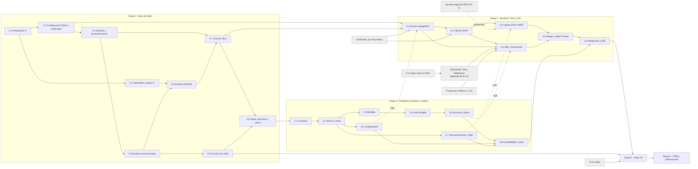

# Ruta de trabajo de DataDian

| Campo | Valor |
|---|---|
| Fecha | 12 de noviembre de 2026 |
| Módulo | 04, **DataDian**. Identificador interno: `documents` |
| Estado | **Vigente.** Orden de etapas fijado por el usuario el 12-nov-2026; reemplaza cualquier otra numeración ([ADR-014](../../decisions/ADR-014-arquitectura-datadian-telco.md), enmienda del 12-nov-2026) |
| Base | [ARQUITECTURA_DB_DATADIAN.md](ARQUITECTURA_DB_DATADIAN.md) (Etapa 2), [ARQUITECTURA_FRONTEND_DATADIAN.md](ARQUITECTURA_FRONTEND_DATADIAN.md) (Etapa 3), [ARQUITECTURA_BACKEND_DATADIAN.md](ARQUITECTURA_BACKEND_DATADIAN.md) (Etapa 4), [ARQUITECTURA_DATADIAN_TELCO.md](ARQUITECTURA_DATADIAN_TELCO.md) (visión general), [ETAPA_5_INTEGRACION_ODOO.md](../../etapas/ETAPA_5_INTEGRACION_ODOO.md) y [ETAPA_6_ESPECIFICACION.md](../../etapas/ETAPA_6_ESPECIFICACION.md) |
| Uso | Mapa único de lo que falta para terminar DataDian: qué se hace, en qué orden, de qué depende y cuándo se da por terminado. El detalle técnico está en cada documento de arquitectura; esta ruta no lo repite |

Sin fechas: el PDF §29.2 prohíbe inventar cronogramas. Cada subetapa termina cuando cumple su criterio de salida, no en una fecha.

---

## 1. Estado actual (12-nov-2026)

| Etapa | Estado |
|---|---|
| 1. Fundaciones | Cerrada el 10-nov-2026 (ADR-013). Sus criterios no verificados están en [`PENDIENTES.md`](../../PENDIENTES.md) §3 |
| **2. Base de datos de DataDian** | **En curso.** **2.1 y 2.2 implementadas y en auditoría**: rol `app_worker`, convención `DD0xx`, calendario de festivos y plazos (migración `0010`, aplicada en local). Siguiente: **2.3**. De la 2.3 a la 2.9, pendientes |
| 3. Frontend de DataDian | Pendiente. Diseño propuesto; espera el cierre de la Etapa 2 |
| 4. Backend: Telco y API | Pendiente. Diseño propuesto |
| 5. Integración con Odoo 19 | Pendiente. Especificación propuesta; disparador por confirmar |
| 6. CRM y notificaciones | Pendiente. Especificación aprobada (E2-1 a E2-13) |

**Verificación de la 2.1 y la 2.2:** pruebas de la API 13 archivos y 94 de 94; `packages/contracts` 17 de 17; `pnpm typecheck` en verde; `drizzle-kit check` sin diferencias. Las desviaciones frente al diseño están en [ARQUITECTURA_DB_DATADIAN.md](ARQUITECTURA_DB_DATADIAN.md) §10.3.

**Pendiente operativo:** antes de aplicar la `0010` en cualquier entorno existente hay que correr `infra/compose/postgres/app-worker.sql` con `APP_WORKER_PASSWORD` ([`PENDIENTES.md`](../../PENDIENTES.md) §7.2).

---

## 2. Orden de etapas

| Etapa | Contenido | Especificación completa | Ficha en `docs/etapas/` |
|---|---|---|---|
| 1 | Fundaciones (cerrada) | [PLAN_IMPLEMENTACION_INICIAL.md](../../PLAN_IMPLEMENTACION_INICIAL.md) | — |
| **2** | **Base de datos de DataDian** (2.1 a 2.9) | [ARQUITECTURA_DB_DATADIAN.md](ARQUITECTURA_DB_DATADIAN.md) | [ETAPA_2_BASE_DE_DATOS.md](../../etapas/ETAPA_2_BASE_DE_DATOS.md) |
| **3** | **Frontend de DataDian** (3.1 a 3.8), contra contratos y mocks | [ARQUITECTURA_FRONTEND_DATADIAN.md](ARQUITECTURA_FRONTEND_DATADIAN.md) | [ETAPA_3_FRONTEND.md](../../etapas/ETAPA_3_FRONTEND.md) |
| **4** | **Backend: Telco y API** (4.1 a 4.6) | [ARQUITECTURA_BACKEND_DATADIAN.md](ARQUITECTURA_BACKEND_DATADIAN.md) | [ETAPA_4_BACKEND.md](../../etapas/ETAPA_4_BACKEND.md) |
| **5** | **Integración con Odoo 19** | [ETAPA_5_INTEGRACION_ODOO.md](../../etapas/ETAPA_5_INTEGRACION_ODOO.md) | La misma |
| 6 | CRM y notificaciones (fuera de DataDian) | [ETAPA_6_ESPECIFICACION.md](../../etapas/ETAPA_6_ESPECIFICACION.md) | La misma |
| 7 | Integration Hub completo y LeadGen | Documento madre §15 | — |
| 8 | Puente Make y módulo de Automatización | Documento madre §15 | — |
| 9 | Analítica, planes, Panel Global y piloto | Documento madre §15 | — |
| 10 | Agentes propios (final) | Documento madre §15 | — |

El plan del blueprint (§7: núcleo criptográfico, SOAP, RPA, base de datos, UBL y frontend) queda repartido así: la base de datos es la Etapa 2, el frontend la 3, y el núcleo criptográfico, el SOAP, el RPA, el UBL y el E2E son las subetapas 4.1 a 4.6.

---

## 3. Subetapas

Cada subetapa termina con `pnpm lint`, `pnpm typecheck` y `pnpm test` en verde, los README de las carpetas tocadas al día y `graphify update .`. La columna "Criterio de salida" resume el de su documento; el texto completo está en la sección citada.

### 3.1 Etapa 2: Base de datos ([ARQUITECTURA_DB_DATADIAN.md](ARQUITECTURA_DB_DATADIAN.md) §10)

| Sub | Nombre | Depende de | Entregables | Criterio de salida | Estado |
|---|---|---|---|---|---|
| 2.1 | Preparación | Etapa 1; migración `0009` | Rol `app_worker` (`init.sql`, `app-worker.sql`, CI, `.env.example`), `workerDatabase()`, convención `DD0xx` en `packages/contracts`, actor `SYSTEM_ACTOR_TELCO` | `app_worker` existe, es `NOBYPASSRLS` y no lee tablas de negocio; la CI levanta los tres roles | **Implementada; en auditoría** |
| 2.2 | Calendario y plazos (`0010`) | 2.1 | `co_holidays`, `co_holiday_years`, `radian_deadline_rules`, `co_easter_sunday`, `co_holidays_compute`, `is_business_day`, `radian_deadline`, semillas 2020 a 2035 | Festivos de 2026 y Pascua 2024 a 2030 correctos; vectores de plazo de las dos reglas; ancla en 2036 → `DD006` | **Implementada; en auditoría** |
| 2.3 | Configuración DIAN y certificados (`0011`) | 2.1 | `dian_settings`, `dian_certificates`, `imap_mailboxes`, disparadores, RLS y privilegios por columna | Aislamiento RLS; `app_user` no lee secretos; activación inválida → `DD010`; NIT único; certificado inmutable y sin borrado | Pendiente (siguiente) |
| 2.4 | Archivos y sincronizaciones (`0012`) | 2.3 | `dian_files`, `dian_sync_runs` | Hash y tamaño válidos; archivo único e inmutable; coherencia de estados de la ejecución | Pendiente |
| 2.5 | Facturas recibidas evolucionadas (`0013`) | 2.4 | Columnas nuevas, inmutabilidad con XML, políticas por comando, `received_document_taxes`, carga de filas existentes, contrato | **Las 21 pruebas de `documents.test.ts` pasan sin cambios**; inmutabilidad con `DD005`; sin `DELETE` | Pendiente |
| 2.6 | Eventos RADIAN (`0014`) | 2.2 y 2.5 | `radian_event_rules`, `radian_events`, `radian_event_attempts`, disparadores, índice único parcial, cálculo del vencimiento | Matriz de secuencia; concurrencia 031/033 (50 repeticiones); transiciones `DD004`; plazo según la regla activa | Pendiente |
| 2.7 | Cola de Telco (`0015`) | 2.4 y 2.6 | `telco_jobs`, `telco_backoff`, disparador de transiciones, `pg_notify`, políticas de `app_worker` | 8 conexiones, 1 000 trabajos, cada uno reclamado una vez; recuperación de arrendamientos; espera exponencial | Pendiente |
| 2.8 | Vínculo con Odoo y privilegios de Telco (`0016`) | 2.5 | `odoo_document_links`, copia de `odoo_*`, privilegios de `app_worker` sobre `audit_logs`, `organizations` y `odoo_connections` | Vínculos copiados = filas con `odoo_move_id`; sin duplicados; auditoría solo por inserción | Pendiente |
| 2.9 | Vistas, permisos y cierre (`0017`) | 2.3 a 2.8 | Vistas `security_invoker`, permisos `documents:events` y `documents:sync`, enumerados en `packages/contracts`, README | Vistas aisladas; `drizzle-kit check` sin diferencias; **reversos de `0010` a `0017` aplicados y reaplicados en una base desechable de la CI** | Pendiente |

**Criterio de salida de la Etapa 2:** las migraciones `0010` a `0017` aplicadas en la CI, con las pruebas de RLS, de restricciones, de cola concurrente y de plazos en verde.

### 3.2 Etapa 3: Frontend ([ARQUITECTURA_FRONTEND_DATADIAN.md](ARQUITECTURA_FRONTEND_DATADIAN.md) §11)

| Sub | Nombre | Depende de | Entregables | Criterio de salida | Estado |
|---|---|---|---|---|---|
| 3.1 | Contratos y máquina de estados | Etapa 2 cerrada (enumerados alineados con los `CHECK`) | Esquemas zod, catálogo E1 a E32, `deriveRadianActions`, OpenAPI de DataDian, permisos y submódulo `sync` | Matriz de al menos 200 combinaciones; enumerados = `CHECK`; OpenAPI 3.1 válido con 32 rutas; ningún secreto en las respuestas | Pendiente |
| 3.2 | Mocks y arnés de pruebas | 3.1 | MSW, motor de escenarios, fixtures, Playwright, variantes de botón `info` y `accent` | Toda respuesta del mock pasa su esquema; `msw` fuera de `dist/`; contraste AA | Pendiente |
| 3.3 | Bandeja de recepción | 3.2 | `inbox/`: grilla, filtros en la URL, búsqueda NIT/CUFE, orden por vencimiento | Filtros en la consulta; 1 000 facturas sin bloqueo; RBAC | Pendiente |
| 3.4 | Vista dividida: visor y línea de tiempo | 3.3 | `invoice/`: visor (representación, XML, PDF), línea de tiempo, traza 02/04 | Enlace directo; XML idéntico (SHA-256); sin HTML del proveedor; foco correcto | Pendiente |
| 3.5 | Acciones RADIAN, modal de reclamo y plazo | 3.4 | Botones por `deriveRadianActions`, modal del 031, `Idempotency-Key`, semáforo y sondeo | E2E `happy-path`, `claim`, `dian-rejection`, `deadline` y `tacit-acceptance` contra los mocks | Pendiente |
| 3.6 | Configuración por organización | 3.2 | `settings/`: datos DIAN, certificado, software y PIN, ambiente, buzones IMAP; Odoo conservado | E2E `certificate` y `production-switch`; PIN y contraseña fuera de la caché | Pendiente |
| 3.7 | Sincronizaciones, cola, Zona 4 y cliente SSE | 3.2 | `sync/`, cola de muertos, conector `radian` en la Zona 4, `useDatadianStream` detrás de bandera | E2E `sync`; Zona 4 en `warning` con un trabajo muerto | Pendiente |
| 3.8 | Accesibilidad, rendimiento y cierre | 3.3 a 3.7 | E2E `rbac` y `a11y`, Lighthouse, textos, README | axe sin violaciones graves; Lighthouse de accesibilidad ≥ 95; LCP < 2,5 s | Pendiente |

**Criterio de salida de la Etapa 3:** todas las pantallas funcionan contra los mocks, los contratos están publicados en `packages/contracts` (zod y OpenAPI) y las pruebas unitarias, de componentes y E2E pasan en la CI sin violaciones graves de accesibilidad.

### 3.3 Etapa 4: Backend, Telco y API ([ARQUITECTURA_BACKEND_DATADIAN.md](ARQUITECTURA_BACKEND_DATADIAN.md) §13)

| Sub | Nombre | Depende de | Entregables | Criterio de salida | Estado |
|---|---|---|---|---|---|
| 4.1 | Núcleo criptográfico | Etapa 2 (2.3 y 2.7); Etapa 3 (3.6) para su E2E | Esqueleto de `apps/telco`, `JobRunner`, `CertificateVault`, chequeo de reloj, `XadesEpesSigner`, `CudeFormula` sin fórmula verificada; API E12, E13 y E15 a E19 | Matriz de certificados de prueba; nada en disco; firma verificada con xadesjs y `xmlsec1`; canario de secretos; E2E `certificate` contra la API | Pendiente |
| 4.2 | Cliente SOAP | 4.1 | `SoapWsSecurityClient`, `GetXmlByDocumentKey`, `GetStatusEvent`, `SendEventUpdateStatus`, `dian-fake-soap` | `SignedInfo` byte a byte; variantes alteradas rechazadas; **en habilitación** las dos consultas responden 200 | Pendiente |
| 4.3 | Ingesta: RPA, IMAP y `GetXmlByDocumentKey` | 4.2; Etapa 3 (3.7) | `RpaMtlsWorker`, `dian-fake-portal`, `ImapIngestor`, `xml_fetch` y `xml_ingest`; API E1, E3 a E5, E20 a E27 | Portal falso con `.pfx` en memoria; sin duplicados; comprobación humana → `dead`; E2E `sync` contra la API | Pendiente |
| 4.4 | UBL y transmisión de eventos | 4.1 y 4.2; Etapa 3 (3.5) | `buildApplicationResponse`, XSD oficial, CUDE del anexo, ZIP determinista, `radian_event_send`; API E7 a E10 | Cuatro eventos validan contra el XSD; reintento con bytes idénticos; E2E `happy-path`, `claim` y `dian-rejection`; 030 registrado en habilitación (**D-14**) | Pendiente |
| 4.5 | Reglas, plazos y State Tracker | 4.3 y 4.4 | `StateTracker`, `radian_status_query`, `CoCalendar` con vectores compartidos; API E2, E11, E14, E28 a E31 | Mismos vectores en TypeScript y en `app.radian_deadline`; respuesta perdida resuelta sin duplicar; E2E `deadline` y `tacit-acceptance` | Pendiente |
| 4.6 | Integración con el frontend y E2E | 4.1 a 4.5; Etapa 3 cerrada | SSE (E32), prueba de contrato, web contra la API real, simulación de tráfico, tableros y alertas, manual de operación | Todos los E2E de la Etapa 3 **sin cambios** contra la pila completa; simulación de la §11 aprobada; lista de habilitación §9.3 completa salvo exenciones escritas | Pendiente |

**Criterio de salida de la Etapa 4:** los E2E de la Etapa 3 pasan sin cambios contra la API real y Telco con la DIAN simulada; la simulación de tráfico cumple sus criterios; la lista de chequeo de habilitación está completa, salvo los puntos que el usuario exima por escrito por D-14 o por la revisión legal del portal.

### 3.4 Etapas 5 y 6

| Etapa | Depende de | Entregables | Criterio de salida | Estado |
|---|---|---|---|---|
| 5. Integración con Odoo 19 ([ficha](../../etapas/ETAPA_5_INTEGRACION_ODOO.md)) | Etapa 4 (033 aceptado por la DIAN, cola de Telco); 2.8 (`odoo_document_links`); D-16; disparador confirmado | Trabajo «crear borrador en Odoo», datos del XML, adjuntos, idempotencia por CUFE, corrección de los tres riesgos del código conservado | Una factura con el 033 aceptado queda como borrador de factura de proveedor en Odoo 19, con el XML adjunto, sin duplicados y con los riesgos corregidos | Pendiente |
| 6. CRM y notificaciones ([especificación](../../etapas/ETAPA_6_ESPECIFICACION.md)) | Etapa 5 cerrada; D-10, D-11 | CRM completo con adjuntos y notificaciones internas | Flujo lead → oportunidad → actividad funcionando | Pendiente |

---

## 4. Diagrama de dependencias

Las flechas van de lo que se necesita a lo que lo necesita. Los bloqueos externos (§5) van en gris.

---

## 5. Bloqueos externos

Ninguno bloquea la Etapa 2 ni la Etapa 3: las dos se construyen sin la DIAN. Todos afectan a la Etapa 4 o a la producción.

| Bloqueo | Quién lo resuelve | Qué bloquea | Mientras tanto |
|---|---|---|---|
| **Certificado `.pfx` de pruebas de Telcobras** y su contraseña | Usuario | Cierre de la 4.1 con un certificado real; pruebas en habilitación de la 4.2, la 4.3 y la 4.4 (lista §9.3 del backend) | Certificados generados con una CA de pruebas en la CI; los falsos `dian-fake-soap` y `dian-fake-portal` |
| **SoftwareID, PIN y habilitación** del software ante la DIAN | Usuario, según D-14 | Envío real de eventos en habilitación (4.4, lista §9.3 punto 3) y paso a producción; el PIN puede entrar en el CUDE (PV-2) | La 4.4 cierra con los falsos y el punto queda pendiente con aviso al usuario |
| **D-14: figura ante la DIAN** (proveedor tecnológico, mandato 043, habilitación propia o solo descarga) | Arquitecto con contabilidad y legal | Quién firma, el `SignerRole` y `DianExtensions` (PV-11), el registro del software y el envío de eventos | Consultar y descargar documentos solo necesita el certificado |
| **Revisión legal del acceso automatizado al portal (PV-7)** | Legal | Uso del RPA (4.3) en producción. No se resuelven captchas con terceros ni se evade una comprobación humana | Bandera que bloquea el RPA en producción; ingesta por IMAP y carga manual del XML |
| **Verificación de los puntos 1 a 20 contra fuentes primarias** (anexo T5.1 de la Resolución 000227 de 2025, WSDL, política de firma v2, Resolución 085 de 2022, `Instructivo-RADIAN.pdf`) | Arquitecto | Cada punto bloquea la subetapa de la tabla siguiente. Lista completa en [`PENDIENTES.md`](../../PENDIENTES.md) §7.1 | El diseño los deja en parámetros, catálogos o columnas nulables |
| D-16: versión, edición y RADIAN nativo de Odoo | Arquitecto | Etapa 5 | — |
| D-13: proveedor y región del servidor | Gerencia y arquitecto | Paso a producción de DataDian | — |

**Puntos por verificar que bloquean una subetapa** (numeración de [ARQUITECTURA_BACKEND_DATADIAN.md](ARQUITECTURA_BACKEND_DATADIAN.md) §14):

| Subetapa | Puntos |
|---|---|
| 4.1 | 9 (URI de firma), 10 (hora legal), 16 (canonicalización y `SigPolicyHash`), 17 (NIT en el certificado), 20 (NTP y tolerancia) |
| 4.2 | 1 (operación de envío), 15 (`Timestamp` y `PrefixList`), 18 (formato de las respuestas) |
| 4.3 en producción | 7 (acceso automatizado al portal) |
| 4.4 | 1, 2 (fórmula del CUDE), 3 (código del evento), 11 (`SignerRole`), 12 (persona del 030 y el 032), 13 (`cbc:ID` y nomenclatura), 14 (`SoftwareSecurityCode`), 19 (conceptos del reclamo) |
| 4.5 | 4 (plazo), con el valor por defecto aceptado mientras tanto |
| Todas | 6 (normativa vigente) |

---

## 6. Decisiones aceptadas

El usuario aceptó el 12-nov-2026 las decisiones 1 a 9 de la §12 de [ARQUITECTURA_DB_DATADIAN.md](ARQUITECTURA_DB_DATADIAN.md):

1. **Rol `app_worker`** para Telco, `NOBYPASSRLS`, con una sola excepción entre organizaciones: `telco_jobs`, sin datos de negocio (§9.1).
2. **Cola de Telco en PostgreSQL** (`telco_jobs` con `FOR UPDATE SKIP LOCKED`), sin BullMQ ni Valkey para Telco (§7.6).
3. **NIT único entre organizaciones** en `dian_settings` (§5.1).
4. **Certificados en tabla propia con historial** (`dian_certificates`) (§5.2).
5. **Regla de plazo por defecto mientras se verifica el punto 4:** 3 días hábiles desde el registro del 032 en la DIAN, desde el día hábil siguiente, con corte al final del día y sábado no hábil (§7.4).
6. **La base no bloquea un 031 fuera de plazo** (`enforce_claim_deadline = false`): la DIAN decide.
7. **El 031 exige el 032**, como el blueprint, hasta verificar el punto 5.
8. **Expandir ahora y contraer en la Etapa 4:** `received_document_imports`, `import_id`, las columnas del Excel y `odoo_*` conviven hasta que el código nuevo las reemplace (§4.2).
9. **Festivos sembrados de 2020 a 2035** (§7.5).

La décima (alinear la numeración) quedó resuelta con esta ruta y la enmienda de ADR-014.

---

## 7. Decisiones abiertas

### 7.1 Frontend ([ARQUITECTURA_FRONTEND_DATADIAN.md](ARQUITECTURA_FRONTEND_DATADIAN.md) §13)

1. Contrato primero con catálogo zod y OpenAPI de DataDian generado desde el catálogo.
2. MSW como herramienta de mocks (dependencia de desarrollo nueva).
3. Vista dividida sobre las zonas del shell: visor en la Zona 2 y línea de tiempo en la Zona 3.
4. Colores de los botones: **la paleta no tiene naranja**; el 032 pasa al amarillo y se agregan las variantes `info` y `accent`.
5. Plazo vencido: bloquear los botones o permitir el 031 con advertencia (`expiryIsTerminal`).
6. Facturas de contado: permitir, advertir o bloquear (se propone advertir).
7. Confirmación previa para los cuatro eventos.
8. Decisión interna heredada (aprobar, borrador, rechazar y Odoo) en una tarjeta secundaria hasta la Etapa 5.
9. Visor con contenido normalizado y XML original; sin XSLT en esta etapa.
10. Submódulos `invoices`, `sync` y `settings`.
11. SSE propio de DataDian en la 4.6 o esperar el SSE general (E2-4) de la Etapa 6.
12. Persona del 030 y el 032 si se confirma el punto 12.
13. Paso a producción solo con la lista de habilitación completa.
14. ~~Alinear la numeración~~: resuelta el 12-nov-2026.
15. Mover los textos de DataDian a `i18n/es-CO/datadian.ts`.

### 7.2 Backend ([ARQUITECTURA_BACKEND_DATADIAN.md](ARQUITECTURA_BACKEND_DATADIAN.md) §15)

1. `apps/telco` como aplicación TypeScript aparte del monolito.
2. Vault como proceso aislado (proceso hijo en la 4.1, contenedor aparte en producción).
3. Paquetes compartidos nuevos: `dian-ubl`, `database` y `envelope-crypto`.
4. Librería PKCS#12: pkijs o node-forge.
5. xadesjs para XAdES-EPES y xml-crypto para WS-Security.
6. Sobre sellado asimétrico para que **la API no pueda descifrar el `.pfx` aunque tenga la KEK** (cambia `pfx_data_key` de la Etapa 2).
7. IMAP solo descubre CUFE; el XML siempre viene de `GetXmlByDocumentKey`.
8. Ante una comprobación humana del portal, el trabajo muere sin reintentos; RPA bloqueado en producción hasta la revisión legal.
9. Umbral de desfase de reloj: 2 s por defecto.
10. Límites de concurrencia y de tasa hacia la DIAN (5 por segundo e instancia).
11. SSE con `LISTEN/NOTIFY` en la 4.6 o esperar E2-4 en la Etapa 6.
12. Visor por la API en lugar de URL prefirmadas de S3.
13. Capturas y trazas de Playwright solo en habilitación.
14. Pruebas nocturnas contra habilitación: quién provee y custodia el certificado y el software de pruebas.
15. ~~Alinear la numeración~~: resuelta el 12-nov-2026.
16. Cambios a la Etapa 2 si se confirman los puntos 12 y 13 (columna de la persona del evento y secuencia del `cbc:ID`).
17. Cifras de la simulación de tráfico como criterio de la 4.6.

### 7.3 Otras

- **Disparador del borrador en Odoo** (Etapa 5): propuesto el 033 registrado por la DIAN.
- **Adaptaciones al stack de ADR-014, punto 5**, que no cubren las decisiones aceptadas de la §6: `apps/telco` (backend 1) y la custodia del `.pfx` en S3 privado.

---

## 8. Pendientes y riesgos

Todos están en [`PENDIENTES.md`](../../PENDIENTES.md), por etapa: §7.1 (puntos por verificar 1 a 20), §7.2 (pendientes por etapa, incluidos los riesgos del código conservado para la Etapa 5) y §7.3 (calidad del repositorio que DataDian no causó).
